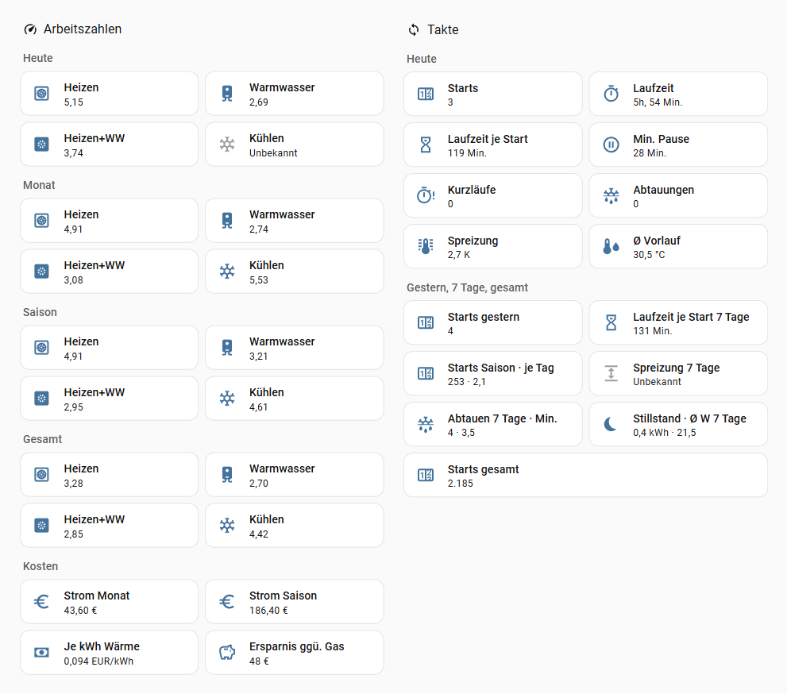
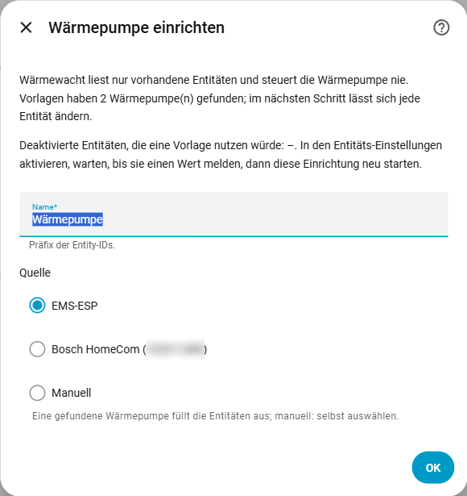
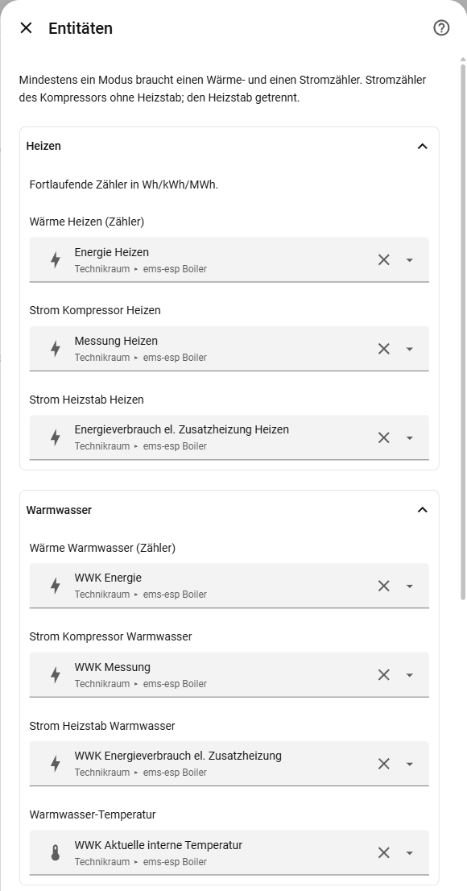
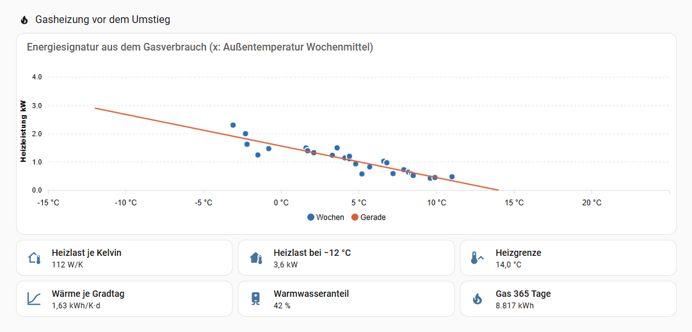
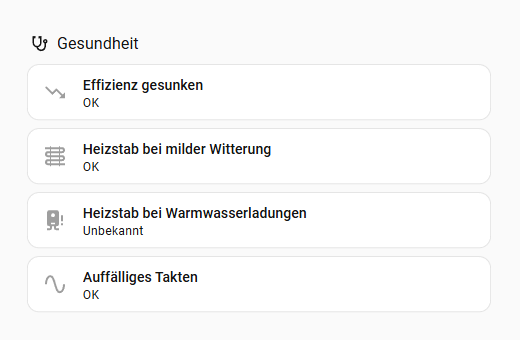
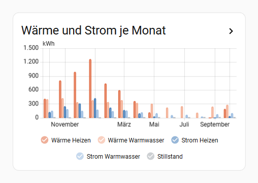
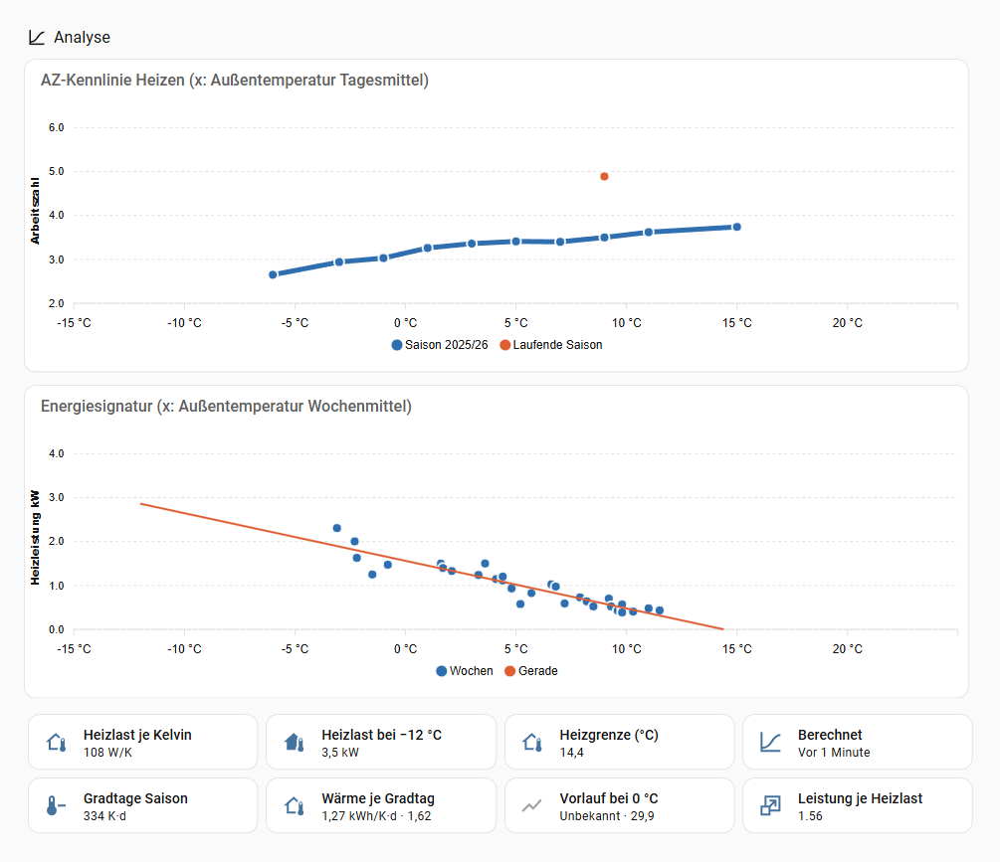

<picture>
  <source media="(prefers-color-scheme: dark)" srcset="https://raw.githubusercontent.com/waermewacht/integration/main/assets/github/readme-header-dark@2x.png">
  
</picture>

[](https://github.com/waermewacht/integration/releases)
[](https://github.com/waermewacht/integration/actions/workflows/ci.yml)
[](LICENSE)
[](https://waermewacht.github.io/integration/?lang=en)

[Deutsch](https://github.com/waermewacht/integration/blob/main/README.md) · **English**

> **Templates:** The templates for EMS-ESP, Bosch HomeCom and Daikin Altherma (P1P2MQTT) run on real installations; all others are beta (see [Requirements](#requirements)).

**How efficient is your heat pump really?** Wärmewacht ("heat watch") calculates performance factors per operating mode and period in Home Assistant, counts starts, short runs and defrosts and shows a few diagnostic values. It works from the entities your heat pump already provides. Wärmewacht only reads and never controls anything. No cloud, no network requests.

**Try it without installing:** the [demo](https://waermewacht.github.io/integration/?lang=en) shows performance factors, cycling, health check, hot water, the COP curve and the energy signature for a cold January week, a mild autumn with a cycling unit, a hybrid system with a gas boiler and a gas boiler before switching – with the real [cards](#cards), made-up values, but computed by the integration's own code.

**Still on gas or oil?** Wärmewacht also computes your house's heat load from the gas or oil consumption, as a basis for sizing a heat pump: [Gas boiler before switching](#gas-boiler-before-switching).

> **A guide, not an expert diagnosis.** The figures depend on what your heat pump's meters measure. See [System boundary and limits](#system-boundary-and-limits).

The user interface is available in German and English and follows the language of your Home Assistant.



<sub>Real figures of a Bosch Compress 5800i AW (EMS-ESP) in October, German UI. "Heizen+WW" (heating + hot water) is the factor including standby electricity and is therefore below both single values.</sub>

## Contents

- [Features](#features) · [What Wärmewacht does differently](#what-wärmewacht-does-differently-from-template-sensors)
- **Getting started:** [Requirements](#requirements) · [Installation](#installation) · [Setup](#setup) · [Settings](#settings) · [Gas boiler before switching](#gas-boiler-before-switching)
- **[Entities](#entities):** [Performance factors](#performance-factors) · [Energy](#energy) · [Cycling](#cycling) · [Hot water charges](#hot-water-charges) · [Health check](#health-check) · [Hybrid system](#hybrid-system) · [Costs and gas comparison](#costs-and-gas-comparison) · [Performance curve and heat load](#performance-curve-and-heat-load)
- **[Actions](#actions):** [Report](#report) · [Performance curve](#performance-curve) · [Heat load](#heat-load)
- **More:** [Notifications](#notifications) · [Cards](#cards) · [Dashboard examples](#dashboard-examples) · [System boundary](#system-boundary-and-limits) · [Troubleshooting](#troubleshooting) · [Privacy](#privacy) · [Removal](#removal) · [Reporting issues](#reporting-issues) · [Related projects](#related-projects)

## Features

- **Performance factors** for heating, hot water and heating + hot water, plus the **energy efficiency ratio for cooling (EER)**, each for today, yesterday, month, season and total.
- **Heat and electricity sensors per mode** and a sensor for **standby**, with long-term statistics for statistics cards.
- **Cycling:** starts, run time, run time per start, short runs, shortest pause, defrosts and a binary sensor **Conspicuous cycling**.
- **Diagnostics:** backup heater share, flow-return spread and mean flow temperature while heating (with an activity).
- **Hot water per charge:** performance factor of the last charge and of the charges of the last 30 days, last thermal disinfection.
- **Health check:** reports a dropped efficiency at the same weather, a dropped hot water efficiency against last year and the backup heater on mild days or in hot water charges, plus protection and fault messages of the heat pump that keep coming back. Repair issues when a meter stands still, a source fails, the outdoor temperature is stuck or flow rate, flow and return do not add up.
- **Costs and gas comparison** (optional, with a fixed price or a price sensor for dynamic tariffs): electricity cost, heat cost per kWh and the savings against a gas boiler; with a grid import meter, electricity from own PV or battery counts at the feed-in tariff, with its share per mode.
- **Performance curve and heat load:** heating performance factor over the outdoor temperature and heat load from the energy signature. As sensors and via actions for any period. Plus figures such as degree days, flow temperature at 0 °C (the heating curve), spread on cold days and power per heat load.
- **Gas or oil boiler before switching:** heat load, heating limit and hot water share from the gas or oil consumption of the last 365 days, as an entry of its own ([more](#gas-boiler-before-switching)).
- **Report for any period** via an action, broken down by month. Also **before the setup**, as far back as the long-term statistics of your meters go.
- **Templates for EMS-ESP and Bosch HomeCom:** find Bosch/Buderus heat pumps on their own and fill in the entities. As beta also Luxtronik (alpha innotec, Novelan), Stiebel Eltron/Tecalor (ISG), iDM, Mitsubishi Ecodan (MELCloud, F1p bridge or ESPHome), Vaillant (myVAILLANT), Waterkotte, Buderus via the MX300/MX400 gateway (integration `buderus`), Bosch/Buderus Home Comfort (`bosch_buderus_heating`) and EMS-ESP hybrid systems (HM200); tested as well: Daikin Altherma (P1P2MQTT), Lambda, Panasonic Aquarea (HeishaMon) and Viessmann (ViCare, E3 controllers). Other heat pumps are mapped by hand.
- **Easy on SD cards:** writes only when something changed, and then at most every 10 minutes. In addition at the end of a run, at midnight and on shutdown. Sensors update once a minute and on events.

## What Wärmewacht does differently from template sensors

- **Performance factor of a period = Σ heat / Σ electricity**, never the mean of daily values.
- **Unknown instead of 0:** Without heat or below the minimum electricity (default 0.5 kWh) a performance factor is unknown. Zeros would drag means and statistics down.
- **Standby kept separate:** Electricity while the compressor stands still does not count in the factor per mode, but it does in heating + hot water. Fraunhofer ISE calculates the same way in its field tests.
- **Cooling never enters the seasonal factor.** It has its own EER.
- **Cycling from real compressor runs:** A Home Assistant restart in the middle of a run is not a new start. If the heat pump switches from heating to hot water without stopping, it stays one run. A run that was already going when first seen does not count as a start.
- **Meter resets and steps back:** Steps back keep the highest reading; only heat above it is booked (net). This covers noise and defrosts, during which the heat pump subtracts the heat it took. Only a drop of more than 10 % and more than 1 kWh counts as a reset with a new baseline, implausible jumps are not booked. `unknown` and `unavailable` never count as 0.
- **Look back from the long-term statistics:** Today, yesterday, month, season and total already include the time before the setup.

## Requirements

A gas boiler before switching needs only a gas counter and the outdoor temperature, see [Gas boiler before switching](#gas-boiler-before-switching). For a heat pump:

- Home Assistant 2026.4 or newer.
- The recorder (on by default in Home Assistant) for the look back, the report, the performance curve and the heat load. Which entities it must record: [Keeping the recorder lean](#keeping-the-recorder-lean).
- At least one mode with a **heat meter** and a **compressor electricity meter**: cumulative energy sensors in Wh, kWh or MWh. Without heat meters the compressor state is enough; then there is cycling and electricity, but no performance factors.

| Source | Status |
| --- | --- |
| [EMS-ESP](https://github.com/emsesp/EMS-ESP32) (MQTT) with Bosch/Buderus heat pumps, e.g. CS5800i/CS6800i, WLW176i/WLW186i | template, tested on a CS5800i/CS6800i |
| EMS-ESP with the device `heatpump`: Hybrid Manager HM200 (hybrid system with an oil or gas boiler), HP Module | beta, from the MQTT data of a hybrid system; heat pump and boiler apart, [hybrid system](#hybrid-system) |
| [Bosch HomeCom](https://github.com/serbanb11/bosch-homecom-hass) (`bosch_homecom`, local and cloud) | template, new, compared with EMS-ESP on the same CS5800i/CS6800i |
| [Luxtronik](https://github.com/BenPru/luxtronik) (`luxtronik2`; alpha innotec, Novelan) | beta, from the source code; electricity per mode only with newer firmware |
| [Stiebel Eltron / Tecalor ISG](https://github.com/pail23/stiebel_eltron_isg_component) (`stiebel_eltron_isg`) | beta, from the source code; meters in whole kWh; no cooling electricity, so no EER |
| [Panasonic Aquarea via HeishaMon](https://github.com/kamaradclimber/heishamon-homeassistant) (`aquarea`) | template, tested on a real installation; energy summed up from the power values, no backup heater |
| [Lambda](https://github.com/GuidoJeuken-6512/lambda_heat_pumps) (`lambda_heat_pumps`) | template, tested on an EU13L; own meters for defrost and standby |
| [iDM Navigator 2.0](https://github.com/Xerolux/idm-heatpump-hass) (`idm_heatpump`, with web interface) | beta, from the source code |
| [Viessmann ViCare](https://www.home-assistant.io/integrations/vicare/) (core `vicare`) | template, tested on a Vitocal 151-A (E3 controller; older Vitotronic controllers from the source code); cycling and electricity, **heat and performance factor experimental** once Home Assistant provides the heat |
| [Mitsubishi Ecodan via MELCloud](https://www.home-assistant.io/integrations/melcloud/) (core `melcloud`, HA 2026.5+) | beta, from the source code; performance factors without cycling |
| [Vaillant myVAILLANT](https://github.com/signalkraft/mypyllant-component) (`mypyllant`) | beta, from the source code; performance factors without cycling |
| [Mitsubishi Ecodan via F1p bridge](https://github.com/F1p/Home-Assistant-Mitsubishi-CN105-to-MQTT) (MQTT, CN105) | beta, from the source code; performance factors, cycling and defrosts |
| [Mitsubishi Ecodan with ESPHome](https://github.com/gekkekoe/esphome-ecodan-hp) (`esphome`, esphome-ecodan-hp) | beta, from the source code; performance factors, cycling and defrosts |
| [Waterkotte EcoTouch](https://github.com/marq24/ha-waterkotte) (`waterkotte_heatpump`) | beta, from the source code; compressor electricity as a total only |
| [Buderus/Bosch via MX300, MX400, K30](https://github.com/BassXT/buderus) (`buderus_ha`) | beta, from the source code; performance factors, cycling and defrosts |
| [Bosch/Buderus Home Comfort](https://github.com/SoftwareSchmied/ha-bosch-buderus-heating) (`bosch_buderus_heating`), cloud and local via K40/K40RF | beta, proposed by the integration's author and checked against the source code; performance factors, cycling, defrosts, system pressure |
| [Daikin Altherma via P1P2MQTT](https://github.com/Arnold-n/P1P2Serial) (MQTT) | template, tested on two Altherma 3; performance factors, cycling and defrosts, meters in whole kWh |
| any heat and electricity meters | manual mapping |

The EMS-ESP template recognizes the heat pump by the `boiler` device. It needs the compressor state (`hpcompon`) and the heating meters. It finds the entities through the entity registry, not by entity ID, so renaming and all of EMS-ESP's naming formats are fine. It understands the activity (`hpactivity`) in all EMS-ESP languages and in the index format.

In hybrid systems (oil or gas boiler plus Hybrid Manager HM200) the device `boiler` is the boiler; the heat pump sits under the device `heatpump`. The template "EMS-ESP Heatpump" (beta) covers it: the heat pump from `heatpump_…` (compressor from the speed `hpcompspd`), boiler, outdoor and storage temperature from `boiler_…`. How Wärmewacht treats the boiler: see [Hybrid system](#hybrid-system).

The HomeCom template needs the energy per mode ("Wärme erzeugt Heizung", "Strom Kompressor Heizung" etc.; English: heat produced and compressor energy per heating, hot water and cooling). `bosch_homecom` creates these entities disabled: enable them first. The setup shows which ones are still disabled. "Compressor running" is the compressor speed above 0. Compared with EMS-ESP, HomeCom has limits:

- **Day values from the cloud:** the energy arrives as the day's sum, up to two hours late. Wärmewacht books it when it arrives, so "today" lags behind. The cloud never delivers the last one or two hours of a day (observed up to 0.5 kWh per day).
- **Standby:** electricity of a fetch that brought no heat of the same mode.
- **Activity only from `bosch_homecom` 1.6.1 on:** Only from this version on is there the sensor "Compressor status", and with it defrosts, the flow-return spread and the mean flow temperature. It comes from the cloud, about a minute later than at the heat pump, and is missing while the cloud cannot be reached. Wärmewacht adds it to an existing entry at the next start by itself.
- **No flow rate:** `bosch_homecom` reports "L/min" but delivers l/h.

If you run EMS-ESP, use EMS-ESP: meters in 0.01 kWh every minute, and the activity.

**Beta templates** are derived from the source code of each integration, not confirmed on a real installation. The setup shows them with "(beta)". If you have such a heat pump, feedback with the [diagnostics file](#reporting-issues) helps a lot. The main limits:

- **Viessmann ViCare:** The heat per mode (sensors "Heating heat production today" and "DHW heat production today") only comes with a newer version of Home Assistant ([home-assistant/core#192458](https://github.com/home-assistant/core/pull/192458), not released yet). Wärmewacht then picks it up by itself and calculates the performance factor; this is derived from the source code and not yet confirmed on a real installation (experimental), and not every device reports the heat. Until then Wärmewacht shows cycling, run times, electricity per mode and costs, but no performance factor. E3 controllers (Vitocal 150-A to 252-A) report no activity; older Vitotronic controllers report defrosts but no energy. Wärmewacht counts the cloud's day values in UTC days. If the cloud starts at local midnight (confirmed for a Vitocal 151-A), the electricity of the day's first hour (two in summer) arrives a little later, but complete.
- **Mitsubishi Ecodan (MELCloud):** `melcloud` creates the heat per mode disabled: enable it first. Without a usable compressor signal (only every 30 minutes) there is no cycling and no defrost count. MELCloud reports the totals of the **previous day**: they jump once just after midnight and then stay the same all day. Wärmewacht therefore books them into the previous day, so month and season are right at month boundaries too. "Today" stays empty for this source, "yesterday" is the earliest figure. If the cloud misses an update, that day is missing.
- **Mitsubishi Ecodan (F1p bridge):** Local via the CN105 port, with compressor and activity, so with cycling and defrosts. The energy comes as the previous day's total, as with MELCloud. The bridge sometimes sends its own estimate before the real value; if it is higher, Wärmewacht counts a little too much. As the bridge sets no `state_class`, there is no look back before the setup.
- **Mitsubishi Ecodan (ESPHome):** Like the F1p bridge, the esphome-ecodan-hp firmware provides compressor, activity, defrost and the energy as the previous day's total. The template recognises the entities by the firmware's names; if you renamed them in the YAML, map them by hand. The FTC clock must be right, also after a DST change. Defrost includes standby and restart and therefore tends to be too long.
- **Buderus/Bosch via MX300/MX400 (`buderus`):** Reads the Bosch cloud like Bosch HomeCom, but with lifetime meters per mode (0.01 kWh, fetched every 10 minutes) and with the activity including defrost. "Compressor running" is the modulation above 0. No flow rate.
- **Bosch/Buderus Home Comfort (`bosch_buderus_heating`):** Also lifetime meters per mode from the Bosch cloud (about every 5 minutes), with the activity including defrost, start counter, heating run time and system pressure. With the local access via a K40/K40RF, the template takes the compressor signal and the flow temperature right at the heat pump (TC1), otherwise the modulation and the system supply. The heat meter dips briefly during a defrost; Wärmewacht only books heat above the highest value so far, i.e. net. No flow rate.
- **Daikin Altherma (P1P2MQTT):** The heat pump's own meters (heat and electricity per mode, backup heater) in whole kWh. They only arrive with the counter request of the bridge switched on ("Counter_Request_Function"). Activity from the flags defrost, hot water, cooling and heating. The hot water entities exist only with the matching field settings of the controller.
- **Waterkotte:** The meters are yearly sums, heat per mode, but compressor electricity as a total only. Wärmewacht assigns the electricity to the running mode, in the look back by the share of heat. A run without a hot water or cooling flag counts as heating (the heating release `status_heating` is no heating state). Enable "Cooling" (`state_cooling`), otherwise cooling counts as heating. There is no starts counter (Wärmewacht counts itself) and no defrost signal.
- **Vaillant (myVAILLANT):** Wärmewacht books hour by hour from the statistics mypyllant writes itself. Set mypyllant's option "Seconds between energy data updates" to 3600 to 7200 seconds, otherwise it fetches the energy only at start. The figures therefore lag one to three hours behind. There is no compressor signal and no defrost, so no cycling. Standby is an hour without environmental yield.

### Keeping the recorder lean

If you exclude entities in the `recorder` configuration (`exclude`) or record only selected ones (`include`): an entity that is not recorded gets **no long-term statistics** either. Wärmewacht reads almost nothing but these statistics, one row per hour.

- **Must be recorded:**
  - Wärmewacht's energy sensors (heat and electricity per mode, standby electricity) for the report, performance curve, heat load, degree days and health check;
  - the outdoor temperature for the same analyses and the sensor check;
  - the flow temperature for "Flow temperature at 0 °C".
- **Should be recorded:**
  - the heat pump's energy meters. Wärmewacht needs them for the time before the setup: look back, "Recalculate look-back" and report. Without them a newly created entry has no look back;
  - the starts counter. Without statistics, "Starts season" counts only from the first value Wärmewacht sees.
- **May be left out:**
  - all other Wärmewacht sensors (performance factors, cycling, costs, health, diagnostics) and the binary sensors. Wärmewacht stores its state itself. Their history in your own charts is missing then, though;
  - compressor state and activity. Wärmewacht reads their history only once at the setup, to add the cycles of the last 10 days.

Example for `include` (check the entity IDs on the device page; the trailing `*` also covers suffixes like `_2`):

```yaml
recorder:
  include:
    entity_globs:
      - sensor.*_heat_heating*
      - sensor.*_heat_hot_water*
      - sensor.*_electricity_heating*
      - sensor.*_electricity_hot_water*
      - sensor.*_standby_electricity*
    entities:
      - sensor.outdoor_temperature   # your outdoor temperature
      - sensor.flow_temperature      # your flow temperature
      - sensor.heat_meter_heating    # your meters, per mode
```

If it is only about the size of the database, a short retention is often enough (`purge_keep_days`, default 10 days). The long-term statistics are not affected by it.

## Installation

**One click:** [](https://my.home-assistant.io/redirect/hacs_repository/?owner=waermewacht&repository=integration&category=integration) → install, restart Home Assistant → [](https://my.home-assistant.io/redirect/config_flow_start/?domain=waermewacht)

Or by hand:

1. *Settings → Marketplace → Browse*, search for Wärmewacht and install it (before Home Assistant 2026.11: search for it in HACS and download it). Restart Home Assistant.
2. *Settings → Devices & services → Add integration → Wärmewacht*.

## Setup

1. **Name and source:** The name (default "Wärmepumpe") becomes the device name and the prefix of the entity IDs. As source you choose one of the heat pumps found (EMS-ESP, with the MQTT prefix if there are several; Bosch HomeCom with the gateway number) or *Manual*.
2. **Entities:** With a template the form is filled in; every field can be changed. The sections then show only what the template found. All other fields are collapsed under **More fields**: the source has nothing that fits, and an entity that only sounds alike (say frost protection instead of defrost) gives wrong figures. With *Manual* you pick them yourself, all sections as in the table below.

<table>
  <tr>
    <td valign="top"></td>
    <td valign="top"></td>
  </tr>
</table>

| Section | Field | EMS-ESP (standard format) |
| --- | --- | --- |
| Heating | Heat produced heating (meter) | `sensor.boiler_nrgheat` |
| | Compressor electricity heating | `sensor.boiler_meterheat` |
| | Backup heater heating | `sensor.boiler_auxelecheatnrgconsheating` |
| Hot water | Heat produced hot water (meter) | `sensor.boiler_dhw_nrg` |
| | Compressor electricity hot water | `sensor.boiler_dhw_meter` |
| | Backup heater hot water | `sensor.boiler_dhw_auxelecheatnrgcons` |
| | Hot water temperature (actual, tank) | `sensor.boiler_dhw_curtemp` |
| Cooling | Heat removed cooling (meter) | `sensor.boiler_nrgcool` |
| | Compressor electricity cooling | `sensor.boiler_metercool` |
| Operation | Compressor running (on/off or speed) | `binary_sensor.boiler_hpcompon` |
| | Activity | `sensor.boiler_hpactivity` |
| | Compressor starts total | `sensor.boiler_totalcompstarts` |
| One meter for all modes, special meters | Heat produced total (meter, only without per mode) | – |
| | Compressor electricity total (only without per mode) | – |
| | Backup heater total (only without per mode) | – |
| | Electricity defrost | – |
| | Electricity standby | – |
| | Compressor run time heating (counter) | `sensor.boiler_uptimecompheating` |
| | Compressor starts heating (counter) | `sensor.boiler_heatingstarts` |
| Activity from several entities | Defrost running (on/off) | – |
| | Hot water running (on/off) | – |
| | Cooling running (on/off) | – |
| | Heating running (on/off) | – |
| | Set operating mode (cooling?) | – |
| Measurements | Outdoor temperature | `sensor.boiler_outdoortemp` |
| | Flow temperature | `sensor.boiler_hptc1` |
| | Return temperature | `sensor.boiler_hptc0` |
| | Flow rate | `sensor.boiler_pc0flow` |
| | System pressure | `sensor.boiler_syspress` |
| | Source temperature (brine) | – |

- The electricity meters per mode are those of the **compressor without backup heater**. Enter the backup heater separately: either per mode or as "Backup heater total", not both. The total is assigned to the mode that is running or ran last. Without an activity it counts as heating.
- If the compressor electricity comes as one meter for all modes (Waterkotte), enter it as "Compressor electricity total" instead of per mode. Wärmewacht assigns it to the running mode like the backup heater; electricity without a compressor run is standby.
- If the heat comes from **one heat meter for heating and hot water** (for example between the heat pump and a buffer tank whose top heats the hot water for a fresh water station), enter it as "Heat produced total" and leave the heat per mode empty (the form refuses both). Wärmewacht books every increase to the mode running; during a defrost and after the compressor stops (pump overrun, standby) to the mode that ran last – like "Compressor electricity total". Heat always goes to a mode; standby exists for electricity only. Without an activity everything counts as heating, so hot water needs the activity. Cooling still needs a meter of its own ("Heat removed cooling"): a heat meter counts no heat while cooling, and what the total meter counts then anyway is not booked (diagnostics `heat_total_not_booked`). **Before the setup** (look-back, statistics of the own sensors) the long-term statistics hold no activity: there an hour's heat is split by the electricity per mode of the same hour (an hour with only heating or only hot water is exact, a mixed one gets the same ratio for both). If the electricity is one meter as well, the time before the setup counts as heating entirely; the split starts with the setup. If you switch an existing entry to "Heat produced total" via "Reconfigure", the split starts with the switch; the time between the setup and the switch stays as booked (heating).
- **Electricity defrost** and **Electricity standby** are for sources that keep this electricity in meters of their own (Lambda and iDM templates). Electricity defrost counts towards the mode that is running or ran last (without an activity: heating), electricity standby as standby. EMS-ESP has no such meters.
- The template takes meters in 0.01 kWh where available, otherwise the whole-kWh ones (e.g. `sensor.boiler_nrgsuppheating`). EMS-ESP provides the backup heater per mode in 0.01 kWh only from version 3.9 on (`metereheatheat`, `dhw_metereheat`), before that in whole kWh. Existing entries move to the finer meters at the next start by themselves.
- Without "Compressor running" there is no cycling. Without "Activity" no defrosts, no flow-return spread and no mean flow temperature. "Compressor running" may be a binary sensor or a speed or modulation (running above 0). With a manual mapping, Wärmewacht understands the values of EMS-ESP: `0`–`7` or texts such as `heating`, `hot water`, `defrost` (or the German "Heizen", "Warmwasser", "Abtauen"), plus common names of self-made status entities such as `heat`, `dhw`, `defrosting` or the German "Heizung", "Warmwasserbereitung", "Abtauung". Other texts count as "other"; the electricity then stays with the mode recognized last. How often such texts come is counted by the finding [Conspicuous status messages](#health-check).
- The outdoor temperature is used by the [performance curve and heat load](#performance-curve-and-heat-load). Wärmewacht reads its hourly means from the long-term statistics, so the sensor needs statistics (`state_class: measurement`). Wärmewacht only checks the flow rate for plausibility (see [troubleshooting](#troubleshooting)). That needs the activity, and flow and return for the comparison with heat and spread.
- **Source temperature (brine)** only for brine/water and water/water heat pumps: the temperature of the source entering the heat pump, such as the brine supply (with Viessmann via Optolink e.g. "Primary Supply Temperature"). The Carnot efficiency, "Heating curve 2 K lower" and "Hot water 2 K colder" then use it instead of the outdoor temperature; everything else (heat load, degree days, performance curve, flow temperature at 0 °C) stays on the outdoor temperature, so keep entering it. For the look-back the sensor needs long-term statistics (`state_class: measurement`). No template fills the field. Air/water: leave it empty.

- **Activity from several entities** (collapsed section): If the heat pump has no single activity entity but flags (on/off) for defrost, hot water, cooling and heating, enter those. An "on" flag wins in this order: defrost, hot water, cooling, heating. If the compressor runs and no flag is on, the run counts as heating. The *set operating mode* (e.g. "Cool") turns heating into cooling when the activity entity only tells heating from hot water (three-way valve). The templates for Stiebel and HeishaMon fill this in, the one for ViCare the hot water flag.

Several heat pumps: add one entry each.

### Settings

*Wärmewacht → entry → cogwheel (Configure)*. Every change reloads the entry. On top only the electricity price and the design outdoor temperature, everything else in sections that start collapsed (open when an error or a suggestion from Tarifwacht/Einspeisewacht concerns them). Saving without opening a section keeps its values. At the very top the form sums up the entry (template or own mapping, meters per mode, activity and compressor, measurements, electricity price, PV split, limits) and says under “Missing” what a missing meter costs, e.g. “No hot water heat meter: no hot water performance factor”; likewise for gas and oil boilers. The fields in the order of the form:

| Setting | Default | Meaning |
| --- | --- | --- |
| Electricity price | – | ct/kWh gross. With a price sensor (under “More prices”) it only counts for the hours without its price. Without both there are no cost sensors. |
| Design outdoor temperature | – | °C per DIN/TS 12831-1 for your postcode (e.g. the BWP climate map). For the heat load at the design temperature. |
| ***More prices and gas comparison (optional)*** | | |
| Electricity price sensor | – | For dynamic tariffs (Tibber, Nordpool, EPEX Spot …) or a template with the annual tariff; in ct/kWh, €/kWh or €/MWh, needs `state_class: measurement`. See [costs](#costs-and-gas-comparison). |
| Electricity base price | – | €/year gross, only for a separate heat pump meter (heat pump tariff). On the household meter leave it empty: that base price is paid anyway. |
| Gas working price | – | ct/kWh gross on the gross calorific value (as on the gas bill). For the savings against a gas boiler. |
| Gas base price | – | €/year gross, spread per day. Without it only the working prices are compared. |
| ***Price change from a date (optional)*** | | |
| Valid from, electricity price, electricity base price, gas price, gas base price | – | New prices from midnight of that day; before it the previous ones apply. The prices above are then the prices from the start. Empty fields stay as they are. Costs and the gas comparison use for every hour (electricity) or day (gas) the price valid at the time, in the look-back too. The summary on top of the form lists all price changes. |
| Remove a price change | – | Then the prices before apply again. To correct one: remove it and enter it again with the same date in the same save. |
| ***Own PV and battery in the costs (optional)*** | | |
| Grid import meter | – | Optional: the meter of the grid connection the heat pump is behind. With it, electricity from own PV or battery costs the feed-in tariff instead of the grid price, see [costs](#costs-and-gas-comparison). Not for a separate heat pump tariff meter. |
| Feed-in meter, PV production meter | – | Optional: with both, Wärmewacht splits proportionally (below), otherwise "heat pump first". With a hybrid inverter its AC output as PV. |
| Battery charge meter, discharge meter | – | Optional, only both together. Whether the battery sits behind the PV inverter, Wärmewacht tells from the data. |
| Feed-in tariff | – | ct/kWh: what own electricity would have earned when fed in; empty = 0. |
| ***Heating power from the data sheet (optional)*** | | |
| Rated heating power at A-7/W35 | – | kW from the data sheet. Gives the sensor "Power per heat load". |
| Smallest heating power | – | kW from the data sheet. Shows whether cycling is to be expected in mild weather. |
| ***Limits and evaluation*** | | |
| Minimum electricity for a ratio | 0.5 kWh | Below it the performance factor is unknown instead of a random value. |
| Short run below | 10 min | Fraunhofer ISE reports cycles under about 10 minutes separately. |
| Critical run below | 6 min | Minimum run time of about 6 minutes according to the Dimplex planning manual. |
| Conspicuous above starts per hour | 3 | More starts within one hour count as conspicuous. Compressor manufacturers give 6 to 12 starts per hour as the upper limit. |
| Conspicuous above starts per day | – | Optional, e.g. for a heat pump that only switches on and off: more starts within the last 24 hours count as conspicuous. Empty: off. There is no limit with a source; for comparison see "starts per year" under [Cycling](#cycling). |
| Backup heater: mild weather from | 5 °C | Health check: daily mean outdoor temperature from which the heat pump should heat alone (own assumption). |
| Efficiency dropped from | 15 % | Health check: drop of the heating performance factor against the previous season at the same outdoor temperature; off again only 5 points lower (own assumption). |
| Thermal disinfection from | 60 °C | Hot water temperature from which a charge counts as thermal disinfection. DVGW W 551 requires 60 °C at the outlet; the storage sensor often reads a little lower. |
| Season starts in | July | Start of the season (heating period July to June). |
| Starts total (as of now, e.g. from the heat pump's display) | – | Only without a start counter of the heat pump. The field shows the current "Starts total"; enter the number from the display and Wärmewacht counts on from it (it keeps only the difference to its own count). Correct it again any time, e.g. when Wärmewacht missed starts while Home Assistant was off. |

Every optional field may stay empty. Sources of the defaults in [docs/ENTWICKLUNG.md](docs/ENTWICKLUNG.md) (German). If you change the season start, Wärmewacht recomputes the current season from the long-term statistics (standby before the setup estimated per hour).

### Reconfigure

*Wärmewacht → ⋮ → Reconfigure* shows the entity form again with the current mapping. There you can **swap, add or remove any entity**, the outdoor temperature too, for example after replacing a sensor. Deleting the entry and setting it up again is never needed for this; for a heat pump it would discard the booked figures. The figures booked so far are kept. A newly added meter counts from that moment; Wärmewacht adds the time before the setup from the long-term statistics by itself when the entry reloads, as the button **Recalculate look-back** does. If it gets an energy sensor of its own, Wärmewacht writes that sensor's past into the statistics too (see [Energy](#energy)).

**Recalculate look-back** (button, configuration) computes the energy before the setup anew from the long-term statistics, with today's entities and rules: when an update improved the rules of the look-back or you imported a meter's statistics later. After a meter was added or changed, Wärmewacht does it by itself at the next start. What Wärmewacht booked since the setup stays. The time between the setup and adding a meter is still missing in month, season and total. The button does not change the statistics of the own energy sensors. Not for sources with previous-day values (MELCloud, F1p bridge): their statistics do not suit a look-back.

If a template learns a new signal in an update (e.g. the hot water temperature), Wärmewacht adds it at start when it belongs to the same heat pump and the entry has none. What you deliberately remove under *Reconfigure* stays removed.

If you rename a source (entity ID in the entity settings, *Recreate entity IDs* on the device), Wärmewacht follows the new ID itself and reloads the entry shortly after. No need to *Reconfigure*; history and statistics stay, because Home Assistant renames them as well.

## Gas boiler before switching

If you still heat with gas and think about a heat pump, the key figure is the **heat load**: how much power does the house need on the coldest day? Wärmewacht computes it from the gas consumption, with the same [energy signature](#performance-curve-and-heat-load) as for a heat pump. Heating limit, heat per degree day and the hot water share come with it.



<sub>Cross-check on a real installation, German UI: the heat meters of a Bosch Compress 5800i AW (EMS-ESP) are entered as "gas" here, with efficiency 1. The gas boiler calculation arrives at 112 W/K, the heat pump itself at 107 W/K (last 365 days against the last complete season). With a real gas boiler the last tile shows the gas consumption.</sub>

**Setup:** *Add integration → Wärmewacht*, source **Gas boiler (before switching)**. Then:

| Field | Meaning |
| --- | --- |
| Gas total | One counter for heating and hot water: gas meter (pulse, AI-on-the-edge) or the boiler's counter, in kWh or m³ |
| Gas heating only | instead of "Gas total" if the boiler counts heating and hot water apart (e.g. Viessmann ViCare) |
| Gas hot water | optional, if hot water is counted apart |
| Outdoor temperature | required, with long-term statistics; a nearby weather station is fine |
| Flow temperature | optional: flow of the boiler or of the heating circuit, with long-term statistics (state class `measurement`) |
| Flow sensor sits in the heating circuit | tick it when the sensor measures the flow of the heating circuit (after a buffer tank or mixing valve), not the boiler outlet, see **Flow temperature** below |
| Readings by hand | instead of a counter: the unit of your gas meter (m³ or kWh), see [Readings by hand](#readings-by-hand) |
| Calorific value, Z-number | only for counters in m³, from the gas bill (kWh = m³ × calorific value × Z-number) |

The counters need long-term statistics (state class `total` or `total_increasing`). Wärmewacht reads only those, for the **last 365 days**: if your gas meter's statistics already reach back that far (for example from the energy dashboard), the results appear 2 minutes after the setup. After that Wärmewacht recomputes daily at 3:00. It listens to no states and stores nothing.

**Changing it later:** swap, add or remove counters, outdoor temperature and flow under *Wärmewacht → ⋮ → Reconfigure*; efficiency, design outdoor temperature and prices under the gear (*Configure*). A second entry for the same counter is not needed and is refused; nor is deleting and setting it up again (with readings by hand, that would discard the entered readings). As Wärmewacht computes everything from the long-term statistics, a change applies to the whole 365 days at once. A new outdoor sensor brings its own statistics, though: heat load and heating limit then start over with its data.

**Heat from gas:** gas in kWh on the gross calorific value (as on the bill) times **efficiency 0.87**, the field value of condensing boilers (Jagnow/Wolff, DBU 2004). Older boilers are lower; change it in the settings. The heat load changes in proportion.

**Hot water** does not count towards the heat load. Wärmewacht separates it:

- with a hot water counter of its own: from that one (subtracted from "Gas total");
- with "Gas total" and no hot water counter from the **summer base**: the median daily gas on days with a mean of at least 15 °C (heating limit of VDI 3807) counts as hot water and is taken off every day. This needs at least 14 such days in the 365. Without them (a meter recorded only since autumn) nothing is subtracted and the hot water share stays unknown (`no_summer_days`). The standard heat load is still right, because it comes from the slope alone; the heating limit is then too high.

| Entity | Unit | Meaning |
| --- | --- | --- |
| Heat load per kelvin | W/K | Slope of the energy signature. Attributes as for the heat pump, plus `boiler_efficiency` and `dhw_method` |
| Heat load at design temperature | kW | standard, only with the design outdoor temperature set |
| Heating limit | °C | where the line reaches 0 |
| Heat per degree day | kWh/K·d | heating heat per degree day G20/15, over heating days |
| Hot water share | % | share of the gas for hot water. Attributes `method` (`counter`, `summer_base`, `no_summer_days`, `heating_only`), `summer_days`, `summer_base_kwh_per_day` |
| Gas 365 days | kWh | gas of the last 365 days. Attributes `days` (days with data), `complete`, `heat_kwh` (heat after efficiency) |
| Gas cost 365 days | € | only with a gas price in the settings; with base price |
| Flow temperature at 0 °C | °C | only with the flow temperature: the flow the heating runs at a daily mean of 0 °C. Attributes `slope` (K flow per K outdoor), `r_squared`, `days`, `spread`, `coldest_day`, `dhw_method`, `flow_selection` (`heating_heat`: hours with heating heat, `heating_circuit`: hours the heating circuit ran) |
| Flow temperature at design temperature | °C | with the design outdoor temperature set as well: the line extended to it, attribute `design_temp` |

### Readings by hand

No gas counter in Home Assistant? Then choose **Readings by hand** with your meter's unit instead of a counter in the setup (m³ needs the calorific value and Z-number). You enter the reading like this:

- **Entity "Enter meter reading"** (number): type the value, it counts for now. Easiest as a tile on the dashboard. Its state is the last reading, attributes `last_reading` and `readings` (count).
- **Action "Add meter reading (gas, oil)"** (`waermewacht.add_gas_reading`, fields `config_entry`, `reading`, optional `time`): also for older readings, e.g. from bills or photos. A reading at the same minute replaces the old one; "Remove meter reading (gas, oil)" (`remove_gas_reading`) removes a typo.

A meter only counts up: a reading that does not fit between the ones before and after is refused. Each period between two readings of **5 to 35 days** is one point of the energy signature (instead of a week), weighted with its length. It needs at least 4 such periods covering 8 weeks, otherwise the usual rules apply (spread, frost days). **Reading weekly is best**, for example every Sunday: monthly works too, but monthly means lie closer together and the line tends to stay preliminary. Hot water comes from periods with a mean of at least 15 °C (14 days in total), the gas of the last 365 days from the readings around it (linear). There is no flow temperature with readings by hand.

### Oil boiler

For an oil boiler, choose **Oil boiler (before switching)** in the setup. It is computed just like gas, with three differences:

- **Consumption:** a counter in kWh (e.g. the boiler's fuel counter, with EMS-ESP `boiler_gasmeterheat`, named so for oil as well), an oil meter in litres, or read by hand: **oil meter** (counts up) or **tank level** (counts down). A litre of heating oil EL is **10.66 kWh** on the gross calorific value (net 10 kWh/l after HeizkostenV § 9, ratio 0.938 after the KfW/BAFA infosheet on CO₂ factors), adjustable.
- **Efficiency by boiler type:** condensing 0.87, low temperature 0.79, constant temperature (mostly before 1990) 0.70, each on the gross calorific value. The values come from the generator expenditure factors of DIN V 4701-10 (IWU 2005, one- and two-family houses: condensing and low temperature 1987–1994, constant temperature up to 1986). If you know better, choose "Custom value". The heat load changes in proportion.
- **Price** in € per 100 litres, as dealers quote it. There is no base price.

**Tank level by hand:** Enter the level with the entity **"Enter tank level"** (or the action "Add meter reading (gas, oil)" with a time). After filling up, first **"Enter refill"** with the amount (delivery note; or the action "Add oil refill", `waermewacht.add_oil_refill`, with a time), then the new level. Wärmewacht computes the consumption from it: level before − level after + refilled. A level up to 100 litres above what the earlier levels and the refills explain (gauge read imprecisely, warmer oil) is accepted: the consumption then stays where it is and counts on once the level falls below it again. A level more than 100 litres above is refused – usually a refill is missing. A refill at the same minute as a level counts before that level. Tank gauges are imprecise and oil expands with temperature: read weekly, at the same time of day.

For oil the sensors are named "Heating oil 365 days" (with the attribute `litres`) and "Oil cost 365 days", all others as for gas. Wärmewacht does not evaluate a tank level sensor (ultrasonic, OilFox level) yet; a consumption counter in kWh or litres already works.

**Flow temperature:** Besides the heat load, the second question before switching is whether the radiators manage with a low flow temperature. As for the heat pump ([flow temperature at 0 °C](#performance-curve-and-heat-load)), Wärmewacht fits a line through the days: hours with heating heat and no hot water, the flow weighted with the heat, against the daily outdoor mean. It needs at least 14 days spanning 6 K. A hot water charge lifts the boiler's flow well above that of the heating, so Wärmewacht computes the flow only with a hot water counter of its own or with "Gas heating only" without hot water (if the boiler does make hot water, add the hot water counter). With the summer base it stays unknown (`flow_needs_dhw_counter`).

If the sensor sits in the **heating circuit** (after a buffer tank or mixing valve) rather than at the boiler outlet, tick **"Flow sensor sits in the heating circuit"**. Hot water charges then do not reach it, and no hot water counter is needed. With a buffer and solar thermal the burner and the heating circuit also run at different times (the circuit draws from the buffer, solar heats without gas). So Wärmewacht takes not the hours with gas but those in which the heating circuit ran: an hourly mean flow of at least **25 °C** (clearly above room and standby temperature, own assumption), on days with a daily outdoor mean below **15 °C** (heating limit of VDI 3807; a circuit switched off in summer can read a warm boiler room). All these hours count the same; the other rules (at least 2 hours a day, 14 days, 6 K) stay. The attribute `flow_selection` shows how the hours were chosen (`heating_circuit` or `heating_heat`).

Gas boilers often run a steeper heating curve than needed: the value is an **upper bound** of what a heat pump would have to deliver, not a verdict. Whether less will do only shows in a trial with a lowered heating curve on cold days.

If a value is unknown, the attribute `reason` says why (`not_analysed_yet`, `no_recorder`, `gas_unit`, `no_calorific_value`, for the flow `flow_needs_dhw_counter`, `too_few_days`, `spread_too_small`, with readings by hand `too_few_periods`, otherwise the reasons of the energy signature). The action [Heat load](#heat-load) works for a gas or oil boiler too; it then defaults to the last 365 days. Everything at a glance shows the card **Wärmewacht Gas and oil boiler** (`custom:waermewacht-boiler-card`, see [Cards](#cards)). The chart above is the card from the [dashboard examples](#performance-curve-and-energy-signature), with the sensor "Heat load per kelvin" of the gas entry.

**Limits:**

- Boilers mostly estimate their gas from burner time and power instead of measuring it. A real gas meter is more accurate.
- A gas cooker on the same meter counts as hot water (summer base) or as heating; it cannot be separated.
- A fireplace or tiled stove lowers the gas mainly on cold days. The line gets flatter, the heat load comes out too low.
- **Solar thermal** (hot water or space heating support) delivers heat no gas meter sees:
  - In summer it often covers the hot water. The summer base, and with it the hot water share, come out too low.
  - With space heating support it lowers the gas in sunny weeks. How that moves the line depends on when the system delivers: mainly in mild weeks of spring and autumn it gets steeper (heat load rather too high, heating limit too low), on sunny frost days flatter (heat load too low). A heat meter on the solar circuit would settle it; Wärmewacht does not use one yet.
  - The flow of a heating circuit behind the buffer tank is not lifted by hot water charges. If the flow says `flow_needs_dhw_counter` although the sensor sits in the heating circuit: tick **"Flow sensor sits in the heating circuit"** under *Reconfigure*. Then the hours in which the circuit ran count, not those with gas.

## Entities

All entities belong to a separate device per heat pump. Which ones are created depends on the mapped signals and the settings.

### Performance factors

| Entity | Needs |
| --- | --- |
| COP heating *period* | heat and electricity heating |
| COP hot water *period* | heat and electricity hot water |
| COP heating+DHW *period* | heating or hot water complete |
| EER cooling *period* | heat and electricity cooling |

*Period* is **today**, **yesterday**, **month**, **season** or **total**: up to 20 sensors without a unit. Today and yesterday swing a lot and are therefore disabled by default. The season of cooling is the calendar year: cooling runs from spring to autumn, and a heating season starting in July would split it. "Total" goes as far back as the long-term statistics of your meters at the time of setup.

- Factor per mode = heat / electricity (compressor plus backup heater), **without** standby.
- Heating + hot water = heat of both / (electricity of both + standby). This corresponds to a seasonal performance factor.

The sensors have long-term statistics (`state_class: measurement`). They are a time mean of the quotient, not a balance. For monthly or yearly values use the [energy sensors](#energy) or the [report](#report).

Attributes:

| Attribute | Meaning |
| --- | --- |
| `heat_kwh` | heat in the period |
| `electricity_kwh` | electricity in the period (compressor plus backup heater, without standby) |
| `standby_kwh` | standby in the period (heating + hot water only) |
| `period_start` | start of the period (empty for "total") |
| `counter_step_kwh` | resolution of the coarsest meter involved: 0.01 or 1 kWh |
| `reliable` | `true` if meter rounding accounts for at most 5 % of the electricity |

### Energy

| Entity | Unit | Meaning |
| --- | --- | --- |
| Heat heating / hot water, Heat removed cooling | kWh | heat since the setup (cooling: heat removed) |
| Electricity heating / hot water / cooling | kWh | electricity while the compressor runs, with backup heater and "Electricity defrost", without standby |
| Standby electricity | kWh | electricity while the compressor stands still, all modes, plus the source's "Electricity standby". Attributes from the diary (with the daily analysis, so only with an outdoor temperature): mean power of the last 7 days (`mean_power_w_7d`) against the median of the 30 days before (`reference_w`), smallest and largest day (`min_day_w`, `max_day_w`); `rising` is on from +50 % **and** +10 W (own assumption) |
| Standby power 7 days | W | mean standby power of the last 7 days (the same as the attribute `mean_power_w_7d`), from the daily analysis, so only with an outdoor temperature |

All with long-term statistics (`total_increasing`). Each sensor is only created if the matching meter is mapped. "Standby electricity" is created when standby can be told apart: with heat and electricity meters of the same mode, or with an electricity meter and "Compressor running" (not with day values from a cloud). Please do not disable them or exclude them from the [recorder](#keeping-the-recorder-lean): the report, the performance curve and the heat load read their statistics for the time after the setup.

**Statistics before the setup:** After the setup, Wärmewacht writes the hours before it into the statistics of these sensors, once per sensor. They are computed from the statistics of your meters, with standby estimated per hour. Statistics cards then show the months before the setup as well. If a sensor only appears later, because you add a meter under *Reconfigure* (say the hot water heat or the boiler meters of a hybrid system), it gets its past the same way when the entry reloads: the time before the setup and the time between the setup and adding the meter, from that meter's statistics. Its state only counts from when the meter was added. This applies to heat, boiler heat and fuel and to the electricity of a mode with its own meter. Standby electricity and electricity Wärmewacht splits off a common meter get nothing: that energy was already in the electricity of the other sensors. Wärmewacht only writes hours before the first row Home Assistant recorded itself. About 15 minutes after the start, Wärmewacht shifts the sums once, from the first imported hour on. So they start at 0, and the first bar of a statistics card is not negative. The change per hour stays the same. The hour of the setup (or of adding the meter) is missing up to that moment.

**Standby:** Electricity of a mode counts as standby if, since the previous meter reading, that mode delivered no heat and the compressor did not run in it. Without a compressor state, only the heat decides. If its heat meter counts in whole kWh (it then steps only every hour or two), electricity up to 2 hours after the last heat step of that mode counts as running, as in the look-back. At the start of a run after a longer pause, electricity until the first heat step then still counts as standby, and real standby shortly after a run as running; a compressor state makes it exact. With neither a compressor state nor a heat meter of that mode, its electricity counts as running.

### Cycling

Most cycling sensors need "Compressor running". Defrosts only need the activity. "Starts total" also exists when only the heat pump's starts counter is mapped.

| Entity | Unit | Meaning |
| --- | --- | --- |
| Starts today, Starts yesterday | – | observed compressor starts |
| Starts per year | – | starts of the last 12 months, else projected, with the Fraunhofer field test for comparison (below) |
| Starts season | – | Starts since the start of the season from the heat pump's counter and its long-term statistics. If the statistics do not reach back that far, it counts from their first value. Attributes `since` and `per_day`. For comparison: 90 % of the air/water heat pumps in the Fraunhofer field test stay below 5,500 starts a year, about 15 a day. Needs the start counter and the outdoor temperature (set with the daily analysis). |
| Starts total | – | the heat pump's counter if mapped (attribute `source: heat_pump`), otherwise starts observed since the setup (`since_setup`), counted on from a total entered in the settings (`since_setup_corrected`) |
| Run time today | min | compressor run time, in steps of 5 minutes |
| Run time per start today, 7 days, month | min | mean duration of the runs that ended in the period |
| Short runs today | – | runs below the short-run limit; attributes `threshold_minutes`, `critical_runs`, `critical_threshold_minutes` |
| Runs continuously below | °C | Below this outdoor temperature the compressor practically runs without a break while heating: the upper bound of the warmest 2-K class (hourly outdoor mean) in which it heats at least 90 % of the time. Attribute `classes`: per class hours, heating run time share in %, starts per day and minutes per start; `expected_continuous_below`: where it should begin according to the heat load and "Smallest heating power" (setting) (heating limit − smallest power ÷ heat load per kelvin). Unknown with `never_continuous` if it never runs continuously, or `too_few_hours` (a class counts from 24 hours). Like the heat load from the last complete season, else the current one (`season`, `other_season`). For a modulating heat pump running continuously only means "not cycling", not "full power": no power limit can be read from it. |
| Short runs from | °C | From this outdoor temperature on the heating runs last less than the short-run limit on average (setting, default 10 min): the lower bound of the coldest class from which this holds up to the warmest class with starts. Unknown with `no_short_runs` if no class runs that short (good). Same classes as "Runs continuously below". |
| Shortest pause today | min | shortest time between the end of a run and the next start |
| Defrosts today | – | count; attributes `minutes` (duration today), `yesterday` (count yesterday). With the daily analysis (only with an outdoor temperature) for the last 7 days the count (`defrosts_7d`), warm defrosts (`warm_defrosts_7d`, hourly mean of 10 °C or more), mean and longest duration (`mean_minutes_7d`, `longest_minutes_7d`), plus `classes`: defrosts per run hour per 2 K class against the previous season (`factor` = current ÷ previous) |

**Starts per year:** the sensor "Starts per year" counts where it can and projects otherwise (attribute `method`):

1. `last_12_months`: the starts of the last 12 months, from the heat pump's start counter and its long-term statistics (attribute `since`; like "Starts season" only with an outdoor temperature, since the daily analysis reads it); without a start counter or without statistics from the starts Wärmewacht counted itself, once the diary covers a year. No projection.
2. `heating_days`: heating starts per heating day of the last 7 days × heating days of the last 12 months + other starts (hot water, cooling) per day × 365. A heating day has an outdoor day mean below the heating limit of the heat load. Needs the activity, a heat load with a heating limit, the outdoor temperature of the last 12 months in the long-term statistics and at least 3 heating days among the 7. Attributes `heating_starts_per_heating_day`, `other_starts_per_day`, `heating_days_per_year`, `heating_days_7d`.
3. `last_7_days`: starts per day of the last 7 days × 365. Rough: rather too high in winter, too low in summer.

Plus `field_class`, the place in the field test WP-QS of Fraunhofer ISE (51 air/water heat pumps, measuring year 2024): `low_third` up to 2,000 starts a year (a third of the systems were that low), `typical` up to 5,500 (90 % stayed below, about 15 a day), `top_10_percent` above. This is an **orientation, not a check**, and "Conspicuous cycling" does not use it. For the 7 days, times without a compressor state (source unreachable, e.g. a cloud outage, or Home Assistant off) do not count: it runs over the observed hours (`starts_per_day_7d`, `starts_7d_observed_hours`). Without 12 months unknown until the compressor has been observed for 7 full days (`starts_7d_days`, `starts_7d_reason: too_few_days`), or when less than 6 days (144 hours) of them were observed (`too_few_hours`). The cycling card shows the value as a tile and says how it came about. Up to 0.7.4 these attributes were on "Starts today".

**Run time per outdoor temperature:** Since 0.6.0 the diary keeps per day and per 2-K class of the hourly outdoor mean the hours, the run time while heating (to the second, from the runs) and the starts while heating; hours without a known compressor state do not count. For the time before, Wärmewacht takes the heat pump's counters "Compressor run time heating" and "Compressor starts heating" and their long-term statistics (EMS-ESP: filled in by the template; with your own mapping in the collapsed section "One meter for all modes, special meters"). On an EMS-ESP heat pump the counters matched the observed runs within 1 % (run time) and exactly (starts). Without these counters the table starts with the update. The cycling card shows the run time share over the outdoor temperature as a chart and the two tiles.

If the compressor state was missing for more than 5 minutes (Home Assistant or the source down), the affected run counts as uncertain. The same applies when an energy meter or an activity signal was unavailable for more than 5 minutes during the run: some sources then freeze the compressor reading, and the run looks longer than it was. It is then left out of run time per start, short runs and pauses.

### Conspicuous cycling

Binary sensor (problem), only with "Compressor running". It is on if within the last 24 hours

- there were more starts within one hour than set (default: more than 3) **or**
- at least 3 runs were shorter than the critical run (default: 6 minutes) **or**
- there were more starts than "Conspicuous above starts per day", if set (default: off).

Attributes: `triggers` (what set it off: `starts_per_hour`, `critical_runs`, `starts_per_day`), `max_starts_per_hour`, `starts_24h`, `critical_runs_24h`, `short_runs_24h`, `starts_per_hour_limit`, `starts_per_day_limit`. The projection "starts per year" does not count here.

### Hot water charges

A charge is one continuous period of the activity hot water. A defrost in between does not end it. Heat and electricity of the charge come from the hot water meters, without standby. What the meters report up to 5 minutes after the end still counts; with meters in whole kWh (Daikin) up to 2 hours, at most until the next charge. The figure of the last charge then appears that much later. Wärmewacht keeps charges for 40 days.

| Entity | Meaning | Needs |
| --- | --- | --- |
| COP hot water last charge | Heat over electricity (compressor and backup heater) of the last finished charge. Attributes: `start`, `minutes`, `heat_kwh`, `electricity_kwh`, `aux_kwh`, `aux_kwh_defrost` (backup heater during a defrost), `start_temp`, `max_temp`, `disinfection`, `uncertain` | hot water complete and activity, running meters (not with day or hourly values from a cloud, so not with Bosch HomeCom, ViCare, MELCloud, the F1p bridge and myVAILLANT: the values arrive too late) |
| COP hot water charges 30 days | the same over the normal charges of the last 30 days, without thermal disinfection. Attributes: `charges`, `uncertain`, `mean_minutes`, `mean_heat_kwh`, `mean_lift` (temperature lift in K), `aux_share` (without backup heater during defrosts), `disinfections` | the same |
| Hot water 2 K colder | how much electricity a year hot water 2 K colder would have saved, in kWh (tile in the hot water card, in € too with a fixed electricity price). Per normal charge of the last 30 days from the Carnot COP: storage temperature (mean of the start and the highest value of the charge) against the outdoor temperature at the start (with "Source temperature (brine)" against the brine, attribute `source_signal`); the heat pump's own efficiency factor cancels out. Projected to a year from the days the charges cover (hot water varies little over the year). Attributes `kwh_per_year` and `percent` for 1, 2 and 3 K, `eur_per_year`, `charges`, `days`, `sink_temp`, `source_temp`; unknown with `reason: too_few_charges` below 10 charges or 7 days. The condenser runs a few kelvin above the storage temperature, so the saving is rather a little too high; the smaller storage loss is not included. Whether the water is still hot enough (hygiene), Wärmewacht does not know. Needs the activity, the storage temperature and the outdoor temperature; with the daily analysis. |
| Last thermal disinfection | When the storage last reached the set temperature (default 60 °C after DVGW W 551). A new one counts only after it was 5 K below in between. | hot water temperature |

`uncertain`: the activity was unknown during the charge, or Home Assistant was not running. Such charges count in the ratio, but not in duration, heat and lift per charge.

### Health check

Once a day (around 3 am) Wärmewacht checks for anomalies that cost money or hint at a fault. It says **what** stands out and **how** that shows, not **why**. If the data are not enough, a sensor is *unknown* and gives the reason in the attribute `reason`, never "off" for lack of data. Derived and referenced in [docs/GESUNDHEITSCHECK.md](docs/GESUNDHEITSCHECK.md) (German).



| Binary sensor (problem) | On if | Needs |
| --- | --- | --- |
| Efficiency dropped | The heating performance factor of the current season is at least 15 % (adjustable) below the previous season at the same outdoor temperature. Off again only 5 points lower. | heating complete and outdoor temperature |
| Hot water efficiency below last year | The performance factor of normal [hot water charges](#hot-water-charges) in the last 30 days is at least 15 % below the same 30 days of the previous year (without thermal disinfection, at least 10 charges on each side). Same time of year, because the cold water is colder in winter. Causes: higher storage temperature, scaled heat exchanger. At the earliest one year after the setup, re-evaluated once a day. | charges and hot water temperature |
| Backup heater in hot water charges | In the last 30 days the backup heater used more than 10 % of the electricity of normal [hot water charges](#hot-water-charges) (without thermal disinfection, at least 10 charges). Re-evaluated after every charge and at midnight. | charges, hot water temperature and a backup heater meter |
| Backup heater on mild days | In the last 7 days, on days with a daily mean of 5 °C or more (adjustable), the backup heater used at least 2 kWh for heating in total. Unknown with fewer than 3 mild days with heating heat in the window. | in addition a backup heater meter |
| Conspicuous status messages | In the last 7 days (today included) the activity entity entered a protection or fault message at least 3 times, such as "Durchflussüberwachung" (flow monitor), "Hochdrucksicherung" (high pressure switch), "low pressure fault". Evaluated with every message and at midnight, not only at 3 am. | an activity entity |
| System pressure dropped | The pressure of the heating water in the last 7 days (mean of the hourly values per day, their median) is at least 0.3 bar below the highest such weekly value of the 90 days before. A slow loss of pressure points to a leak or an expansion vessel losing air; after refilling, the check is off again. With EMS-ESP it is also on once the pressure in 7 days is below 1.05 bar (pre-pressure of the Bosch expansion vessel 0.75 bar plus 0.3 bar). Short outliers do not count. Once a day, from the long-term statistics. After venting and in the days after refilling the pressure normally drops by one or two tenths of a bar (air escapes); that stays below the limit. If the check reports something: read the pressure at the unit and refill (Bosch: to 2 bar); if it drops again, have an installer look for a leak or at the expansion vessel. | system pressure with long-term statistics (EMS-ESP `syspress`) |

- **Same weather:** The comparison is per 2 K class of the [performance curve](#performance-curve-and-heat-load), weighted by the heat of the current season. If one season merged classes (common early in a season with few days), Wärmewacht sums the classes of the other over the same range. It needs a common range of at least 4 K with 14 days and 10 kWh of electricity together.
- **Attributes:** Efficiency: `ratio_current`, `ratio_previous_same_weather`, `drop_percent`, `threshold_percent` and `classes` (days and performance factor of both seasons per class). Backup heater mild: `aux_kwh_7d`, `aux_kwh_defrost_7d`, `mild_days_7d`, `min_outdoor_temp`, `threshold_kwh` and `days` (per mild day). Backup heater hot water: `charges`, `aux_share`, `aux_kwh`, `aux_kwh_defrost`, `defrost_aux_charges`, `disinfections`, `aux_kwh_disinfections`, `threshold_percent`. Backup heater during a defrost (detected with meters in 0.01 kWh) does not count in either check and is shown in `…_defrost`; it stays in the performance factor. Hot water last year: `ratio`, `charges`, `from`, `to`, the same with `previous_` for last year, `change_percent`, `threshold_percent`. Status messages: `entries_7d` (protection and fault messages together), `most_frequent` and `most_frequent_count` (the most frequent of them), `protection`, `waiting`, `unclassified` (count per text in 7 days), `days_observed`, `threshold_entries`. The lists are not recorded.
- **Status messages:** Counted are texts that Wärmewacht maps to no mode (the "other" ones), each time one is entered: a change from "heating" to "flow monitor" is one message; staying there, or coming back with the same text after a restart (unavailable), is not. A protection or fault message followed by a defrost within 10 minutes does not count: some controllers report "Durchflussüberwachung" (flow monitor) regularly right before defrosting. Wärmewacht sorts the texts by words, regardless of case and ä/ae: **normal waits** first (utility lock, EVU, SG Ready, anti cycling, minimum off time, start delay, purge, standby; German Netzbelastung, Schaltspielsperre, Mindeststandzeit, Spülen, Primärpumpenvorlauf …), then **protection and faults** (error, fault, failure, alarm, pressure, low flow, flow switch, dew point, frost protection, lockout; German Störung, Fehler, Durchfluss, Niederdruck, Hochdruck, Frostschutz, Taupunkt, Einsatzgrenze, Sicherung, Abschaltung …), last a plain **lock** or pause (a wait). So "EVU-Abschaltung" is a wait, "Hochdrucksperre" protection. Waits are never a finding; anything else ("Vorlaufgrenze") is only listed in `unclassified`. The threshold of 3 is an own assumption: once is chance, a message with every cycle is a pattern. Counting starts with the update to this version; without hits the finding shows "Too few days" for the first 7 days. At most 20 different texts a day (more under "…"); the counts live in the live file and are saved with it.
- **Status in words:** Each check (cycling included) has a sensor "Check …" (Check efficiency, Check backup heater mild days, Check backup heater hot water, Check hot water vs. last year, Check cycling, Check status messages). It shows "Fine", "Conspicuous" or the reason why there is no verdict yet, translated into the language of Home Assistant. For cards without a table of reasons; in templates `state_translated('sensor.warmepumpe_check_efficiency')` gives the text. Automations keep using the binary sensors, the figures are in their attributes.
- **Reasons for *unknown*:** `not_analysed_yet` (after start), `no_previous_season`, `too_few_classes`, `too_few_days`, `too_little_electricity`, `comparison_restarted`, `too_few_charges`, `no_previous_year` (fewer than 10 charges last year, e.g. in the first year).
- **Restart efficiency comparison** (button, configuration): after a deliberate change such as a new heating curve. The next 28 days become the new reference; until then "Efficiency dropped" is unknown.
- **Data faults** (meter stands still, source unreachable, outdoor temperature unusable, flow rate implausible or 0, flow and return swapped) are reported as a [repair issue](#troubleshooting), not as a sensor.
- **Diary:** At midnight Wärmewacht adds an entry for the previous day (outdoor temperature, starts, run time per mode, short runs, defrosts, spread, flow temperature, flow rate, energy, hot water charges), for up to 3 years. It is kept in the history file and written once a day. Since 0.5.0 also the outdoor temperature while heating. "Flow-return spread 7 days", the Carnot efficiency, the rise of standby and the defrosts per class come from it.

### Diagnostics

| Entity | Unit | Meaning | Needs |
| --- | --- | --- | --- |
| Backup heater share month, season | % | backup heater share of the electricity for heating and hot water (with standby). Attributes `heating` and `dhw`: the share within each mode, e.g. when the heater only helps with hot water. Season also `field_mean_percent: 1.3` for comparison: the mean backup heater share in the field test WP-QS of Fraunhofer ISE | backup heater meter |
| Backup heater share heating / hot water month, season | % | backup heater share within one mode (the same values as the attributes `heating` and `dhw`). If the heater only runs for hot water, heating shows 0 % | backup heater meter and the mode complete |
| Flow-return spread today | K | flow minus return, time-weighted over the time the compressor was heating | flow, return and activity |
| Flow temperature today | °C | mean flow temperature, weighted the same way | flow and activity |

### Hybrid system

With a boiler next to the heat pump (section "Boiler (hybrid system)" in the setup) Wärmewacht **never counts the boiler as heat pump**: performance factors, performance curve, standby, backup heater and costs stay the heat pump's. The boiler's heat enters where the building is concerned: heat load and energy signature and heat per degree day count the heat of heat pump **and** boiler, from the statistics of the boiler's counters (also for the time before it was mapped). Flow at 0 °C stays with the heat pump's hours: whether its flow sensor sees the heating circuit while the boiler runs is open.

| Entity | What | Needs |
| --- | --- | --- |
| Boiler heat heating / hot water | Heat the boiler reports (Buderus "energy supplied", EMS-ESP `boiler_nrgheat2`, `boiler_dhw_nrg2`) | mapping |
| Boiler fuel heating / hot water | Fuel in kWh (EMS-ESP `boiler_gasmeterheat`, `boiler_dhw_gasmeter`, also for oil) | mapping |
| Heat pump share heating month / season | Heat pump heat in % of the heat of heat pump and boiler, heating only (as most field studies). Attributes: `with_dhw` (with hot water), `heat_pump_heat_kwh`, `boiler_heat_kwh`, the same with `_dhw`, `boiler_heat_from_fuel`, `boiler_efficiency`, `period_start` | heat pump heating heat and boiler |

- **Boiler heat:** best the heat the boiler reports itself. Only without it Wärmewacht takes fuel × boiler efficiency (settings, default 0.87 on the gross calorific value). It never takes EMS-ESP's `boiler_nrgheat`: EMS-ESP calculates that one from modulation × the nominal power set.
- **Accuracy:** the boiler does not measure either, it estimates from its operating data (per Buderus possibly with a considerable deviation). The heat pump's share is a good order of magnitude, not a measurement, and no proof under the building law.
- **Period:** boiler and heat pump counters often start at different times; the share is therefore only computed for month and season, never from lifetime readings. The boiler reports about every 10 minutes in 0.1 kWh.
- **Boiler mapped later** (Reconfigure): for the month and season begun before, the share stays *unknown* (attribute `boiler_from`); from the next month or season on it is back.
- **Power per heat load** is mostly below 1 in a hybrid system: planned that way, not a fault.

### Costs and gas comparison

With an electricity price or an electricity price sensor in the [settings](#settings).

| Entity | Unit | Meaning | Needs |
| --- | --- | --- | --- |
| Electricity cost month, season | € | all electricity of the heat pump (all modes, standby, backup heater) × electricity price, plus the prorated electricity base price; in steps of 10 cents | electricity price and an electricity meter |
| Heat cost per kWh season | €/kWh | cost of heating and hot water (electricity with standby, prorated electricity base price) per kWh of heat; unknown below 0.5 kWh of heat | electricity price, heating or hot water complete |
| Savings vs. gas boiler season | € | gas cost (working price plus prorated gas base price) for the same heat minus the heat pump's cost of heating and hot water (electricity with standby, prorated electricity base price); in whole euros | electricity price, gas working price, heating or hot water complete |

- **Season** means the heating period from the set month (default: 1 July to 30 June). The attribute `period_start` gives its start.
- **Fixed price:** applies to every hour, as entered in the settings.
- **Electricity price sensor (dynamic tariff):** every hour gets its own price, the sensor's hourly mean from the long-term statistics, times the electricity of that hour – also in the look-back before the setup, as far as the sensor's statistics reach back. The running hour uses its current value; prices are read after each full hour (after a restart the costs are unknown for about a minute). Units: ct/kWh, €/kWh (EUR/kWh) or €/MWh (EUR/MWh); the form refuses others. **The sensor needs `state_class: measurement`**, otherwise Home Assistant keeps no long-term statistics for it; Wärmewacht then takes its recorded states, but only as far as the recorder keeps them (default 10 days). For a template sensor, set `state_class: measurement` and `unit_of_measurement`. Hours without a price of the sensor use the fixed electricity price if set, otherwise the costs are unknown: electricity without a price never counts as free. Within an hour Wärmewacht does not weight by consumption (15-minute prices count with their hourly mean). Sources with day values (MELCloud, F1p, ESPHome Ecodan) get the day's mean price.
- **Own electricity from PV and battery** (with a grid import meter): electricity the heat pump does not take from the grid costs the feed-in tariff (what it would have earned otherwise), grid electricity the grid price. Performance factors do not change. Per hour from the long-term statistics of the meters, also in the look-back:
  - **proportional** (grid import, feed-in and PV set, battery optional): house consumption = grid import + PV − feed-in + discharge − charge. The heat pump gets the same grid share as the house. Example: heat pump 2 kWh, house 3 kWh, 1 kWh of it from the grid → 0.67 kWh of the heat pump from the grid.
  - **heat pump first** (only grid import set): the grid import of the hour goes to the heat pump first – 1 kWh from the grid in the example. The cautious assumption when the house consumption is not known.
  - Hours in which a needed meter has no statistics count entirely as grid electricity (`hours_all_grid`); so does the running hour. So do hours with an implausible meter value (`hours_implausible`): more than 150 kWh in one hour (e.g. Wh briefly reported as kWh), less than 0, and the hour in which such a jump falls back.
  - Not included: no feed-in payment at negative exchange prices (§ 51 EEG) – the price sensor need not be an exchange price.
  - Attributes: `allocation` (`proportional`, `heat_pump_first` or `none`), `grid_share` (grid share in the period, 0 to 1), `kwh_from_grid`, `kwh_own`, `hours_all_grid`, `hours_implausible`.
  - **Per mode:** `own_share_by_mode` (share of own electricity, 0 to 1, e.g. `{heating: 0.31, dhw: 0.58}`), `kwh_own_by_mode` and `kwh_from_grid_by_mode`, with the keys `heating`, `dhw`, `cooling` and `standby`, each only with electricity in the period. Each hour gives its grid share to all modes of that hour: hot water at noon on PV gets a high share, heating at night a small one. Below the minimum electricity for a performance factor (default 0.5 kWh) the share is unknown (`null`). Backup heater electricity counts with its mode. These attributes are not recorded. The costs card shows them under "Electricity month" and "Electricity season" ("own: heating 31 %, DHW 58 %").
  - If you have set up Tarifwacht or Einspeisewacht, Wärmewacht suggests the meters from there (once; you choose the grid import meter yourself, it switches the split on). From Tarifwacht also the price sensor, if its current tariff has a total price sensor (not for "exchange price plus surcharges").
- **Where the price came from** is in the attributes of the cost sensors: `price_source` (`sensor`, `fixed` or `mixed` = partly the fixed price), with a sensor also `price_entity`, `average_price_eur_per_kwh` (mean price paid), `hours_fixed_price` and `hours_without_price`.
- **Cost unknown (`reason: no_price`):** If an hour with electricity has no price, the sum of the period stays empty instead of being too low. Most common cause: the price sensor has no `state_class`. Home Assistant then keeps no long-term statistics for it, only its history (10 days by default). Remedy: also enter a fixed electricity price. It only counts for the hours without a sensor price (`price_source: mixed`).
- **Prices only from a day on (`priced_from`):** If the sensor's prices begin only within the period (newly set up, or so far without `state_class`) and no day before had a price, costs, “heat cost per kWh” and the gas comparison count from the first fully priced day. `priced_from` names that day, `hours_without_price` includes the hours before it. If prices are missing in the middle of the period, after there were some, the cost stays unknown (`reason: no_price`).
- **Dated prices** (section “Price change from a date”): electricity gets the price of each hour, gas the price of each day (weighted with that day's heat), base prices per day the annual price of that day. With price changes Wärmewacht therefore always prices hour by hour from the long-term statistics, as with a price sensor; a sensor price still comes first, the dated fixed price fills the hours without one.
- **Base prices** are spread per day (annual price ÷ 365 or 366). The electricity base price only counts for a separate heat pump meter and belongs to heating and hot water. Both count only from the first hour for which the meters have data: if the long-term statistics reach back only a few days, the base price of the whole season would otherwise stand against the heat of those days. The first hour comes from the daily analysis (needs the outdoor temperature); until then, shortly after the start, the whole period counts.
- **Gas boiler:** For the same heat (heating and hot water, no cooling) it would need heat ÷ 0.87 of gas on the gross calorific value. 0.87 is the efficiency that field measurements of condensing boilers found (Jagnow/Wolff, DBU 2004). Gas is billed on the gross calorific value, so the figure refers to it.
- **No CO₂ comparison:** it would depend too much on assumptions (average or hourly mix, upstream chains, own PV use, battery, green tariffs).

Attributes of "Savings vs. gas boiler season":

| Attribute | Meaning |
| --- | --- |
| `period_start` | start of the season |
| `heat_kwh` | heat of heating and hot water in the season |
| `heat_pump_cost_eur` | the heat pump's cost of this heat (electricity with standby, prorated electricity base price) |
| `electricity_base_cost_eur` | prorated electricity base price included in it (0 without the setting) |
| `gas_kwh` | gas for the same heat, on the gross calorific value |
| `gas_cost_eur` | gas cost with the prorated base price |
| `gas_base_cost_eur` | prorated gas base price included in it (0 without the setting) |
| `boiler_efficiency` | boiler efficiency on the gross calorific value (0.87) |

### Performance curve and heat load

All sensors in this section need the outdoor temperature plus heat and electricity heating, and the recorder. Wärmewacht computes them 2 minutes after the start and then daily from 3 am, from the long-term statistics (before the setup from the statistics of your meters, like the [report](#report)). The results are kept in memory only. After a restart the sensors are therefore empty for about 2 minutes.

| Entity | Unit | Meaning |
| --- | --- | --- |
| Performance curve heating | timestamp | When it was last computed. The curve is in the attributes. |
| Heat load per kelvin | W/K | Slope of the energy signature of the last complete season; if that is not enough, of the current season so far (see below). |
| Heating limit | °C | Outdoor temperature from which the house needs no heating: where the energy signature reaches 0 (the same as the attribute `heating_limit` of "Heat load per kelvin"). |
| Heat load at design temperature | kW | Standard heat load (line through 0 at 20 °C). Only with the setting design outdoor temperature. |
| Flow-return spread 7 days | K | Spread while heating on cold days (below 5 °C) of the last 7 days, from 10 hours of heating. Also needs flow, return and activity. Attributes `all_days` (every day), `field_reference` and `field_range` (field test WPsmart: 6.8 K, 3.2–9.8 K). No alarm: hydraulics and sensor positions shape the value. |
| Carnot efficiency heating season | – | Heating performance factor divided by the best possible one (Carnot) at the same temperatures: mean of flow and return against the outdoor temperature, per day of heating from the diary, weighted by heat. Takes weather and heating curve out of the performance factor: a cold month or a steep heating curve lower the performance factor, but hardly this one. Field test Fraunhofer ISE (WP-QS, air/water, space heating, November to March): 0.32–0.44, mean 0.39 (attribute `field_reference`). The sensor shows the whole season; since transition months with little load and a small temperature lift press the value down, the card compares the **winter** (November to March, attribute `winter`) with the field test. The winter does not depend on the season start: `winter` is the one of the current heating year (July to June), up to yesterday, `previous_winter` the one before. With a season starting between December and June, `previous_winter` lacks the part before the previous season from January to June (the statistics read reach that far back). From 14 heating days in the season (month from 7), only with activity, flow and outdoor temperature; without a return temperature the flow alone counts and the value comes out a little too high. How much was counted that way is given by `flow_only_days` (days) and `flow_only_percent` (share of the heat); from a tenth of the heat on `sink: flow_only` is set and the card shows "without return, rather too high". In the look-back an hour counts without a return when the return has no statistics for it or lies above the flow. Days with the backup heater do not count. **Look-back:** days before the setup (and before this update) come from the long-term statistics, from the hours with heating only (as for "Flow temperature at 0 °C"), so season and previous season show right away. On a heat pump with long runs this differed by at most 1.4 % from the calculation while heating; on heat pumps that cycle a lot the value from the statistics tends to come out a little low. Attributes `month`, `winter`, `previous_season` and `previous_winter` (value, days, reason), `sink_temp`, `source_temp`, `carnot_cop`, `days`, `days_from_statistics`, `skipped_days`. A reference, not a test bench value, and no alarm. **Brine/water and water/water:** with "Source temperature (brine)" set, the source is the brine while heating instead of the outdoor temperature (attribute `source_signal: source_temp`, else `outdoor`); days before the field was set come from the brine's hourly means, never from the outdoor temperature. It is then compared with the field test for brine/water (Fraunhofer ISE, 0.44-0.52, mean 0.46, only 9 units; `field_reference`), the card puts "source: brine" in front. **Lower heating curve:** `lower_flow_kwh` and `lower_flow_percent` tell how much heating electricity a heating curve 1, 2 or 3 K lower would have saved this season (under `previous_season` for the whole previous season), calculated with the heat pump's own factor: same heat, same factor, flow and return k lower. With a fixed electricity price `price_eur_per_kwh` is given too; the analysis card shows "Heating curve 2 K lower: ≈ −130 kWh, ≈ 38 € less"; the value is also its own sensor "Heating curve 2 K lower" (kWh, previous season, else season so far; attributes `period`, `percent`, `eur`, `lower_flow_kwh`, `lower_flow_percent`). For comparison: in an evaluation of 708 heat pumps 1 K lower saved 2.6 % electricity on average (Brudermueller et al. 2025). Whether the rooms stay warm Wärmewacht cannot know; rather an upper bound. |
| Power per heat load | – | Rated heating power from the data sheet divided by the standard heat load. Only with the setting rated heating power. Attributes `measured_factor` (against the measured heat load), `load_at_7c_kw` and, with the smallest heating power, `cycling_expected`. Field mean 1.5 (Fraunhofer WP-QS). |
| Flow temperature at 0 °C | °C | The heating curve as a figure: least-squares line of the flow over the outdoor temperature, read off at 0 °C. Also needs the flow temperature. Per day only hours with heating heat (at least 0.3 kWh) and no hot water count, at least 2 per day; it needs 14 days spanning 6 K. Attributes `slope` (K flow per K outdoor), `r_squared`, `days`, `spread`, `reasons`, `previous_season` and `previous_slope` (the same for the previous season). Shows whether a changed heating curve works. A little below the set value, because pauses within the hour count. |
| Degree days season | K·d | Degree days G20/15 after VDI 3807 from the start of the season to yesterday: per day 20 °C minus the daily mean, only on days below 15 °C. As a meter: a statistics card shows the degree days per month. Attributes `base` (`G20/15`), `days_counted`, `days_missing` (fewer than 20 hourly values), `days_without_heating`. |
| Heat per degree day season | kWh/K·d | Heating heat divided by the degree days, over heating days only (at least 1 kWh of heating heat per day), from 10 K·d. Cool days without heating in summer and autumn would otherwise push it down a lot. Without heating heat it is unknown. Attribute `degree_days_heating` of the degree days sensor: the degree days of these heating days. Attribute `previous_season`: the same value of the whole previous season. Attributes `previous_same_period`, `previous_same_period_until` and `change_percent`: the previous season only up to the same day of the year before, and the change against it in percent. That is the fair comparison, as the whole previous season also holds the dark winter months with more heat per degree day; the card shows it as “last year to date”. A measure of the heat demand of the house, corrected for the weather. It scatters by about 18 % from month to month, so it is a season value only. |

**Performance curve:** heating performance factor per 2-K class of the daily mean outdoor temperature, without standby. The current and the previous season stay apart: a changed heating curve would blur both.

- A day counts with at least 20 hourly outdoor values and only if it delivered heat for heating. Hours without an outdoor value are dropped together with their energy. Values outside −35 to 45 °C are discarded.
- A class needs at least 7 days. Sparse edge classes are merged into their neighbour. Sparse classes in between stay, but have `sparse: true` and `ratio: null`.

Attributes of "Performance curve heating":

| Attribute | Meaning |
| --- | --- |
| `current_start`, `previous_start` | start of the current and the previous season |
| `current`, `previous` | classes of the current and the previous season, coldest first |

Each class has `lower` and `upper` (°C, lower bound included), `days`, `mean_outdoor` (mean of the daily means), `heat_kwh`, `electricity_kwh`, `ratio` (`null` below the minimum electricity or for a sparse class) and `sparse`.

**Heat load (energy signature):** weekly mean heating power over the weekly mean outdoor temperature. Only heat for heating counts, not hot water. Wärmewacht fits a straight line through the weeks.

- A week starts on Monday 00:00. It counts with at least 6 full days and a mean below 12 °C.
- A full day has at least 20 hourly outdoor values, no cooling and at least 1 kWh of heating heat. Days with the heating off (summer mode held by hand, a gas boiler not switched on yet in autumn) do not count: they say nothing about the house and would make the line too steep. Values outside −35 to 45 °C are discarded. A frost day has a daily mean below 0 °C.
- There is a result only with at least 8 weeks, a spread of 10 K between the coldest and the warmest week, 5 frost days and a falling line. Otherwise the value stays empty and `reasons` gives the reason.
- **Preliminary:** with enough weeks but too small a spread or too few frost days (for example because the statistics only start in late winter), the attributes already show the line with `preliminary: true`: slope, intercept, heating limit and R². The state stays unknown, and the heat load at the design temperature is missing: it would be extrapolated far from mild weeks. The chart card already draws the preliminary line.
- **Which season:** Wärmewacht takes the last complete season when it is enough for a result. Otherwise the current season so far, as soon as it is the better one: first a result, then a preliminary line, then more valid weeks (on a tie the previous season stays). If your statistics only start this autumn, you see this winter's weeks as they come and the values once they suffice, instead of nothing until next summer. The two seasons are never mixed. The attribute `season` tells which one it is; the card then adds "Current season". The minimum rules stay the same. Power/heat load uses the same heat load.
- "Measured" (`measured_kw`) is the line at the design outdoor temperature, with internal and solar gains. "Standard" (`standard_kw`) is the line moved in parallel through 0 at 20 °C, without these gains. The sensor "Heat load at design temperature" shows the standard value.

Attributes of "Heat load per kelvin":

| Attribute | Meaning |
| --- | --- |
| `start`, `end` | period evaluated (the last complete season, otherwise the current one up to the last calculation) |
| `season` | `previous` (last complete season) or `current` (current season so far) |
| `sufficient` | `true` if the data suffice for a result |
| `preliminary` | `true` if the line is only preliminary (enough weeks, but too small a spread or too few frost days) |
| `reasons` | reasons if not: `too_few_weeks`, `spread_too_small`, `too_few_frost_days`, `slope_not_negative` |
| `week_count` | valid weeks |
| `spread` | spread of the weekly means in K |
| `frost_days` | frost days in the valid weeks |
| `intercept_kw`, `slope_kw_per_k` | line P = a + b · T (a in kW, b in kW/K, negative) |
| `r_squared` | coefficient of determination of the line |
| `heating_limit` | heating limit in °C, where the line reaches 0 |
| `design_temp` | design outdoor temperature from the settings |
| `measured_kw`, `standard_kw` | heat load at the design outdoor temperature, measured and standard |
| `weeks` | valid weeks with `start`, `days`, `hours`, `mean_outdoor`, `power_kw` |

Without sufficient data the values of the line are `null`, except for a preliminary line. For other periods and for heating with hot water, use the [actions](#actions). Charts are in the [dashboard examples](#dashboard-examples).

## Actions

*Settings → Tools → Actions* (formerly *Developer tools → Actions*) → choose the action, the heat pump and the period, "Show response". The response can also be used in scripts and automations (`response_variable`). Times without a time zone are local time of your Home Assistant. All actions need the recorder.

### Report

**Wärmewacht: Report** returns heat, electricity and performance factors of a period, broken down by month.

```yaml
action: waermewacht.report
data:
  config_entry: <choose entry>
  start: "2026-09-01 00:00:00"
```

Without start: start of the current season. Without end: now. Example response (made-up values):

```yaml
start: "2026-09-01T00:00:00+02:00"
end: "2026-10-27T10:15:00+01:00"
data_until: "2026-10-27T10:00:00+01:00"
estimated_until: "2026-10-20T15:00:00+02:00"
heating:
  heat_kwh: 440.7
  electricity_kwh: 110.8
  ratio: 3.98
dhw:
  heat_kwh: 240.6
  electricity_kwh: 87.6
  ratio: 2.75
heating_dhw:
  heat_kwh: 681.3
  electricity_kwh: 198.4
  standby_kwh: 32
  ratio: 2.96
cooling:
  heat_kwh: 21.5
  electricity_kwh: 6.2
  ratio: 3.47
months:
  - month: 2026-09
    heating:
      heat_kwh: 38.4
      electricity_kwh: 9.6
      ratio: 4
    dhw:
      heat_kwh: 121.7
      electricity_kwh: 44.1
      ratio: 2.76
    heating_dhw:
      heat_kwh: 160.1
      electricity_kwh: 53.7
      standby_kwh: 17.9
      ratio: 2.24
    cooling:
      heat_kwh: 21.5
      electricity_kwh: 6.2
      ratio: 3.47
  - month: 2026-10
    heating:
      heat_kwh: 402.3
      electricity_kwh: 101.2
      ratio: 3.98
    dhw:
      heat_kwh: 118.9
      electricity_kwh: 43.5
      ratio: 2.73
    heating_dhw:
      heat_kwh: 521.2
      electricity_kwh: 144.7
      standby_kwh: 14.1
      ratio: 3.28
    cooling:
      heat_kwh: 0
      electricity_kwh: 0
      ratio: null
```

- `heating`, `dhw`, `heating_dhw` and `cooling` only appear for modes that are set up. For `cooling`, `ratio` is the EER; `null` means unknown (no heat or below the minimum electricity).
- `electricity_kwh` is without standby; for `heating_dhw`, `standby_kwh` enters the factor.
- `degree_days` (total and per month, only with an outdoor temperature): degree days G20/15, heating heat per degree day (`kwh_per_degree_day`, heating days of at least 1 kWh only, from 10 K·d) and the days counted. Only whole days with at least 20 hourly values count.
- `data_until`: until when hourly values were available. `estimated_until`: until when the figures come from the heat pump's own meters (see below); `null` if the period starts after the setup.
- **Before the setup**, Wärmewacht calculates from the long-term statistics of your meters. They hold no compressor state. So the electricity of a mode in an hour without heat of that mode counts as standby. Hours with a run keep their minutes of standby as running; the factor per mode comes out slightly lower there. A unit that cycles a lot has a run in nearly every hour: then nearly all standby counts as running, and the factor before the setup comes out noticeably lower (about 12 % in a simulation with a start every 20 minutes). “Efficiency dropped” therefore compares both seasons the same way from the meters when they reach across the setup.
- **From the first full hour after the setup** the report uses the statistics of Wärmewacht's own [energy sensors](#energy).

### Performance curve

**Wärmewacht: Performance curve** (`waermewacht.performance_curve`) computes the [curve](#performance-curve-and-heat-load) for any period.

```yaml
action: waermewacht.performance_curve
data:
  config_entry: <choose entry>
  start: "2025-07-01 00:00:00"
  end: "2026-07-01 00:00:00"
  scope: heating_dhw
```

| Field | Default | Meaning |
| --- | --- | --- |
| `start` | start of the current season | Do not mix seasons with different heating curves. |
| `end` | now | |
| `scope` | `heating` | `heating`, or `heating_dhw` (heating and hot water; both without standby) |

The response contains `start`, `end`, `scope` and `classes`: the classes as in the sensor's attribute `current`.

### Heat load

**Wärmewacht: Heat load** (`waermewacht.heat_load`) computes the [energy signature](#performance-curve-and-heat-load) for any period.

```yaml
action: waermewacht.heat_load
data:
  config_entry: <choose entry>
  design_outdoor_temp: -12
```

| Field | Default | Meaning |
| --- | --- | --- |
| `start` | start of the sensors' period: the last complete season or the current one (attribute `season`; gas boiler: 365 days ago) | |
| `end` | end of that period (current season: now); with `start`: now | |
| `design_outdoor_temp` | design outdoor temperature from the settings | °C, for `measured_kw` and `standard_kw` |

The response contains the same values as the attributes of "Heat load per kelvin".

Performance curve and heat load report an error when no outdoor temperature is mapped or the recorder is missing.

## Notifications

A blueprint reports when a check turns conspicuous: in the Home Assistant bell and, optionally, also on the phone, to Telegram or another service, with the finding in words, such as "Wärmewacht: conspicuous" and "Heat pump Efficiency dropped: COP heating 3.10 instead of 3.60 in the same weather last season" or "Heat pump Conspicuous cycling: 5 starts in 24 h (limit 4)". With more than one heat pump, the title names it, such as "Wärmewacht · Basement heat pump: conspicuous". The message comes in German or English.

[](https://my.home-assistant.io/redirect/blueprint_import/?blueprint_url=https%3A%2F%2Fgithub.com%2Fwaermewacht%2Fintegration%2Fblob%2Fmain%2Fblueprints%2Fautomation%2Fwaermewacht%2Fbefund_melden.yaml)

- **Checks:** the problem binary sensors of one or more Wärmewacht devices (efficiency dropped, conspicuous cycling, backup heater in mild weather, backup heater in hot water charges, hot water efficiency below last year, conspicuous status messages – there e.g. "Durchflussüberwachung 12× in 7 days"). Data errors such as stuck meters already come as repair issues.
- **Phone:** a phone with the Home Assistant app; leave empty for the bell only.
- **Also when fine again** (default on): otherwise the notification leaves the bell silently.
- **After a restart** the checks are unknown at first and are judged again shortly after. A finding that persists is back in the bell; the phone only gets a change from fine to conspicuous (switch "Phone also after a restart" to change that).
- **Language** of the message: German or English.
- **More actions** (collapsed): run with the finished text, by the same rules as the phone; `{{ title }}` and `{{ message }}` are ready to use. For Telegram: *Add action*, search for "Telegram", pick "Send message", with the text `{{ title }}: {{ message }}`, in YAML:

  ```yaml
  - action: telegram_bot.send_message
    data:
      message: "{{ title }}: {{ message }}"
  ```

  The old field **Also send to** (an action such as `notify.mobile_app_my_phone`) is there too; existing automations keep it. The new parts (phone picker, more actions, heat pump's name in the title) come after importing the blueprint again (*Settings → Automations & scenes → Blueprints*, menu ⋮ in its row).

## Cards

Wärmewacht ships its own cards, without any extra card from the Marketplace. It adds the dashboard resource itself (*Settings → Dashboards → ⋮ → Resources*, removed again with the last entry; with resources in YAML mode Home Assistant loads the cards directly instead): *Edit dashboard → Add card* and search for "Wärmewacht". Each card shows one topic; you only pick a device when there are several heat pumps. A [gas or oil boiler](#gas-boiler-before-switching) has a card of its own, the other cards show heat pumps. The cards find their entities themselves (independent of language and entity ids), Home Assistant formats numbers and texts, a click opens the details.

**The cards don't show up in the search, or only spin?** Home Assistant loads them with the integration, so only after the restart and with a Wärmewacht entry set up. Up to Wärmewacht 0.4.2, Home Assistant before 2026.11 could also say “Custom element not found” although the file was loaded (a frontend bug, fixed in HA 2026.11): update Home Assistant, or use Wärmewacht from the next version on. The dashboard picks them up when the page loads: reload it once (Ctrl+F5), and in the companion app reset the frontend cache. Whether the file is there shows `http://<HA address>:8123/waermewacht/waermewacht-card.js`.

| Card | Shows |
| --- | --- |
| Wärmewacht Now (`custom:waermewacht-now-card`) | activity (since when), compressor, outdoor, flow, return and storage temperature of the source; heat and electric power if you pick them in the editor |
| Wärmewacht Performance factors (`…-ratios-card`) | table heating, hot water, both, cooling × today, month, season, total; the column "today" only once one of the sensors "COP … today" (disabled by default) is enabled |
| Wärmewacht Health (`…-health-card`) | every check with a dot (green, red, grey), the finding in words and the figure that matters |
| Wärmewacht Cycling (`…-cycling-card`) | starts, run times, shortest pause, short runs, defrosts, spread, standby, starts per year projected (with the Fraunhofer field test) |
| Wärmewacht Hot water (`…-dhw-card`) | last charge (duration, temperature lift) and the charges of the last 30 days |
| Wärmewacht Costs (`…-costs-card`) | electricity month and season (with a grid import meter also the share of own electricity per mode), cost per kWh of heat, savings against gas |
| Wärmewacht Hybrid system (`…-hybrid-card`) | heat pump share, boiler heat |
| Wärmewacht Performance curve and heat load (`…-analysis-card`) | performance curve and energy signature as charts, heat load, heating limit, heat per degree day, flow at 0 °C; while the heat load is still missing, what the data lack (for example "2 of 8 weeks") |
| Wärmewacht Heat and electricity per month (`…-months-card`) | bars of the last twelve months from the long-term statistics, with the performance factor; months of the current season in full colour, those before paler, a line marks the season start; also the outdoor temperature per month (mean as a line, min to max as a band, own axis in °C) if the outdoor sensor has long-term statistics (`state_class: measurement`) |
| Wärmewacht Gas and oil boiler (`…-boiler-card`) | energy signature as a chart (also the preliminary line), heat load, heating limit, heat per degree day, flow, hot water share, consumption and cost of the last 365 days; a missing value says why, the heat load also what the data still lack (e.g. "2 of 8 weeks") |

```yaml
type: custom:waermewacht-health-card
# device_id: …   # only with several heat pumps
# title: Findings  # own heading; a single space hides it
```

All in one card: `type: custom:waermewacht-card`, optionally with `sections: [ratios, health, …]`. The markdown examples below keep working, also with older versions.

## Dashboard examples

The entity IDs depend on the name of the entry (here the default "Wärmepumpe") and on the language of Home Assistant at setup; the examples use the IDs of an English setup. Add a card with *Edit dashboard → Add card → Manual*.

### Performance factors as a table

All performance factors in one markdown card, without any extra card from the Marketplace. Rows without sensors (cooling, for instance) drop out by themselves; a missing value shows "–". The column "Today" fills only once you enable the "COP … today" sensors, which are disabled by default. With another name of the entry, change the first line only.

```yaml
type: markdown
content: |-
  
  | | Today | Month | Season | Total |
  |:--|--:|--:|--:|--:|
  
  | {{ name }} | {{ '%.2f' | format(x | float)
  if x | is_number else '–' }} |
  
```

### Health at a glance

All checks of the [health check](#health-check) in one card: green, red or grey with the reason in words and the figure that matters. Checks your heat pump does not have drop out.

```yaml
type: markdown
content: |-
  
  
  {%- macro num(x, n=1, f='%.*f') %}{{ f | format(n, x | float(0)) }}
  
  
  
  
  
  
  
  
  {%- set detail = 'COP heating ' ~
  num(a.get('ratio_current'), 2) ~ ' instead of ' ~ num(a.get('ratio_previous_same_weather'), 2)
  ~ ' (' ~ num(-(a.get('drop_percent') | float(0)), 1, '%+.*f') ~ ' %)' -%}
  
  {%- set detail =
  num(a.get('aux_share')) ~ ' % · ' ~ num(a.get('aux_kwh'), 2) ~ ' kWh in 30 days' -%}
  {%- set detail = 'COP ' ~
  num(a.get('ratio'), 2) ~ ' instead of ' ~ num(a.get('previous_ratio'), 2) ~ ' (' ~
  num(a.get('change_percent'), 1, '%+.*f') ~ ' %)' -%}
  
  
  **{{ name }}:** {{ text }}{{ ' · ' ~ detail if detail }}
  
```

Backup heater during a defrost does not count in either backup heater check. To show it, add `a.get('aux_kwh_defrost')` or `a.get('aux_kwh_defrost_7d')`. Instead of the table `reasons`, the sensors "Check …" with `state_translated()` work as well (see [health check](#health-check)); the card above also runs with older versions.

### Statistics card: heat and electricity per month

The [report](#report) gives a performance factor per month. A statistics card shows heat and electricity per month, standby as a bar of its own. The months before the setup come from the long-term statistics of the meters:



```yaml
type: statistics-graph
title: Heat and electricity per month
chart_type: bar
period: month
stat_types:
  - change
days_to_show: 365
entities:
  - entity: sensor.warmepumpe_heat_heating
    name: Heat heating
  - entity: sensor.warmepumpe_heat_hot_water
    name: Heat hot water
  - entity: sensor.warmepumpe_electricity_heating
    name: Electricity heating
  - entity: sensor.warmepumpe_electricity_hot_water
    name: Electricity hot water
  - entity: sensor.warmepumpe_standby_electricity
    name: Standby
```

### Performance curve and energy signature



Both charts need the card [apexcharts-card](https://github.com/RomRider/apexcharts-card) from the Marketplace (before Home Assistant 2026.11: HACS). It only has a time axis. The examples therefore map the outdoor temperature from −15 to 25 °C onto the 40 hours that end at the end of today (1 K = 1 hour). The axis labels convert the time back to °C. The y axis only has a lower limit (`min`); upwards ApexCharts scales by itself, so no point is cut off.

Performance curve heating, previous and current season:

```yaml
type: custom:apexcharts-card
header:
  show: true
  title: "Performance curve heating (x: daily mean outdoor temperature)"
graph_span: 40h
span:
  end: day
now:
  show: false
apex_config:
  chart:
    height: 260
  xaxis:
    tickAmount: 8
    labels:
      formatter: "EVAL:(v, ts) => { const t = typeof ts === 'number' ? ts : Number(v); const e = new Date(); e.setHours(24, 0, 0, 0); return Math.round((t - e.getTime()) / 3600000 + 25) + ' °C'; }"
    tooltip:
      enabled: false
  yaxis:
    - min: 1
      tickAmount: 4
      decimalsInFloat: 1
      title:
        text: Performance factor
  tooltip:
    x:
      formatter: "EVAL:(v) => { const e = new Date(); e.setHours(24, 0, 0, 0); return (Math.round(((v - e.getTime()) / 3600000 + 25) * 10) / 10) + ' °C'; }"
  markers:
    size: 5
  legend:
    show: true
grid_options:
  columns: full
  rows: 6
series:
  - entity: sensor.warmepumpe_performance_curve_heating
    name: Previous season
    color: "#2F6FB0"
    extend_to: false
    curve: straight
    show:
      legend_value: false
      in_header: false
    data_generator: |
      const e0 = new Date(); e0.setHours(24, 0, 0, 0);
      const x = (t) => e0.getTime() + (t - 25) * 3600000;
      return (entity.attributes.previous || []).filter(c => c.ratio !== null).map(c => [x((c.lower + c.upper) / 2), c.ratio]);
  - entity: sensor.warmepumpe_performance_curve_heating
    name: Current season
    color: "#DE5E32"
    extend_to: false
    curve: straight
    show:
      legend_value: false
      in_header: false
    data_generator: |
      const e0 = new Date(); e0.setHours(24, 0, 0, 0);
      const x = (t) => e0.getTime() + (t - 25) * 3600000;
      return (entity.attributes.current || []).filter(c => c.ratio !== null).map(c => [x((c.lower + c.upper) / 2), c.ratio]);
```

Energy signature: the weeks as points and the line from the design outdoor temperature (−12 °C without the setting) to the heating limit (otherwise 15 °C):

```yaml
type: custom:apexcharts-card
header:
  show: true
  title: "Energy signature (x: weekly mean outdoor temperature)"
graph_span: 40h
span:
  end: day
now:
  show: false
apex_config:
  chart:
    height: 260
  xaxis:
    tickAmount: 8
    labels:
      formatter: "EVAL:(v, ts) => { const t = typeof ts === 'number' ? ts : Number(v); const e = new Date(); e.setHours(24, 0, 0, 0); return Math.round((t - e.getTime()) / 3600000 + 25) + ' °C'; }"
    tooltip:
      enabled: false
  yaxis:
    - min: 0
      tickAmount: 4
      decimalsInFloat: 1
      title:
        text: Heating power kW
  tooltip:
    x:
      formatter: "EVAL:(v) => { const e = new Date(); e.setHours(24, 0, 0, 0); return (Math.round(((v - e.getTime()) / 3600000 + 25) * 10) / 10) + ' °C'; }"
  markers:
    size: [5, 0]
  legend:
    show: true
grid_options:
  columns: full
  rows: 6
series:
  - entity: sensor.warmepumpe_heat_load_per_kelvin
    name: Weeks
    color: "#2F6FB0"
    stroke_width: 0
    extend_to: false
    curve: straight
    show:
      legend_value: false
      in_header: false
    data_generator: |
      const e0 = new Date(); e0.setHours(24, 0, 0, 0);
      const x = (t) => e0.getTime() + (t - 25) * 3600000;
      return (entity.attributes.weeks || []).map(w => [x(w.mean_outdoor), w.power_kw]).sort((a, b) => a[0] - b[0]);
  - entity: sensor.warmepumpe_heat_load_per_kelvin
    name: Line
    color: "#DE5E32"
    stroke_width: 2
    extend_to: false
    curve: straight
    show:
      legend_value: false
      in_header: false
    data_generator: |
      const e0 = new Date(); e0.setHours(24, 0, 0, 0);
      const x = (t) => e0.getTime() + (t - 25) * 3600000;
      const a = entity.attributes;
      if (a.intercept_kw == null) return [];
      const lo = a.design_temp ?? -12, hi = a.heating_limit ?? 15;
      return [[x(lo), a.intercept_kw + a.slope_kw_per_k * lo], [x(hi), Math.max(0, a.intercept_kw + a.slope_kw_per_k * hi)]];
```

`start` and `end` are predefined in a `data_generator`, so the end of today is called `e0` (`e` in the formatters).

## System boundary and limits

- **System boundary:** A performance factor always applies to the meters it comes from. The usual boundaries follow SEPEMO: H1 heat pump or compressor, H2 plus fan or brine pump, H3 plus backup heater, H4 plus circulation and charging pumps. With the compressor meters of EMS-ESP, Wärmewacht corresponds to **roughly H1**, with backup heater **H3**. Circulation pumps, controller and storage charging pumps are missing. A system factor with an external electricity meter (as on [heatpumpmonitor.org](https://heatpumpmonitor.org/), H4) is therefore lower.
- **Standby as reported by the heat pump:** While the compressor stands still, Bosch heat pumps book electricity steadily into the heating meter, observed at about 25 W, also in summer. The constant value suggests a model value of the firmware rather than a measurement. Only an external meter can tell whether it is right. The factors per mode do not depend on it; heating + hot water does.
- **Whole-kWh meters:** Not every model provides meters in 0.01 kWh. With whole kWh a short period is inaccurate (1 kWh of 5 kWh is 20 %). The attribute `reliable` only becomes `true` once the electricity reaches 20 times the meter resolution.
- **Defrosting:** Bosch heat meters subtract the heat removed during defrosting (observed on a CS5800i/CS6800i); Wärmewacht therefore books net heat. How the meters of other makers handle it is not settled.
- **Look back:** Wärmewacht estimates the standby before the setup hour by hour (see [report](#report)). The sensors miss the partial hour of the setup: the long-term statistics have no value for it yet.
- **Gaps:** If Home Assistant was not running, the first meter reading afterwards books the whole increase. Whether that was running or standby is decided by the heat in the same span.

## Troubleshooting

Wärmewacht reports problems under *Settings → Repairs*. This happens at the earliest 10 minutes after start, so entities have time after a restart.

- **Entity missing:** A mapped entity no longer exists, e.g. because it was deleted. Choose it again under *Wärmewacht → ⋮ → Reconfigure*. Wärmewacht follows a renamed entity itself (since 0.2.2).
- **Own sensor as a source:** An entry uses a sensor of Wärmewacht itself as a source (possible up to 0.2.6) and would read its own results. Wärmewacht ignores it. Under *Wärmewacht → ⋮ → Reconfigure* empty the field or choose the heat pump's entity.
- **Unusable unit:** An energy meter does not report Wh, kWh or MWh. Its values are not counted until the unit fits. Check the unit at the source or choose another meter under *Reconfigure*.
- **Total counter instead of day value:** With a source of day values (Bosch HomeCom, ViCare, MELCloud and others) an energy meter rose on several of the last four days without starting anew, like a total counter. Wärmewacht books day values here; it counts a total counter with its whole value or not at all. Choose the matching day value under *Reconfigure*. If it is a day counter after all, ignore the notice; the setup warns the same way and keeps the choice when submitted again.
- **Day counter instead of total:** In the last four days an energy meter fell below half at the same time of day (± 1 hour) on different days, like an "energy today" counter. With an own mapping Wärmewacht needs total (lifetime) counters; it does not count a day counter correctly, on days below 1 kWh not at all. Choose the matching total counter under *Reconfigure*. If it is a total counter after all (say one that restarted at 0 after a device restart twice at the same time by chance), ignore the notice. Since 0.2.2 the setup warns as well; submitting again unchanged keeps the choice anyway. Templates for sources with day values (Bosch HomeCom, ViCare, MELCloud) are not affected.
- **Meter stands still:** The compressor ran, but a meter of the current mode did not rise: 1 hour for meters with decimals, 6 hours for whole kWh or daily values. Usually the source no longer sends values, the entity is disabled or the wrong meter is mapped. Check the source, enable the entity or choose the right meter under *Reconfigure*.
- **Source unreachable:** A mapped entity has been `unavailable` for more than 60 minutes. Check the source (EMS-ESP, MQTT, cloud).
- **Outdoor temperature unusable:** It has not changed for 48 hours or was outside −35 to +45 °C for more than 3 hours yesterday. The performance curve, heat load and health check depend on it. Check the sensor or choose another entity under *Reconfigure*.
- **Flow rate implausible:** Yesterday the measured flow rate while heating was more than ten times above or below the value heat and spread give (after at least 1 hour of heating, 1 kWh of heat and 2 K of spread). Usually the unit is wrong (e.g. l/h reported as L/min) or it is the wrong sensor. Check the entity or choose another one under *Reconfigure*. The notice disappears after a day with a fitting flow rate.
- **Flow rate 0 while heating:** 15 minutes of heating with a flow rate of 0. Usually the sensor delivers no real value. Check the entity or remove it under *Reconfigure*.
- **Flow and return swapped?** Yesterday the flow was on average more than 1 K colder than the return while heating, after at least one hour of heating. Usually the entities or the sensors are swapped; a flow sensor behind a mixing valve can also cause it. Swap the entities under *Reconfigure* or check the sensors. The notice disappears after a day with a normal spread.
- **Activity entity without an activity:** The mapped activity reports values that carry no activity on this device (for ViCare E3 controllers "ready" / "not_ready"). Defrosts and the mode of runs stay empty. Remove the entity under *Reconfigure*.
- **Compressor without a usable value:** The mapped compressor reports a text (such as "state_4" of a status sensor) instead of on/off or a number. Wärmewacht then counts no runs. Under *Reconfigure* choose an entity that is on while it runs or above 0 (speed, frequency, capacity in %). Setup and *Reconfigure* refuse such an entity since 0.4.12.
- **No new energy values:** For a source with hourly values (myVAILLANT) no new hourly energy values arrived for more than 30 hours. Set mypyllant's option "Seconds between energy data updates" to 3600 to 7200 seconds, or update one of its energy sensors with an automation. Wärmewacht catches up on the missing hours as soon as they arrive.
- **Energy entities changed meaning:** An energy entity no longer measures what it was chosen for. With myVAILLANT this happens when the cloud reorders its energy series, for example after cooling was enabled. Wärmewacht books nothing until the entities are chosen again under *Reconfigure*.

The issues disappear on their own once the problem is solved.

More:

- **Factor stays unknown:** There was no heat in the period or less electricity than the minimum. That is normal for heating in summer.
- **No cycling:** "Compressor running" is not mapped.
- **Performance curve or heat load empty:** After a restart wait about 2 minutes. If the outdoor temperature or the energy sensors have no long-term statistics (excluded from the [recorder](#keeping-the-recorder-lean)?), both stay empty. For the heat load, the attribute `reasons` tells what is missing.
- **Report for a bug report:** button on the device under *Diagnostic*, see [Reporting issues](#reporting-issues). **Diagnostics:** *Wärmewacht → entry → ⋮ → Download diagnostics*. **Debug log:** *Wärmewacht → ⋮ → Enable debug logging*.

## Privacy

Wärmewacht calculates locally, reads only the entities you map and makes no network requests. Per entry it stores the booked energy, the runs and hot water charges of the last 40 days and the diary (up to 3 years). The diagnostics file contains the mapping, the settings, the current states of the source entities (that is, meter readings) and energy totals, but not the name of the entry. Under `source` it lists every entity of the source devices with manufacturer, model and firmware; serial numbers and entry ids in it are replaced by made-up values of the same length, device names and areas are left out. Check it before sharing it publicly.

## Removal

1. *Settings → Devices & services → Wärmewacht* → ⋮ at the entry → *Delete*. The stored figures and repair issues of this entry are deleted with it.
2. Optional: *Settings → Marketplace → Installed* → Wärmewacht → ⋮ → *Uninstall* (before Home Assistant 2026.11: HACS → Wärmewacht → ⋮ → *Remove*), then restart Home Assistant.

The long-term statistics of the deleted sensors stay in Home Assistant until you remove them under *Settings → Tools → Statistics* (formerly *Developer tools*).

## Reporting issues

Please open an [issue](https://github.com/waermewacht/integration/issues) with the heat pump model and the **report for a bug report**: press *Wärmewacht → entry → device → Diagnostic → Report for a bug report*. The report shows up as a notification (bell at the bottom left) to copy. It holds the versions, the mapping by role (integration, unit, state class, state), the settings, which sensors are unknown and why, and open repair issues. Entity ids, names and areas are not in it. Still read it before sharing and delete what you would rather not show. Please report security vulnerabilities privately, see [SECURITY.md](SECURITY.md).

### What is in the diagnostics file?

If the report is not enough, the issue will ask for the diagnostics file (*⋮ → Download diagnostics*). It is more detailed, and not all of it comes from Wärmewacht:

- **From Home Assistant** (every integration gets this header, Wärmewacht cannot change it): version and installation type, operating system, time zone and under `custom_components` the list of **all** installed custom integrations with versions. You may delete these blocks before uploading; they are not needed.
- **From Wärmewacht** (under `data`): mapping, settings, states of the source entities (that is, meter readings), energy totals, counter events and under `source` every entity of the source devices with manufacturer, model and firmware. Serial numbers and entry ids are replaced by made-up values of the same length; the entry name, device names and areas are left out.

If you would rather not share the file publicly, that is fine: the report and the specific details asked for in the issue are usually enough.

Pull requests are welcome, see [CONTRIBUTING.md](CONTRIBUTING.md) (with an English summary at the end).

**Do you own a heat pump with a beta template?** Especially for Mitsubishi Ecodan (MELCloud) and Vaillant (myVAILLANT) some assumptions rest on the integrations' source code only. Feedback with a diagnostics file after a few days of operation helps to confirm them: whether the figures are plausible and when the day values jump.

**Heat pump without a template?** Set up Wärmewacht manually (at least heat and electricity for heating and "Compressor running") and attach the diagnostics file to an issue. Under `source` it lists every entity of the devices behind it, with platform, unique_id, unit and state. That is enough to build a template.

## Related projects

- [home-assistant-heat-pump-performance](https://github.com/vandecook/home-assistant-heat-pump-performance): performance factors from heat and electricity meters, vendor-neutral.
- [daikin_cycle_ml](https://github.com/elRadix/daikin_cycle_ml): extensive analysis for Daikin Altherma with ESPAltherma. The right choice for Daikin.
- [eedc – Energie Effizienz Data Center](https://github.com/supernova1963/eedc-homeassistant): add-on analysing the whole household (PV, storage, EV, heat pump) including economics. Complements Wärmewacht, which goes deeper into the heat pump.
- [heatpumpmonitor.org](https://heatpumpmonitor.org/): public comparison of many installations. Wärmewacht uses the same terms (SEPEMO boundaries, starts) so that figures can be put in context.

## Sister integrations

By the same author and built the same way: set up in the UI, in German and English, gentle on SD cards.

- **Energy**
  - [Einspeisewacht](https://github.com/einspeisewacht/integration) – what negative electricity prices cost your PV feed-in (German EEG § 51) · [demo](https://einspeisewacht.github.io/integration/?lang=en)
  - [Tarifwacht](https://github.com/tarifwacht/integration) – what your grid consumption would have cost with other tariffs, including dynamic ones and Modul 3 · [demo](https://tarifwacht.github.io/integration/?lang=en)
  - [Speicherwacht](https://github.com/speicherwacht/integration) – efficiency, cycles and capacity of your home battery · [demo](https://speicherwacht.github.io/integration/?lang=en)
- **Everyday**
  - [Eilwacht](https://github.com/eilwacht/integration) – Tagesschau breaking news and regional news as automation triggers (German) · [demo](https://eilwacht.github.io/integration/?lang=en)
  - [Streckenwacht](https://github.com/streckenwacht/integration) – roadworks, closures and traffic jams on your own routes (Germany, Luxembourg) · [demo](https://streckenwacht.github.io/integration/?lang=en)

## License

MIT
