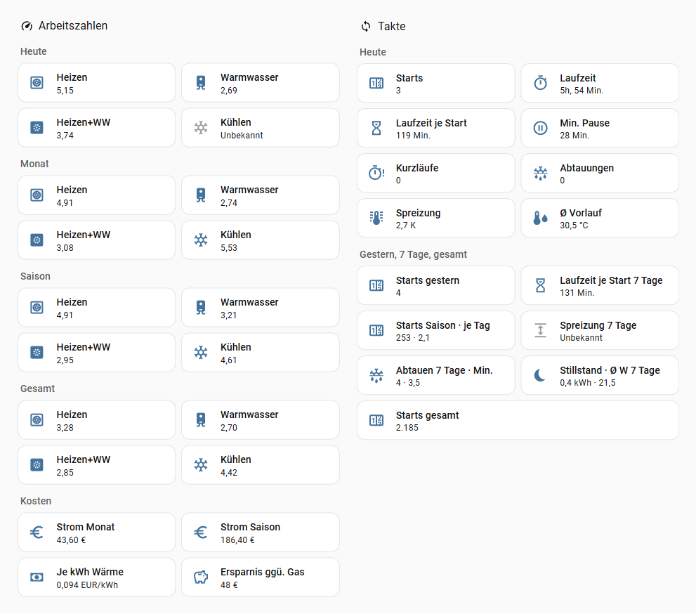
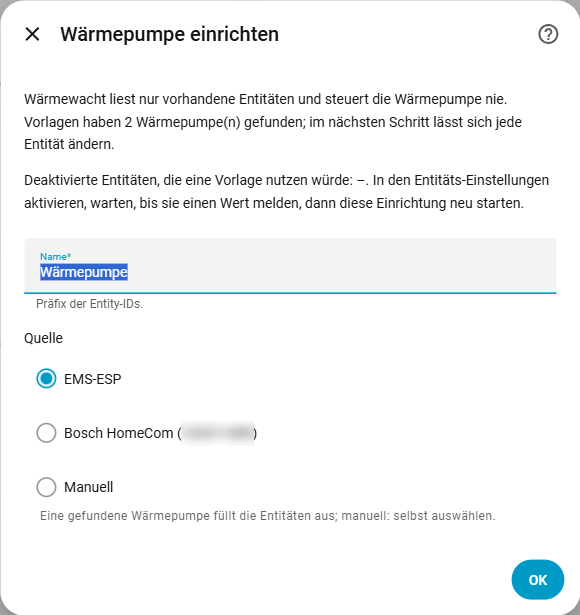
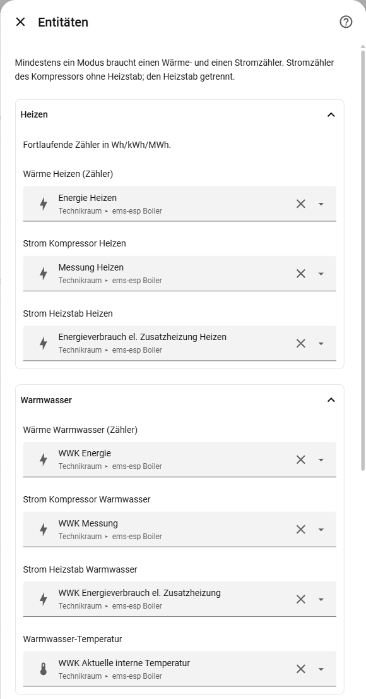
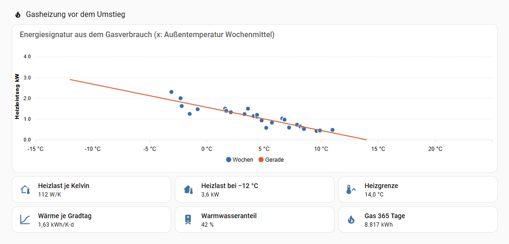
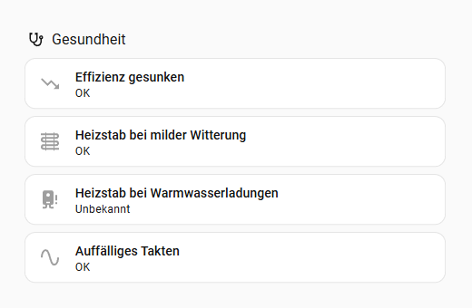
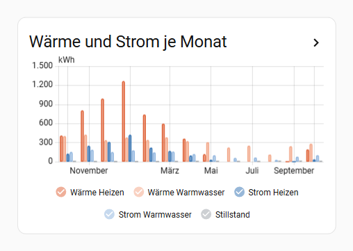
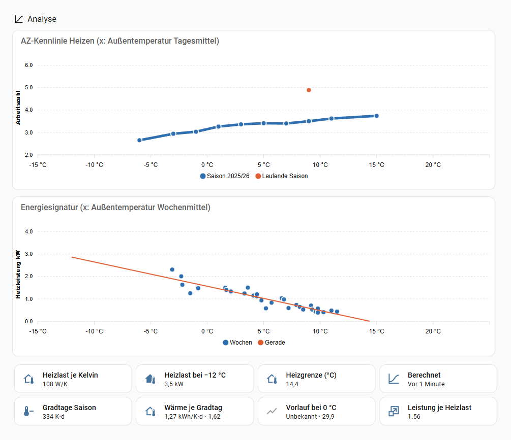

<picture>
  <source media="(prefers-color-scheme: dark)" srcset="https://raw.githubusercontent.com/waermewacht/integration/main/assets/github/readme-header-dark@2x.png">
  
</picture>

[](https://github.com/waermewacht/integration/releases)
[](https://github.com/waermewacht/integration/actions/workflows/ci.yml)
[](LICENSE)
[](https://waermewacht.github.io/integration/?lang=de)

**Deutsch** · [English](https://github.com/waermewacht/integration/blob/main/README.en.md)

> **Vorlagen:** Die Vorlagen für EMS-ESP, Bosch HomeCom und Daikin Altherma (P1P2MQTT) laufen an echten Anlagen, alle anderen sind Beta (siehe [Voraussetzungen](#voraussetzungen)).

**Wie effizient arbeitet deine Wärmepumpe wirklich?** Wärmewacht berechnet in Home Assistant Arbeitszahlen je Betriebsart und Zeitraum, zählt Starts, Kurzläufe und Abtauungen und zeigt einige Diagnosewerte. Grundlage sind die Entitäten, die deine Wärmepumpe schon liefert. Wärmewacht liest nur und steuert nie. Keine Cloud, keine Netzabfragen.

**Ausprobieren ohne Installation:** Die [Demo](https://waermewacht.github.io/integration/?lang=de) zeigt Arbeitszahlen, Takte, Gesundheits-Check, Warmwasser, AZ-Kennlinie und Energiesignatur für eine kalte Januarwoche, einen milden Herbst mit taktender Anlage, eine Hybridanlage mit Gaskessel und eine Gasheizung vor dem Umstieg – mit den echten [Karten](#karten), erfundenen Werten, aber gerechnet vom Code der Integration.

**Noch mit Gas oder Öl?** Wärmewacht rechnet auch die Heizlast deines Hauses aus dem Gas- oder Ölverbrauch, als Grundlage für die Auslegung einer Wärmepumpe: [Gasheizung vor dem Umstieg](#gasheizung-vor-dem-umstieg).

> **Orientierung, keine Fachdiagnose.** Die Werte hängen davon ab, was die Zähler deiner Wärmepumpe messen. Siehe [Bilanzgrenze und Grenzen der Aussage](#bilanzgrenze-und-grenzen-der-aussage).

Die Oberfläche gibt es auf Deutsch und Englisch; sie folgt der Sprache deines Home Assistant.



<sub>Echte Werte einer Bosch Compress 5800i AW (EMS-ESP) im Oktober. „Heizen+WW“ ist die Arbeitszahl mit Stillstand-Strom und liegt deshalb unter beiden Einzelwerten.</sub>

## Inhalt

- [Was Wärmewacht kann](#was-wärmewacht-kann) · [Was Wärmewacht anders macht](#was-wärmewacht-anders-macht-als-template-sensoren)
- **Loslegen:** [Voraussetzungen](#voraussetzungen) · [Installation](#installation) · [Einrichtung](#einrichtung) · [Einstellungen](#einstellungen) · [Gasheizung vor dem Umstieg](#gasheizung-vor-dem-umstieg)
- **[Entitäten](#entitäten):** [Arbeitszahlen](#arbeitszahlen) · [Energie](#energie) · [Takte](#takte) · [Warmwasser-Ladungen](#warmwasser-ladungen) · [Gesundheits-Check](#gesundheits-check) · [Hybridanlage](#hybridanlage) · [Kosten und Gasvergleich](#kosten-und-gasvergleich) · [Kennlinie und Heizlast](#kennlinie-und-heizlast)
- **[Aktionen](#aktionen):** [Bericht](#bericht) · [AZ-Kennlinie](#az-kennlinie) · [Heizlast](#heizlast)
- **Mehr:** [Benachrichtigen](#benachrichtigen) · [Karten](#karten) · [Dashboard-Beispiele](#dashboard-beispiele) · [Bilanzgrenze](#bilanzgrenze-und-grenzen-der-aussage) · [Fehlerbehebung](#fehlerbehebung) · [Datenschutz](#datenschutz) · [Entfernen](#entfernen) · [Fehler melden](#fehler-melden) · [Verwandte Projekte](#verwandte-projekte)

## Was Wärmewacht kann

- **Arbeitszahlen** für Heizen, Warmwasser und Heizen + Warmwasser, dazu die **Leistungszahl Kühlen (EER)**, jeweils für heute, gestern, Monat, Saison und gesamt.
- **Wärme- und Strom-Sensoren je Betriebsart** und ein Sensor für den **Stillstand**, mit Langzeitstatistik für Statistik-Karten.
- **Takte:** Starts, Laufzeit, Laufzeit pro Start, Kurzläufe, kürzeste Pause, Abtauungen und ein Binärsensor **Auffälliges Takten**.
- **Diagnose:** Heizstab-Anteil, Spreizung und mittlere Vorlauftemperatur im Heizbetrieb (mit Betriebsart).
- **Warmwasser je Ladung:** Arbeitszahl der letzten Ladung und der Ladungen der letzten 30 Tage, letzte thermische Desinfektion.
- **Gesundheits-Check:** meldet gesunkene Effizienz bei gleichem Wetter, eine gesunkene Warmwasser-Effizienz gegenüber dem Vorjahr und den Heizstab bei milder Witterung oder bei Warmwasserladungen, dazu Schutz- und Störmeldungen der Wärmepumpe, die immer wiederkommen. Reparaturhinweise, wenn ein Zähler stillsteht, eine Quelle ausfällt, die Außentemperatur hängt oder Durchfluss, Vor- und Rücklauf nicht stimmen.
- **Kosten und Gasvergleich** (optional, mit festem Preis oder Strompreis-Sensor für dynamische Tarife): Stromkosten, Wärmekosten je kWh und die Ersparnis gegenüber einem Gaskessel; mit Netzbezug-Zähler zählt Strom aus eigener PV oder Batterie zur Einspeisevergütung, mit seinem Anteil je Betriebsart.
- **AZ-Kennlinie und Heizlast:** Arbeitszahl Heizen über der Außentemperatur und Heizlast aus der Energiesignatur. Als Sensoren und per Aktion für beliebige Zeiträume. Dazu Kennwerte wie Gradtage, Vorlauf bei 0 °C (die Heizkurve), Spreizung an kalten Tagen und Leistung je Heizlast.
- **Gas- oder Ölheizung vor dem Umstieg:** Heizlast, Heizgrenze und Warmwasseranteil aus dem Gas- oder Ölverbrauch der letzten 365 Tage, als eigener Eintrag ([mehr](#gasheizung-vor-dem-umstieg)).
- **Bericht für einen beliebigen Zeitraum** per Aktion, je Monat aufgeschlüsselt. Auch **vor der Einrichtung**, so weit die Langzeitstatistik deiner Zähler zurückreicht.
- **Vorlagen für EMS-ESP und Bosch HomeCom:** finden Bosch/Buderus-Wärmepumpen selbst und füllen die Entitäten aus. Als Beta dazu Luxtronik (alpha innotec, Novelan), Stiebel Eltron/Tecalor (ISG), Panasonic Aquarea (HeishaMon), iDM, Viessmann (ViCare), Mitsubishi Ecodan (MELCloud, F1p-Brücke oder ESPHome), Vaillant (myVAILLANT), Waterkotte, Buderus über das Gateway MX300/MX400 (Integration `buderus`) und EMS-ESP-Hybridanlagen (HM200); erprobt außerdem Daikin Altherma (P1P2MQTT) und Lambda. Andere Wärmepumpen ordnest du von Hand zu.
- **Schont SD-Karten:** schreibt nur, wenn sich etwas geändert hat, und dann höchstens alle 10 Minuten. Dazu am Ende eines Laufs, um Mitternacht und beim Beenden. Die Sensoren aktualisieren sich einmal pro Minute und bei Ereignissen.

## Was Wärmewacht anders macht als Template-Sensoren

- **Arbeitszahl eines Zeitraums = Σ Wärme / Σ Strom**, nie der Mittelwert von Tageswerten.
- **Unbekannt statt 0:** Ohne Wärme oder unter dem Mindeststrom (Vorgabe 0,5 kWh) ist eine Arbeitszahl unbekannt. Nullen würden Mittelwerte und Statistiken nach unten ziehen.
- **Stillstand getrennt:** Strom bei stehendem Kompressor zählt nicht in die Arbeitszahl je Betriebsart, wohl aber in die Arbeitszahl Heizen + Warmwasser. So rechnet auch das Fraunhofer ISE in seinen Feldtests.
- **Kühlen nie in der Jahresarbeitszahl.** Es hat eine eigene Leistungszahl (EER).
- **Takte aus echten Läufen** des Kompressors: Ein Neustart von Home Assistant mitten im Lauf ist kein neuer Start. Wechselt die Wärmepumpe ohne Stopp von Heizen auf Warmwasser, bleibt es ein Lauf. Ein Lauf, der beim ersten Blick schon lief, zählt nicht als Start.
- **Zähler-Resets und Rücksprünge:** Rücksprünge halten den Höchststand, gebucht wird nur Wärme darüber (netto). Das betrifft Rauschen und das Abtauen, bei dem die Wärmepumpe die entzogene Wärme abzieht. Erst ein Rückgang um mehr als 10 % und mehr als 1 kWh gilt als Reset mit neuer Basis, unplausible Sprünge werden nicht gebucht. `unknown` und `unavailable` gelten nie als 0.
- **Rückblick aus der Langzeitstatistik:** Heute, gestern, Monat, Saison und gesamt enthalten schon bei der Einrichtung die Werte der Zeit davor.

## Voraussetzungen

Für eine Gasheizung vor dem Umstieg genügen Gaszähler und Außentemperatur, siehe [Gasheizung vor dem Umstieg](#gasheizung-vor-dem-umstieg). Für eine Wärmepumpe:

- Home Assistant 2026.4 oder neuer.
- Der Recorder (in Home Assistant standardmäßig an) für Rückblick, Bericht, AZ-Kennlinie und Heizlast. Welche Entitäten er aufzeichnen muss: [Recorder schlank halten](#recorder-schlank-halten).
- Mindestens eine Betriebsart mit einem **Wärmezähler** und einem **Stromzähler des Kompressors**: fortlaufende Energiesensoren in Wh, kWh oder MWh. Ohne Wärmezähler genügt der Kompressorstatus; dann gibt es Takte und Strom, aber keine Arbeitszahlen.

| Quelle | Status |
| --- | --- |
| [EMS-ESP](https://github.com/emsesp/EMS-ESP32) (MQTT) mit Bosch/Buderus-Wärmepumpen, z. B. CS5800i/CS6800i, WLW176i/WLW186i | Vorlage, erprobt an einer CS5800i/CS6800i |
| EMS-ESP mit Gerät `heatpump`: Hybrid Manager HM200 (Hybridanlage mit Öl- oder Gaskessel), HP Module | Beta, aus den MQTT-Daten einer Hybridanlage; Wärmepumpe und Kessel getrennt, [Hybridanlage](#hybridanlage) |
| [Bosch HomeCom](https://github.com/serbanb11/bosch-homecom-hass) (`bosch_homecom`, lokal und Cloud) | Vorlage, neu, an derselben CS5800i/CS6800i mit EMS-ESP verglichen |
| [Luxtronik](https://github.com/BenPru/luxtronik) (`luxtronik2`; alpha innotec, Novelan) | Beta, aus dem Quellcode; Strom je Betriebsart erst mit neuerer Firmware |
| [Stiebel Eltron / Tecalor ISG](https://github.com/pail23/stiebel_eltron_isg_component) (`stiebel_eltron_isg`) | Beta, aus dem Quellcode; Zähler in ganzen kWh; kein Strom fürs Kühlen, also keine EER |
| [Panasonic Aquarea über HeishaMon](https://github.com/kamaradclimber/heishamon-homeassistant) (`aquarea`) | Beta, aus dem Quellcode; Energie aus den Leistungen aufsummiert, kein Heizstab |
| [Lambda](https://github.com/GuidoJeuken-6512/lambda_heat_pumps) (`lambda_heat_pumps`) | Vorlage, erprobt an einer EU13L; eigene Zähler für Abtauen und Stillstand |
| [iDM Navigator 2.0](https://github.com/Xerolux/idm-heatpump-hass) (`idm_heatpump`, mit Weboberfläche) | Beta, aus dem Quellcode |
| [Viessmann ViCare](https://www.home-assistant.io/integrations/vicare/) (Core `vicare`) | Beta, aus dem Quellcode; **nur Takte und Strom, keine Arbeitszahl** |
| [Mitsubishi Ecodan über MELCloud](https://www.home-assistant.io/integrations/melcloud/) (Core `melcloud`, ab HA 2026.5) | Beta, aus dem Quellcode; Arbeitszahlen ohne Takte |
| [Vaillant myVAILLANT](https://github.com/signalkraft/mypyllant-component) (`mypyllant`) | Beta, aus dem Quellcode; Arbeitszahlen ohne Takte |
| [Mitsubishi Ecodan über F1p-Brücke](https://github.com/F1p/Home-Assistant-Mitsubishi-CN105-to-MQTT) (MQTT, CN105) | Beta, aus dem Quellcode; Arbeitszahlen, Takte und Abtauen |
| [Mitsubishi Ecodan mit ESPHome](https://github.com/gekkekoe/esphome-ecodan-hp) (`esphome`, esphome-ecodan-hp) | Beta, aus dem Quellcode; Arbeitszahlen, Takte und Abtauen |
| [Waterkotte EcoTouch](https://github.com/marq24/ha-waterkotte) (`waterkotte_heatpump`) | Beta, aus dem Quellcode; Kompressorstrom nur gesamt |
| [Buderus/Bosch über MX300, MX400, K30](https://github.com/BassXT/buderus) (`buderus_ha`) | Beta, aus dem Quellcode; Arbeitszahlen, Takte und Abtauen |
| [Daikin Altherma über P1P2MQTT](https://github.com/Arnold-n/P1P2Serial) (MQTT) | Vorlage, erprobt an zwei Altherma 3; Arbeitszahlen, Takte und Abtauen, Zähler in ganzen kWh |
| beliebige Wärme- und Stromzähler | manuelle Zuordnung |

Die EMS-ESP-Vorlage erkennt die Wärmepumpe am Gerät `boiler`. Sie braucht Kompressorstatus (`hpcompon`) und die Zähler für Heizen. Sie findet die Entitäten über die Entitäten-Registry, nicht über die Entity-ID. Umbenennen und alle Namensformate von EMS-ESP sind deshalb kein Problem. Die Betriebsart (`hpactivity`) versteht sie in allen Sprachen von EMS-ESP und im Index-Format.

Bei Hybridanlagen (Öl- oder Gaskessel plus Hybrid Manager HM200) ist das Gerät `boiler` der Kessel; die Wärmepumpe steht unter dem Gerät `heatpump`. Dafür gibt es die Vorlage „EMS-ESP Heatpump“ (Beta): Wärmepumpe aus `heatpump_…` (Kompressor aus der Drehzahl `hpcompspd`), Kessel, Außen- und Speichertemperatur aus `boiler_…`. Wie Wärmewacht den Kessel behandelt, steht unter [Hybridanlage](#hybridanlage).

Die HomeCom-Vorlage braucht die Energie je Betriebsart („Wärme erzeugt Heizung“, „Strom Kompressor Heizung“ usw.). `bosch_homecom` legt diese Entitäten deaktiviert an: Aktiviere sie zuerst. Die Einrichtung zeigt, welche noch deaktiviert sind. „Kompressor läuft“ ist die Kompressordrehzahl über 0. Gegenüber EMS-ESP hat HomeCom Grenzen:

- **Tageswerte aus der Cloud:** Die Energie kommt als Summe des Tages, bis zu zwei Stunden verspätet. Wärmewacht bucht sie, wenn sie eintrifft, „heute“ hinkt also nach. Die letzten ein bis zwei Stunden eines Tages liefert die Cloud nie (beobachtet bis 0,5 kWh am Tag).
- **Stillstand:** Strom eines Abrufs, mit dem keine Wärme derselben Betriebsart kam.
- **Betriebsart erst ab `bosch_homecom` 1.6.1:** Erst ab dieser Version gibt es den Sensor „Kompressorstatus“ und damit Abtauungen, Spreizung und mittleren Vorlauf. Er kommt aus der Cloud, etwa eine Minute später als an der Wärmepumpe, und fehlt, solange die Cloud nicht erreichbar ist. Einen bestehenden Eintrag ergänzt Wärmewacht beim nächsten Start von selbst.
- **Kein Durchfluss:** `bosch_homecom` meldet „L/min“, liefert aber l/h.

Läuft bei dir EMS-ESP, nimm EMS-ESP: Zähler auf 0,01 kWh im Minutentakt und die Betriebsart.

**Beta-Vorlagen** sind aus dem Quellcode der jeweiligen Integration abgeleitet, nicht an einer echten Anlage bestätigt. Die Einrichtung zeigt sie mit „(beta)“. Hast du so eine Anlage, hilft eine Rückmeldung mit [Diagnose-Datei](#fehler-melden) sehr. Die wichtigsten Grenzen:

- **Viessmann ViCare:** Home Assistant liefert keine Wärme (die Bibliothek PyViCare liest sie noch nicht aus). Wärmewacht zeigt deshalb Takte, Laufzeiten, Strom je Betriebsart und Kosten, aber keine Arbeitszahl. E3-Regler (Vitocal 150-A bis 252-A) melden keine Betriebsart; ältere Vitotronic-Regler melden Abtauen, aber keine Energie. Die Tageswerte der Cloud zählt Wärmewacht in UTC-Tagen. Beginnt die Cloud um Mitternacht Ortszeit (bestätigt für eine Vitocal 151-A), kommt der Verbrauch der ersten Stunde des Tages (im Sommer der ersten zwei) etwas später an, aber vollständig.
- **Mitsubishi Ecodan (MELCloud):** Die Wärme je Betriebsart legt `melcloud` deaktiviert an: Aktiviere sie zuerst. Ohne brauchbares Kompressorsignal (nur alle 30 Minuten) gibt es keine Takte und keine Abtauungen. MELCloud meldet die Summen des **Vortags**: Sie springen einmal kurz nach Mitternacht und bleiben dann den Tag über gleich. Wärmewacht bucht sie deshalb in den Vortag, und Monat und Saison stimmen auch am Monatswechsel. „Heute“ bleibt bei dieser Quelle leer, „gestern“ ist der früheste Wert. Bleibt die Aktualisierung der Cloud einmal aus, fehlt der Tag.
- **Mitsubishi Ecodan (F1p-Brücke):** Lokal über den CN105-Anschluss, mit Kompressor und Betriebsart, also mit Takten und Abtauungen. Die Energie kommt wie bei MELCloud als Summe des Vortags. Die Brücke sendet vor dem echten Wert manchmal eine eigene Schätzung; liegt sie höher, zählt Wärmewacht etwas zu viel. Ohne `state_class` der Brücke gibt es keinen Rückblick vor der Einrichtung.
- **Mitsubishi Ecodan (ESPHome):** Die Firmware esphome-ecodan-hp liefert wie die F1p-Brücke Kompressor, Betriebsart, Abtauen und die Energie als Summe des Vortags. Die Vorlage erkennt die Entitäten an den Namen der Firmware; hast du sie im YAML umbenannt, ordne von Hand zu. Die Uhr der FTC muss stimmen, auch nach der Zeitumstellung. Abtauen schließt Standby und Wiederanlauf mit ein und fällt deshalb eher zu lang aus.
- **Buderus/Bosch über MX300/MX400 (`buderus`):** Liest wie Bosch HomeCom die Bosch-Cloud, aber mit Lebenszeit-Zählern je Betriebsart (0,01 kWh, alle 10 Minuten abgerufen) und mit der Betriebsart samt Abtauen. „Kompressor läuft“ ist die Modulation über 0. Kein Durchfluss.
- **Daikin Altherma (P1P2MQTT):** Die Zähler der Wärmepumpe selbst (Wärme und Strom je Betriebsart, Heizstab) in ganzen kWh. Sie kommen nur, wenn in der Brücke die Zählerabfrage („Counter_Request_Function“) eingeschaltet ist. Betriebsart aus den Flags Abtauen, Warmwasser, Kühlen und Heizen. Die Warmwasser-Entitäten gibt es nur mit den passenden Feldeinstellungen am Regler.
- **Waterkotte:** Die Zähler sind Jahressummen, Wärme je Betriebsart, Kompressorstrom aber nur gesamt. Wärmewacht ordnet den Strom der laufenden Betriebsart zu, im Rückblick nach dem Anteil an der Wärme. Ein Lauf ohne Warmwasser- oder Kühl-Merker zählt als Heizen (die Heizfreigabe `status_heating` ist kein Heizzustand). Aktiviere „Kühlen“ (`state_cooling`), sonst zählt Kühlbetrieb als Heizen. Es gibt keinen Startzähler (Wärmewacht zählt selbst) und kein Abtausignal.
- **Vaillant (myVAILLANT):** Wärmewacht bucht Stunde für Stunde aus der Statistik, die mypyllant selbst schreibt. Stelle in mypyllant die Option „Seconds between energy data updates“ auf 3600 bis 7200 Sekunden, sonst ruft es die Energie nur beim Start ab. Die Zahlen hinken dadurch ein bis drei Stunden nach. Es gibt kein Kompressorsignal und kein Abtauen, also keine Takte. Stillstand ist eine Stunde ohne Umweltwärme.

### Recorder schlank halten

Wer in der `recorder`-Konfiguration Entitäten ausschließt (`exclude`) oder nur ausgewählte aufnimmt (`include`): Eine nicht aufgezeichnete Entität bekommt auch **keine Langzeitstatistik**. Wärmewacht liest fast nur diese Statistik, eine Zeile je Stunde.

- **Müssen aufgezeichnet werden:**
  - die Energie-Sensoren von Wärmewacht (Wärme und Strom je Betriebsart, Strom Stillstand) für Bericht, AZ-Kennlinie, Heizlast, Gradtage und Gesundheits-Check;
  - die Außentemperatur für dieselben Auswertungen und die Prüfung des Fühlers;
  - die Vorlauftemperatur für „Vorlauf bei 0 °C“.
- **Sollten aufgezeichnet werden:**
  - die Energiezähler der Wärmepumpe. Wärmewacht braucht sie für die Zeit vor der Einrichtung: Rückblick, „Rückblick neu berechnen“ und Bericht. Ohne sie fehlt bei einem neu angelegten Eintrag der Rückblick;
  - der Startzähler. Ohne Statistik zählt „Starts Saison“ erst ab dem ersten Wert, den Wärmewacht sieht.
- **Dürfen fehlen:**
  - alle übrigen Sensoren von Wärmewacht (Arbeitszahlen, Takte, Kosten, Gesundheit, Diagnose) sowie die Binärsensoren. Wärmewacht speichert seinen Stand selbst. Deren Verlauf in eigenen Diagrammen fehlt dann allerdings;
  - Kompressorstatus und Betriebsart. Ihren Verlauf liest Wärmewacht nur einmal bei der Einrichtung, um die Takte der letzten 10 Tage nachzutragen.

Beispiel für `include` (Entity-IDs auf der Geräteseite prüfen; das `*` am Ende erfasst auch Endungen wie `_2`):

```yaml
recorder:
  include:
    entity_globs:
      - sensor.*_warme_heizen*
      - sensor.*_warme_warmwasser*
      - sensor.*_strom_heizen*
      - sensor.*_strom_warmwasser*
      - sensor.*_strom_stillstand*
    entities:
      - sensor.aussentemperatur      # deine Außentemperatur
      - sensor.vorlauftemperatur     # deine Vorlauftemperatur
      - sensor.waermemenge_heizen    # deine Zähler, je Betriebsart
```

Geht es nur um die Größe der Datenbank, genügt oft eine kurze Aufbewahrung (`purge_keep_days`, Standard 10 Tage). Die Langzeitstatistik bleibt davon unberührt.

## Installation

**Mit einem Klick:** [](https://my.home-assistant.io/redirect/hacs_repository/?owner=waermewacht&repository=integration&category=integration) → installieren, Home Assistant neu starten → [](https://my.home-assistant.io/redirect/config_flow_start/?domain=waermewacht)

Oder von Hand:

1. *Einstellungen → Marketplace → Durchstöbern*, nach Wärmewacht suchen und installieren (vor Home Assistant 2026.11: in HACS suchen und herunterladen). Home Assistant neu starten.
2. *Einstellungen → Geräte & Dienste → Integration hinzufügen → Wärmewacht*.

## Einrichtung

1. **Name und Quelle:** Der Name (Vorgabe „Wärmepumpe“) wird Gerätename und Präfix der Entity-IDs. Als Quelle stehen die gefundenen Wärmepumpen zur Wahl (EMS-ESP, bei mehreren mit ihrem MQTT-Präfix; Bosch HomeCom mit der Gateway-Nummer) oder *Manuell*.
2. **Entitäten:** Mit einer Vorlage ist das Formular ausgefüllt; jedes Feld lässt sich ändern. Die Abschnitte zeigen dann nur, was die Vorlage gefunden hat. Alle übrigen Felder stehen eingeklappt unter **Weitere Felder**: Dafür liefert die Quelle nichts Passendes, und eine nur ähnlich klingende Entität (etwa Frostschutz statt Abtauen) ergibt falsche Werte. Manuell wählst du selbst, alle Abschnitte wie in der Tabelle unten.

<table>
  <tr>
    <td valign="top"></td>
    <td valign="top"></td>
  </tr>
</table>

| Abschnitt | Feld | EMS-ESP (Standardformat) |
| --- | --- | --- |
| Heizen | Erzeugte Wärme Heizen (Zähler) | `sensor.boiler_nrgheat` |
| | Strom Kompressor Heizen | `sensor.boiler_meterheat` |
| | Strom Heizstab Heizen | `sensor.boiler_auxelecheatnrgconsheating` |
| Warmwasser | Erzeugte Wärme Warmwasser (Zähler) | `sensor.boiler_dhw_nrg` |
| | Strom Kompressor Warmwasser | `sensor.boiler_dhw_meter` |
| | Strom Heizstab Warmwasser | `sensor.boiler_dhw_auxelecheatnrgcons` |
| | Warmwasser-Temperatur (Ist, Speicher) | `sensor.boiler_dhw_curtemp` |
| Kühlen | Wärme Kühlen (entzogen, Zähler) | `sensor.boiler_nrgcool` |
| | Strom Kompressor Kühlen | `sensor.boiler_metercool` |
| Betrieb | Kompressor läuft (an/aus oder Drehzahl) | `binary_sensor.boiler_hpcompon` |
| | Betriebsart (Aktivität) | `sensor.boiler_hpactivity` |
| | Kompressorstarts gesamt | `sensor.boiler_totalcompstarts` |
| Ein Zähler für alle Betriebsarten, Sonderzähler | Erzeugte Wärme gesamt (Zähler, nur ohne Aufteilung je Modus) | – |
| | Strom Kompressor gesamt (nur ohne Aufteilung je Modus) | – |
| | Strom Heizstab gesamt (nur ohne Aufteilung je Modus) | – |
| | Strom Abtauen | – |
| | Strom Stillstand | – |
| Betriebsart aus mehreren Entitäten | Abtauen läuft (an/aus) | – |
| | Warmwasser läuft (an/aus) | – |
| | Kühlen läuft (an/aus) | – |
| | Heizen läuft (an/aus) | – |
| | Eingestellte Betriebsart (Kühlen?) | – |
| Messwerte | Außentemperatur | `sensor.boiler_outdoortemp` |
| | Vorlauftemperatur | `sensor.boiler_hptc1` |
| | Rücklauftemperatur | `sensor.boiler_hptc0` |
| | Durchfluss | `sensor.boiler_pc0flow` |

- Die Stromzähler je Betriebsart sind die des **Kompressors ohne Heizstab**. Den Heizstab trägst du getrennt ein: entweder je Betriebsart oder als „Strom Heizstab gesamt“, nicht beides. Der Gesamtzähler wird der Betriebsart zugerechnet, die gerade läuft oder zuletzt lief. Ohne Betriebsart zählt er zum Heizen.
- Gibt es den Kompressorstrom nur als einen Zähler für alle Betriebsarten (Waterkotte), trag ihn als „Strom Kompressor gesamt“ ein statt je Betriebsart. Wärmewacht rechnet ihn wie den Heizstab der laufenden Betriebsart zu; Strom ohne Kompressorlauf ist Stillstand.
- Gibt es die Wärme nur als **einen Wärmemengenzähler für Heizen und Warmwasser** (etwa zwischen Wärmepumpe und Pufferspeicher, der oben das Warmwasser für eine Frischwasserstation lädt), trag ihn als „Erzeugte Wärme gesamt“ ein und lass die Wärme je Betriebsart leer (beides zusammen lehnt das Formular ab). Wärmewacht bucht jeden Anstieg auf die Betriebsart, die gerade läuft; beim Abtauen und nach dem Kompressorstopp (Pumpennachlauf, Stillstand) auf die, die zuletzt lief – wie „Strom Kompressor gesamt“. Wärme kommt dabei immer zur Betriebsart, Stillstand gibt es nur beim Strom. Ohne Betriebsart zählt alles zum Heizen; für Warmwasser braucht es also die Betriebsart. Kühlen braucht weiter einen eigenen Zähler („Wärme Kühlen“): Ein Wärmemengenzähler zählt beim Kühlen keine Wärme, und was der Gesamtzähler beim Kühlen doch zählt, bucht Wärmewacht nicht (Diagnose `heat_total_not_booked`). **Vor der Einrichtung** (Rückblick, Statistik der eigenen Sensoren) kennt die Langzeitstatistik keine Betriebsart: Dort teilt Wärmewacht die Wärme einer Stunde nach dem Strom je Betriebsart derselben Stunde auf (eine Stunde nur mit Heizen oder nur mit Warmwasser stimmt genau, eine gemischte bekommt für beide dieselbe Arbeitszahl). Gibt es auch den Strom nur als einen Zähler, zählt die Zeit vor der Einrichtung ganz zum Heizen; getrennt wird ab der Einrichtung. Stellst du einen bestehenden Eintrag über „Neu konfigurieren“ auf „Erzeugte Wärme gesamt“ um, wird erst ab der Umstellung getrennt; die Zeit zwischen Einrichtung und Umstellung bleibt, wie sie gebucht ist (Heizen).
- **Strom Abtauen** und **Strom Stillstand** sind für Quellen, die diesen Strom in eigenen Zählern führen (Vorlagen Lambda und iDM). Strom Abtauen zählt zur Betriebsart, die gerade läuft oder zuletzt lief (ohne Betriebsart zum Heizen), Strom Stillstand zum Stillstand. EMS-ESP hat solche Zähler nicht.
- Die Vorlage nimmt Zähler mit 0,01 kWh, wenn es sie gibt, sonst die ganzzahligen (z. B. `sensor.boiler_nrgsuppheating`). Den Heizstab je Betriebsart liefert EMS-ESP erst ab Version 3.9 auch mit 0,01 kWh (`metereheatheat`, `dhw_metereheat`), vorher nur in ganzen kWh. Bestehende Einträge wechseln beim nächsten Start von selbst auf die genaueren Zähler.
- Ohne „Kompressor läuft“ gibt es keine Takte. Ohne „Betriebsart“ keine Abtauungen, keine Spreizung und kein mittlerer Vorlauf. „Kompressor läuft“ darf ein Binärsensor oder eine Drehzahl bzw. Modulation sein (läuft bei über 0). Bei manueller Zuordnung versteht Wärmewacht die Werte von EMS-ESP: `0`–`7` oder Texte wie „Heizen“, „Warmwasser“, „Abtauen“ bzw. `heating`, `hot water`, `defrost`, dazu gängige Namen eigener Status-Sensoren wie „Heizung“, „Heizbetrieb“, „Warmwasserbereitung“, „Trinkwasser“, „Abtauung“, „Kühlung“. Andere Texte zählen als „sonstige“; der Strom bleibt dann beim zuletzt erkannten Modus. Wie oft solche Texte kommen, zählt der Befund [Auffällige Statusmeldungen](#gesundheits-check).
- Die Außentemperatur nutzen [AZ-Kennlinie und Heizlast](#kennlinie-und-heizlast). Wärmewacht liest ihre Stundenmittel aus der Langzeitstatistik; der Sensor braucht also eine Statistik (`state_class: measurement`). Den Durchfluss prüft Wärmewacht nur auf Plausibilität (siehe [Fehlerbehebung](#fehlerbehebung)). Dafür braucht es die Betriebsart, für den Vergleich mit Wärme und Spreizung auch Vor- und Rücklauf.

- **Betriebsart aus mehreren Entitäten** (Abschnitt eingeklappt): Hat die Wärmepumpe keine einzelne Betriebsart-Entität, sondern Merker (an/aus) für Abtauen, Warmwasser, Kühlen und Heizen, trägst du diese ein. Ein Merker „an“ gewinnt in dieser Reihenfolge: Abtauen, Warmwasser, Kühlen, Heizen. Läuft der Kompressor und kein Merker ist an, zählt der Lauf als Heizen. Die *eingestellte Betriebsart* (z. B. „Cool“) macht aus Heizen Kühlen, wenn die Betriebsart-Entität nur zwischen Heizen und Warmwasser unterscheidet (Umschaltventil). Die Vorlagen für Stiebel und HeishaMon füllen das aus, die für ViCare den Merker Warmwasser.

Mehrere Wärmepumpen: je einen Eintrag anlegen.

### Einstellungen

*Wärmewacht → Eintrag → Zahnrad (Konfigurieren)*. Jede Änderung lädt den Eintrag neu. Oben stehen nur Strompreis und Normaußentemperatur, alles Weitere in Abschnitten, die eingeklappt beginnen (aufgeklappt, wenn eine Fehlermeldung oder ein Vorschlag aus Tarifwacht/Einspeisewacht sie betrifft). Speichern, ohne einen Abschnitt aufzuklappen, lässt seine Werte, wie sie sind. Ganz oben fasst das Formular den Eintrag zusammen (Vorlage oder eigene Zuordnung, Zähler je Betriebsart, Betriebsart und Kompressor, Messwerte, Strompreis, PV-Aufteilung, Grenzen) und nennt unter „Was fehlt“, was ein fehlender Zähler kostet, etwa „Kein Warmwasser-Wärmezähler: keine Arbeitszahl Warmwasser“; bei Gas- und Ölheizungen ebenso. Die Felder in der Reihenfolge des Formulars:

| Einstellung | Vorgabe | Bedeutung |
| --- | --- | --- |
| Strompreis | – | ct/kWh brutto. Mit Strompreis-Sensor (unter „Weitere Preise“) gilt er nur für die Stunden ohne dessen Preis. Ohne beide gibt es keine Kosten-Sensoren. |
| Normaußentemperatur | – | °C nach DIN/TS 12831-1 für deine Postleitzahl (z. B. BWP-Klimakarte). Für die Heizlast bei Normaußentemperatur. |
| ***Weitere Preise und Gasvergleich (optional)*** | | |
| Strompreis-Sensor | – | Für dynamische Tarife (Tibber, Nordpool, EPEX Spot …) oder ein Template mit dem Jahrestarif; in ct/kWh, €/kWh oder €/MWh, braucht `state_class: measurement`. Siehe [Kosten](#kosten-und-gasvergleich). |
| Strom-Grundpreis | – | €/Jahr brutto, nur bei eigenem Wärmepumpenzähler (Wärmepumpentarif). Am Haushaltszähler leer lassen: Dessen Grundpreis fällt ohnehin an. |
| Gas-Arbeitspreis | – | ct/kWh brutto auf den Brennwert (wie auf der Gasrechnung). Für die Ersparnis gegenüber einem Gaskessel. |
| Gas-Grundpreis | – | €/Jahr brutto, anteilig je Tag. Ohne ihn vergleicht Wärmewacht nur die Arbeitspreise. |
| ***Eigene PV und Batterie in den Kosten (optional)*** | | |
| Netzbezug-Zähler | – | Optional: Zähler am Netzanschluss, hinter dem die Wärmepumpe hängt. Damit kostet Strom aus eigener PV oder Batterie die Einspeisevergütung statt den Netzpreis, siehe [Kosten](#kosten-und-gasvergleich). Nicht für einen eigenen Wärmepumpenzähler. |
| Einspeisezähler, PV-Erzeugungszähler | – | Optional: Mit beiden rechnet Wärmewacht anteilig (unten), sonst „Wärmepumpe zuerst“. Beim Hybrid-Wechselrichter dessen AC-Ausgang als PV. |
| Batterie-Ladezähler, -Entladezähler | – | Optional, nur beide zusammen. Ob die Batterie hinter dem PV-Wechselrichter sitzt, erkennt Wärmewacht aus den Daten. |
| Einspeisevergütung | – | ct/kWh: was eigener Strom bei Einspeisung gebracht hätte; leer = 0. |
| ***Heizleistung laut Datenblatt (optional)*** | | |
| Heizleistung bei A−7/W35 | – | kW laut Datenblatt. Ergibt den Sensor „Leistung je Heizlast“. |
| Kleinste Heizleistung | – | kW laut Datenblatt. Zeigt, ob in der Übergangszeit Takten zu erwarten ist. |
| ***Grenzen und Auswertung*** | | |
| Mindeststrom für eine Arbeitszahl | 0,5 kWh | Darunter ist die Arbeitszahl unbekannt statt zufällig. |
| Kurzlauf unter | 10 min | Fraunhofer ISE weist Zyklen unter etwa 10 Minuten gesondert aus. |
| Kritischer Lauf unter | 6 min | Mindestlaufzeit laut Dimplex-Projektierungshandbuch etwa 6 Minuten. |
| Auffällig ab Starts pro Stunde über | 3 | Mehr Starts innerhalb einer Stunde gelten als auffällig. Verdichterhersteller nennen 6 bis 12 Starts pro Stunde als Obergrenze. |
| Auffällig ab Starts pro Tag über | – | Optional, z. B. für eine Wärmepumpe, die nur ein- und ausschaltet: Mehr Starts in den letzten 24 Stunden gelten als auffällig. Leer: aus. Eine Grenze mit Quelle gibt es nicht; zur Einordnung siehe „Starts pro Jahr“ unter [Takte](#takte). |
| Heizstab: milde Witterung ab | 5 °C | Gesundheits-Check: Tagesmittel der Außentemperatur, ab dem die Wärmepumpe allein heizen sollte (eigene Annahme). |
| Effizienz gesunken ab | 15 % | Gesundheits-Check: Rückgang der AZ Heizen gegenüber der Vorsaison bei gleicher Außentemperatur; aus erst 5 Punkte darunter (eigene Annahme). |
| Thermische Desinfektion ab | 60 °C | Warmwasser-Temperatur, ab der eine Ladung als thermische Desinfektion zählt. DVGW W 551 verlangt 60 °C am Austritt; der Speicherfühler zeigt oft etwas weniger. |
| Saison beginnt im | Juli | Beginn der Saison (Heizperiode Juli bis Juni). |

Jedes optionale Feld darf leer bleiben. Quellen der Vorgaben in [docs/ENTWICKLUNG.md](docs/ENTWICKLUNG.md). Wird der Saisonbeginn geändert, berechnet Wärmewacht die laufende Saison aus der Langzeitstatistik neu (Stillstand vor der Einrichtung stundenweise geschätzt).

### Neu konfigurieren

*Wärmewacht → ⋮ → Neu konfigurieren* zeigt das Entitäten-Formular erneut, mit der bisherigen Zuordnung. Dort lässt sich **jede Entität tauschen, nachtragen oder entfernen**, auch die Außentemperatur, etwa nach einem Fühlertausch. Den Eintrag zu löschen und neu anzulegen ist dafür nie nötig; bei einer Wärmepumpe gingen dabei die gebuchten Werte verloren. Die bisher gebuchten Werte bleiben. Ein neu hinzugefügter Zähler zählt ab diesem Zeitpunkt; die Zeit vor der Einrichtung holt Wärmewacht beim Neuladen selbst aus der Langzeitstatistik nach, wie die Schaltfläche **Rückblick neu berechnen**. Bekommt er dabei einen eigenen Energie-Sensor, schreibt Wärmewacht auch dessen Vergangenheit in die Statistik (siehe [Energie](#energie)).

**Rückblick neu berechnen** (Schaltfläche, Konfiguration) rechnet die Energie vor der Einrichtung neu aus der Langzeitstatistik, mit den heutigen Entitäten und Regeln: wenn ein Update die Regeln des Rückblicks verbessert hat oder du die Statistik eines Zählers nachträglich importiert hast. Nach einem neu eingetragenen oder gewechselten Zähler tut Wärmewacht das beim nächsten Start selbst. Was Wärmewacht seit der Einrichtung gebucht hat, bleibt. Die Zeit zwischen Einrichtung und Nachtragen eines Zählers fehlt in Monat, Saison und gesamt weiterhin. Die Statistik der eigenen Energie-Sensoren ändert die Schaltfläche nicht. Nicht bei Quellen mit Vortageswerten (MELCloud, F1p-Brücke): Deren Statistik taugt nicht für den Rückblick.

Kennt eine Vorlage nach einem Update ein neues Signal (etwa die Warmwasser-Temperatur), trägt Wärmewacht es beim Start selbst ein, wenn es dieselbe Wärmepumpe betrifft und der Eintrag noch keins hat. Was du unter *Neu konfigurieren* bewusst entfernst, bleibt entfernt.

Benennst du eine Quelle um (Entity-ID in den Entitäts-Einstellungen, *Entity-IDs neu erstellen* am Gerät), zieht Wärmewacht die neue ID selbst nach und lädt den Eintrag kurz danach neu. *Neu konfigurieren* ist dafür nicht nötig; Verlauf und Statistik bleiben, weil Home Assistant sie mit umbenennt.

## Gasheizung vor dem Umstieg

Wer noch mit Gas heizt und über eine Wärmepumpe nachdenkt, braucht vor allem die **Heizlast**: Wie viel Leistung braucht das Haus am kältesten Tag? Wärmewacht rechnet sie aus dem Gasverbrauch, mit derselben [Energiesignatur](#kennlinie-und-heizlast) wie bei einer Wärmepumpe. Dazu kommen Heizgrenze, Wärme je Gradtag und der Warmwasseranteil.



<sub>Gegenprobe an einer echten Anlage: Die Wärmezähler einer Bosch Compress 5800i AW (EMS-ESP) sind hier als „Gas“ eingetragen, mit Nutzungsgrad 1. Die Gasheizung-Rechnung kommt auf 112 W/K, die Wärmepumpe selbst auf 107 W/K (letzte 365 Tage gegenüber der letzten vollständigen Saison). Bei einer echten Gasheizung steht unten der Gasverbrauch.</sub>

**Einrichtung:** *Integration hinzufügen → Wärmewacht*, als Quelle **Gasheizung (vor dem Umstieg)**. Dann:

| Feld | Bedeutung |
| --- | --- |
| Gas gesamt | Ein Zähler für Heizen und Warmwasser: Gaszähler (Impuls, AI-on-the-edge) oder der Zähler der Therme, in kWh oder m³ |
| Gas nur Heizen | statt „Gas gesamt“, wenn die Therme Heizen und Warmwasser getrennt zählt (z. B. Viessmann ViCare) |
| Gas Warmwasser | optional, wenn Warmwasser getrennt gezählt wird |
| Außentemperatur | Pflicht, mit Langzeitstatistik; eine nahe Wetterstation genügt |
| Vorlauftemperatur | optional: Vorlauf der Therme oder des Heizkreises, mit Langzeitstatistik (Zustandsklasse `measurement`) |
| Vorlauffühler sitzt im Heizkreis | anhaken, wenn der Fühler den Vorlauf des Heizkreises misst (hinter Pufferspeicher oder Mischer), nicht den Kesselaustritt, siehe **Vorlauf** unten |
| Ablesung von Hand | statt eines Zählers: Einheit deines Gaszählers (m³ oder kWh), siehe [Ablesung von Hand](#ablesung-von-hand) |
| Brennwert, Zustandszahl | nur für Zähler in m³, aus der Gasrechnung (kWh = m³ × Brennwert × Zustandszahl) |

Die Zähler brauchen eine Langzeitstatistik (Zustandsklasse `total` oder `total_increasing`). Wärmewacht liest nur sie, und zwar die **letzten 365 Tage**: Reicht die Statistik deines Gaszählers schon so weit zurück (etwa aus dem Energie-Dashboard), gibt es die Ergebnisse 2 Minuten nach der Einrichtung. Danach rechnet Wärmewacht täglich um 3 Uhr neu. Es hört keine Zustände ab und speichert nichts.

**Später ändern:** Zähler, Außentemperatur und Vorlauf tauschst, ergänzt oder entfernst du unter *Wärmewacht → ⋮ → Neu konfigurieren*, Nutzungsgrad, Normaußentemperatur und Preise unter dem Zahnrad (*Konfigurieren*). Ein zweiter Eintrag für denselben Zähler ist nicht nötig und wird abgelehnt; Löschen und neu anlegen auch nicht (bei der Ablesung von Hand gingen dabei die eingetragenen Stände verloren). Weil Wärmewacht alles aus der Langzeitstatistik rechnet, gilt eine Änderung sofort für die ganzen 365 Tage. Ein neuer Außenfühler bringt allerdings seine eigene Statistik mit: Heizlast und Heizgrenze beginnen dann mit seinen Daten von vorn.

**Wärme aus Gas:** Gas in kWh auf den Brennwert (wie auf der Rechnung) mal **Nutzungsgrad 0,87**, dem Feldwert von Brennwertkesseln (Jagnow/Wolff, DBU 2004). Ältere Kessel liegen darunter; stell den Wert in den Einstellungen um. Die Heizlast ändert sich im selben Verhältnis.

**Warmwasser** zählt nicht zur Heizlast. Wärmewacht trennt es so:

- mit einem eigenen Warmwasser-Zähler: aus diesem (von „Gas gesamt“ abgezogen);
- mit „Gas gesamt“ ohne Warmwasser-Zähler aus dem **Sommersockel**: Der Median des Tagesverbrauchs an Tagen mit mindestens 15 °C Tagesmittel (Heizgrenze nach VDI 3807) gilt als Warmwasser und geht von jedem Tag ab. Dafür braucht es mindestens 14 solche Tage in den 365 Tagen. Fehlen sie (Zähler erst seit dem Herbst), zieht Wärmewacht nichts ab, und der Warmwasseranteil bleibt unbekannt (`no_summer_days`). Die normgerechte Heizlast stimmt trotzdem, weil sie nur aus der Steigung kommt; die Heizgrenze liegt dann zu hoch.

| Entität | Einheit | Bedeutung |
| --- | --- | --- |
| Heizlast je Kelvin | W/K | Steigung der Energiesignatur. Attribute wie bei der Wärmepumpe, dazu `boiler_efficiency` und `dhw_method` |
| Heizlast bei Normaußentemperatur | kW | normgerecht, nur mit der Einstellung Normaußentemperatur |
| Heizgrenze | °C | wo die Gerade 0 erreicht |
| Wärme je Gradtag | kWh/K·d | Wärme fürs Heizen je Gradtag G20/15, über die Heiztage |
| Warmwasseranteil | % | Anteil des Gases für Warmwasser. Attribute `method` (`counter`, `summer_base`, `no_summer_days`, `heating_only`), `summer_days`, `summer_base_kwh_per_day` |
| Gas 365 Tage | kWh | Gas der letzten 365 Tage. Attribute `days` (Tage mit Daten), `complete`, `heat_kwh` (Wärme nach Nutzungsgrad) |
| Gaskosten 365 Tage | € | nur mit Gaspreis in den Einstellungen; mit Grundpreis |
| Vorlauf bei 0 °C | °C | nur mit Vorlauftemperatur: Vorlauf, den die Heizung bei 0 °C Tagesmittel fährt. Attribute `slope` (K Vorlauf je K Außentemperatur), `r_squared`, `days`, `spread`, `coldest_day`, `dhw_method`, `flow_selection` (`heating_heat`: Stunden mit Heizwärme, `heating_circuit`: Stunden, in denen der Heizkreis lief) |
| Vorlauf bei Normaußentemperatur | °C | dazu die Einstellung Normaußentemperatur: die Gerade bis dorthin verlängert, Attribut `design_temp` |

### Ablesung von Hand

Kein Gaszähler in Home Assistant? Dann wähl bei der Einrichtung statt eines Zählers **Ablesung von Hand** mit der Einheit deines Zählers (m³ braucht Brennwert und Zustandszahl). Den Stand trägst du so ein:

- **Entität „Zählerstand eintragen“** (Zahl): Wert eintippen, er gilt für jetzt. Am einfachsten als Kachel im Dashboard. Der Zustand zeigt den letzten Stand, die Attribute `last_reading` und `readings` (Anzahl).
- **Aktion „Zählerstand eintragen (Gas, Öl)“** (`waermewacht.add_gas_reading`, Felder `config_entry`, `reading`, optional `time`): auch für ältere Stände, etwa aus Rechnungen oder Fotos. Ein Stand zur selben Minute ersetzt den alten; „Zählerstand löschen (Gas, Öl)“ (`remove_gas_reading`) entfernt einen Tippfehler.

Ein Zähler zählt nur aufwärts: Ein Stand, der nicht zwischen den davor und danach passt, wird abgelehnt. Jeder Zeitraum zwischen zwei Ablesungen von **5 bis 35 Tagen** ist ein Punkt der Energiesignatur (statt einer Woche), gewichtet mit seiner Länge. Es braucht mindestens 4 solche Zeiträume mit zusammen 8 Wochen, sonst die üblichen Regeln (Spanne, Frosttage). **Am besten wöchentlich ablesen**, zum Beispiel jeden Sonntag: Monatswerte gehen auch, ihre Mittel liegen aber enger beieinander, die Gerade bleibt dann eher vorläufig. Warmwasser kommt aus Zeiträumen mit mindestens 15 °C im Mittel (zusammen 14 Tage), das Gas der letzten 365 Tage aus den Ständen dazwischen (linear verteilt). Einen Vorlauf gibt es bei der Ablesung von Hand nicht.

### Ölheizung

Für eine Ölheizung wählst du bei der Einrichtung **Ölheizung (vor dem Umstieg)**. Gerechnet wird genauso wie beim Gas, mit drei Unterschieden:

- **Verbrauch:** ein Zähler in kWh (etwa der Brennstoffzähler des Kessels, bei EMS-ESP `boiler_gasmeterheat`, der auch bei Öl so heißt), ein Ölzähler in Litern, oder von Hand abgelesen: **Ölzähler** (zählt aufwärts) oder **Tankstand** (zählt abwärts). Ein Liter Heizöl EL sind **10,66 kWh** auf den Brennwert (Heizwert 10 kWh/l nach HeizkostenV § 9, Umrechnung 0,938 nach dem KfW/BAFA-Infoblatt CO₂-Faktoren), einstellbar.
- **Nutzungsgrad nach Kesselart:** Brennwertkessel 0,87, Niedertemperaturkessel 0,79, Konstanttemperaturkessel (meist vor 1990) 0,70, jeweils auf den Brennwert. Die Werte kommen aus den Aufwandszahlen der Wärmeerzeugung nach DIN V 4701-10 (IWU 2005, Ein- und Zweifamilienhaus: Brennwert und Niedertemperatur 1987–1994, Konstanttemperatur bis 1986). Weißt du es genauer, wähl „Eigener Wert“. Die Heizlast ändert sich im selben Verhältnis.
- **Preis** in € je 100 Liter, wie bei Händlern üblich. Einen Grundpreis gibt es nicht.

**Tankstand von Hand:** Trag den Stand über die Entität **„Tankstand eintragen“** ein (oder die Aktion „Zählerstand eintragen (Gas, Öl)“ mit Zeitpunkt). Nach dem Tanken zuerst **„Nachfüllen eintragen“** mit der getankten Menge (Lieferschein; oder die Aktion „Öl-Nachfüllung eintragen“, `waermewacht.add_oil_refill`, mit Zeitpunkt), dann den neuen Stand. Wärmewacht rechnet daraus den Verbrauch: Stand davor − Stand danach + Nachgefülltes. Liegt ein Stand bis zu 100 Liter höher, als es die Stände davor und die Nachfüllungen erklären (Anzeige ungenau abgelesen, Öl wärmer), nimmt Wärmewacht ihn an: Der Verbrauch bleibt dann stehen und zählt erst weiter, wenn der Stand wieder darunter fällt. Liegt er mehr als 100 Liter darüber, lehnt Wärmewacht ihn ab – meist fehlt dann eine Nachfüllung. Eine Nachfüllung zur selben Minute wie ein Stand zählt vor diesem Stand. Tankanzeigen sind ungenau und Öl dehnt sich mit der Temperatur aus: Lies am besten wöchentlich und immer zur selben Tageszeit ab.

Die Sensoren heißen bei Öl „Heizöl 365 Tage“ (mit Attribut `litres`) und „Ölkosten 365 Tage“, alle anderen wie beim Gas. Einen Tankstand-Sensor (Ultraschall, OilFox-Füllstand) wertet Wärmewacht noch nicht aus; ein Verbrauchszähler in kWh oder Litern geht schon.

**Vorlauf:** Neben der Heizlast ist die zweite Frage vor dem Umstieg, ob die Heizkörper mit niedrigem Vorlauf auskommen. Wärmewacht legt dafür wie bei der Wärmepumpe ([Vorlauf bei 0 °C](#kennlinie-und-heizlast)) eine Gerade durch die Tage: Stunden mit Heizwärme und ohne Warmwasser, Vorlauf gewichtet mit der Wärme, gegen das Tagesmittel draußen. Es braucht mindestens 14 Tage, die zusammen 6 K auseinanderliegen. Eine Warmwasserladung hebt den Vorlauf der Therme deutlich über den der Heizung, deshalb rechnet Wärmewacht den Vorlauf nur mit einem eigenen Warmwasser-Zähler oder mit „Gas nur Heizen“ ohne Warmwasser (macht die Therme doch Warmwasser, trag den Warmwasser-Zähler ein). Mit dem Sommersockel bleibt er unbekannt (`flow_needs_dhw_counter`).

Sitzt der Fühler im **Heizkreis** (hinter Pufferspeicher oder Mischer) statt am Kesselaustritt, hak **„Vorlauffühler sitzt im Heizkreis“** an. Warmwasserladungen erreichen ihn dann nicht, ein Warmwasser-Zähler ist nicht nötig. Mit Puffer und Solarthermie laufen Brenner und Heizkreis außerdem zu verschiedenen Zeiten (der Heizkreis zieht aus dem Puffer, Solar heizt ohne Gas). Wärmewacht nimmt deshalb nicht die Stunden mit Gas, sondern die, in denen der Heizkreis lief: Stundenmittel des Vorlaufs mindestens **25 °C** (deutlich über Raum- und Stillstandstemperatur, eigene Annahme), an Tagen mit einem Tagesmittel draußen unter **15 °C** (Heizgrenze nach VDI 3807; ein im Sommer abgeschalteter Heizkreis kann einen warmen Heizungsraum messen). Alle diese Stunden zählen gleich, die übrigen Regeln (mindestens 2 Stunden je Tag, 14 Tage, 6 K) bleiben. Das Attribut `flow_selection` zeigt, wie gewählt wurde (`heating_circuit` oder `heating_heat`).

Gasthermen laufen oft mit einer steileren Heizkurve als nötig: Der Wert ist eine **Obergrenze** dessen, was eine Wärmepumpe liefern müsste, kein Urteil. Ob es mit weniger geht, zeigt erst ein Versuch mit abgesenkter Heizkurve an kalten Tagen.

Ist ein Wert unbekannt, nennt das Attribut `reason` den Grund (`not_analysed_yet`, `no_recorder`, `gas_unit`, `no_calorific_value`, beim Vorlauf `flow_needs_dhw_counter`, `too_few_days`, `spread_too_small`, bei der Ablesung von Hand `too_few_periods`, sonst die Gründe der Energiesignatur). Die Aktion [Heizlast](#heizlast) geht auch für eine Gas- oder Ölheizung, vorgegeben sind dann die letzten 365 Tage. Alles auf einen Blick zeigt die Karte **Wärmewacht Gas- und Ölheizung** (`custom:waermewacht-boiler-card`, siehe [Karten](#karten)). Das Diagramm oben ist die Karte aus den [Dashboard-Beispielen](#az-kennlinie-und-energiesignatur), mit dem Sensor „Heizlast je Kelvin“ des Gas-Eintrags.

**Grenzen:**

- Thermen schätzen ihren Gasverbrauch meist aus Brennerlaufzeit und Leistung, statt ihn zu messen. Ein echter Gaszähler ist genauer.
- Ein Gasherd am selben Zähler zählt als Warmwasser (Sommersockel) oder als Heizen; trennen lässt er sich nicht.
- Kamin oder Kachelofen senken den Gasverbrauch vor allem an kalten Tagen. Die Gerade wird flacher, die Heizlast fällt zu niedrig aus.
- **Solarthermie** (Warmwasser oder Heizungsunterstützung) liefert Wärme, die kein Gaszähler sieht:
  - Im Sommer deckt sie oft das Warmwasser. Der Sommersockel und damit der Warmwasseranteil fallen zu niedrig aus.
  - Mit Heizungsunterstützung senkt sie das Gas in sonnigen Wochen. Wie sich die Gerade dadurch verschiebt, hängt davon ab, wann die Anlage liefert: vor allem in milden Wochen der Übergangszeit wird sie steiler (Heizlast eher zu hoch, Heizgrenze zu niedrig), an sonnigen Frosttagen flacher (Heizlast zu niedrig). Ein Wärmemengenzähler am Solarkreis würde das klären; Wärmewacht wertet ihn noch nicht aus.
  - Der Vorlauf eines Heizkreises hinter dem Pufferspeicher wird von Warmwasserladungen nicht gehoben. Steht beim Vorlauf `flow_needs_dhw_counter`, obwohl der Fühler im Heizkreis sitzt: unter *Neu konfigurieren* **„Vorlauffühler sitzt im Heizkreis“** anhaken. Dann zählen die Stunden, in denen der Heizkreis lief, nicht die mit Gas.

## Entitäten

Alle Entitäten hängen an einem eigenen Gerät je Wärmepumpe. Welche entstehen, hängt von den zugeordneten Signalen und Einstellungen ab.

### Arbeitszahlen

| Entität | Braucht |
| --- | --- |
| AZ Heizen *Zeitraum* | Wärme und Strom Heizen |
| AZ Warmwasser *Zeitraum* | Wärme und Strom Warmwasser |
| AZ Heizen+WW *Zeitraum* | Heizen oder Warmwasser vollständig |
| EER Kühlen *Zeitraum* (Leistungszahl) | Wärme und Strom Kühlen |

*Zeitraum* ist **heute**, **gestern**, **Monat**, **Saison** oder **gesamt**. Das sind zusammen bis zu 20 Sensoren ohne Einheit („AZ“ = Arbeitszahl). Heute und gestern schwanken stark und sind deshalb standardmäßig deaktiviert. Die Saison des Kühlens ist das Kalenderjahr: Gekühlt wird von Frühjahr bis Herbst, eine Heizsaison ab Juli würde das teilen. „Gesamt“ reicht so weit zurück wie die Langzeitstatistik deiner Zähler bei der Einrichtung.

- Arbeitszahl je Betriebsart = Wärme / Strom (Kompressor plus Heizstab), **ohne** Stillstand.
- Heizen + Warmwasser = Wärme beider / (Strom beider + Stillstand). Das entspricht einer Jahresarbeitszahl.

Die Sensoren haben eine Langzeitstatistik (`state_class: measurement`). Sie ist ein Zeitmittel des Quotienten, keine Bilanz. Für Monats- oder Jahreswerte nimm die [Energie-Sensoren](#energie) oder den [Bericht](#bericht).

Attribute:

| Attribut | Bedeutung |
| --- | --- |
| `heat_kwh` | Wärme im Zeitraum |
| `electricity_kwh` | Strom im Zeitraum (Kompressor plus Heizstab, ohne Stillstand) |
| `standby_kwh` | Stillstand im Zeitraum (nur Heizen + Warmwasser) |
| `period_start` | Beginn des Zeitraums (bei „gesamt“ leer) |
| `counter_step_kwh` | Auflösung des gröbsten beteiligten Zählers: 0,01 oder 1 kWh |
| `reliable` | `true`, wenn die Rundung der Zähler höchstens 5 % des Stroms ausmacht |

### Energie

| Entität | Einheit | Bedeutung |
| --- | --- | --- |
| Wärme Heizen / Warmwasser / Kühlen | kWh | Wärme seit der Einrichtung (beim Kühlen: entzogene Wärme) |
| Strom Heizen / Warmwasser / Kühlen | kWh | Strom bei laufendem Kompressor, mit Heizstab und „Strom Abtauen“, ohne Stillstand |
| Strom Stillstand | kWh | Strom bei stehendem Kompressor, alle Betriebsarten, dazu „Strom Stillstand“ der Quelle. Attribute aus dem Tagebuch (mit der täglichen Analyse, also nur mit Außentemperatur): mittlere Leistung der letzten 7 Tage (`mean_power_w_7d`) gegen den Median der 30 Tage davor (`reference_w`), kleinster und größter Tag (`min_day_w`, `max_day_w`); `rising` ist an ab +50 % **und** +10 W (eigene Annahme) |
| Stillstand-Leistung 7 Tage | W | Mittlere Leistung im Stillstand der letzten 7 Tage (dasselbe wie das Attribut `mean_power_w_7d`), aus der täglichen Analyse, also nur mit Außentemperatur |

Alle mit Langzeitstatistik (`total_increasing`). Jeder Sensor entsteht nur, wenn der passende Zähler zugeordnet ist. „Strom Stillstand“ entsteht, wenn sich der Stillstand abtrennen lässt: mit Wärme- und Stromzähler derselben Betriebsart oder mit Stromzähler und „Kompressor läuft“ (nicht bei Tageswerten aus der Cloud). Bitte nicht deaktivieren und nicht aus dem [Recorder](#recorder-schlank-halten) ausschließen: Bericht, AZ-Kennlinie und Heizlast lesen ihre Statistik für die Zeit nach der Einrichtung.

**Statistik vor der Einrichtung:** Nach der Einrichtung schreibt Wärmewacht die Stunden davor in die Statistik dieser Sensoren, einmal je Sensor. Sie sind aus der Statistik deiner Zähler berechnet, mit stundenweise geschätztem Stillstand. Statistik-Karten zeigen damit auch die Monate vor der Einrichtung. Entsteht ein Sensor erst später, weil du unter *Neu konfigurieren* einen Zähler nachträgst (etwa die Wärme Warmwasser oder die Kesselzähler einer Hybridanlage), bekommt er beim Neuladen ebenso seine Vergangenheit: die Zeit vor der Einrichtung und die zwischen Einrichtung und Nachtragen, aus der Statistik dieses Zählers. Sein Zustand zählt erst ab dem Nachtragen. Das gilt für Wärme, Kesselwärme und Brennstoff und für den Strom einer Betriebsart mit eigenem Zähler. Strom Stillstand und Strom, den Wärmewacht aus einem gemeinsamen Zähler aufteilt, bekommen nichts nach: Diese Energie steckte vorher schon im Strom der anderen Sensoren. Wärmewacht schreibt nur Stunden vor der ersten Zeile, die Home Assistant selbst aufgezeichnet hat. Etwa 15 Minuten nach dem Start hebt Wärmewacht die Summen ab der ersten importierten Stunde einmalig an. So beginnen sie bei 0, und der erste Balken einer Statistik-Karte ist nicht negativ. Die Änderung je Stunde bleibt dabei gleich. Die Stunde der Einrichtung (bzw. des Nachtragens) fehlt bis zu diesem Zeitpunkt.

**Stillstand:** Strom einer Betriebsart gilt als Stillstand, wenn seit dem letzten Zählerwert weder Wärme dieser Betriebsart kam noch der Kompressor in ihr lief. Ohne Kompressorstatus entscheidet nur die Wärme. Gibt es weder Kompressorstatus noch Wärmezähler dieser Betriebsart, zählt ihr Strom als Lauf.

### Takte

Die meisten Takt-Sensoren brauchen „Kompressor läuft“. Abtauungen brauchen nur die Betriebsart. „Starts gesamt“ gibt es auch, wenn nur der Startzähler der Wärmepumpe zugeordnet ist.

| Entität | Einheit | Bedeutung |
| --- | --- | --- |
| Starts heute, Starts gestern | – | beobachtete Kompressorstarts; an „Starts heute“ die Hochrechnung aufs Jahr (unten) |
| Starts Saison | – | Starts seit Saisonbeginn aus dem Zähler der Wärmepumpe und seiner Langzeitstatistik. Reicht die Statistik nicht so weit zurück, zählt er ab ihrem ersten Wert. Attribute `since` und `per_day`. Zur Einordnung: 90 % der Luft/Wasser-Anlagen im Fraunhofer-Feldtest liegen unter 5.500 Starts im Jahr, etwa 15 am Tag. Braucht den Startzähler und die Außentemperatur (wird mit der täglichen Analyse bestimmt). |
| Starts gesamt | – | Zähler der Wärmepumpe, wenn zugeordnet (Attribut `source: heat_pump`), sonst beobachtete Starts seit der Einrichtung (`since_setup`) |
| Laufzeit heute | min | Kompressor-Laufzeit, in Schritten von 5 Minuten |
| Laufzeit pro Start heute, 7 Tage, Monat | min | mittlere Dauer der Läufe, die im Zeitraum endeten |
| Kurzläufe heute | – | Läufe unter der Kurzlauf-Grenze; Attribute `threshold_minutes`, `critical_runs`, `critical_threshold_minutes` |
| Kürzeste Pause heute | min | kürzeste Zeit zwischen Ende und nächstem Start |
| Abtauungen heute | – | Anzahl; Attribute `minutes` (Dauer heute), `yesterday` (Anzahl gestern). Mit der täglichen Analyse (nur mit Außentemperatur) für die letzten 7 Tage Anzahl (`defrosts_7d`), warme Abtauungen (`warm_defrosts_7d`, Stundenmittel ab 10 °C), mittlere und längste Dauer (`mean_minutes_7d`, `longest_minutes_7d`), dazu `classes`: Abtauungen je Laufstunde je 2-K-Klasse gegen die Vorsaison (`factor` = laufende ÷ vorige) |

**Starts pro Jahr (Hochrechnung):** Attribute an „Starts heute“: `starts_per_day_7d` (Starts der letzten 7 vollständigen Tage je beobachtetem Tag), `starts_per_year_projected` (× 365), `starts_7d_observed_hours` (Stunden davon mit bekanntem Kompressorstatus) und `starts_field_class`, die Einordnung in den Feldtest WP-QS des Fraunhofer ISE (51 Luft/Wasser-Wärmepumpen, Messjahr 2024): `low_third` bis 2.000 Starts im Jahr (ein Drittel der Anlagen lag so niedrig), `typical` bis 5.500 (90 % lagen darunter, etwa 15 am Tag), `top_10_percent` darüber. Das ist eine **Orientierung, keine Prüfung**: Eine Woche im Herbst oder Winter ist kein Jahr, und „Auffälliges Takten“ schaltet davon nicht. Zeiten ohne Kompressorstatus (Quelle nicht erreichbar, etwa ein Cloud-Ausfall, oder Home Assistant aus) zählen nicht: gerechnet wird über die beobachteten Stunden (Starts ÷ beobachtete Stunden × 24 × 365). Unbekannt, bis der Kompressor 7 volle Tage beobachtet ist (`starts_7d_days`, `starts_7d_reason: too_few_days`), oder wenn davon weniger als 6 Tage (144 Stunden) beobachtet sind (`too_few_hours`). Die Karte „Takte“ zeigt die Hochrechnung als Kachel („aus 6,6 Tagen hochgerechnet“ nach einer Lücke).

Fehlte der Kompressorstatus länger als 5 Minuten (Home Assistant oder Quelle aus), gilt der betroffene Lauf als unsicher. Ebenso, wenn während des Laufs ein Energiezähler oder ein Signal der Betriebsart länger als 5 Minuten nicht verfügbar war: Manche Quellen frieren dann den Kompressorwert ein, und der Lauf wirkt länger, als er war. Er zählt dann nicht für Laufzeit pro Start, Kurzläufe und Pausen.

### Auffälliges Takten

Binärsensor (Problem), nur mit „Kompressor läuft“. Er ist an, wenn in den letzten 24 Stunden

- innerhalb einer Stunde mehr Starts lagen als eingestellt (Vorgabe: mehr als 3) **oder**
- mindestens 3 Läufe kürzer waren als der kritische Lauf (Vorgabe: 6 Minuten) **oder**
- mehr Starts lagen als „Auffällig ab Starts pro Tag über“, wenn eingestellt (Vorgabe: aus).

Attribute: `triggers` (was ausgelöst hat: `starts_per_hour`, `critical_runs`, `starts_per_day`), `max_starts_per_hour`, `starts_24h`, `critical_runs_24h`, `short_runs_24h`, `starts_per_hour_limit`, `starts_per_day_limit`. Die Hochrechnung „Starts pro Jahr“ zählt hier nicht.

### Warmwasser-Ladungen

Eine Ladung ist ein zusammenhängender Zeitraum mit der Betriebsart Warmwasser. Eine Abtauung dazwischen beendet sie nicht. Wärme und Strom der Ladung kommen aus den Warmwasser-Zählern, ohne Stillstand. Was die Zähler bis 5 Minuten nach dem Ende melden, zählt noch dazu; bei Zählern in ganzen kWh (Daikin) bis 2 Stunden, längstens bis zur nächsten Ladung. Der Wert der letzten Ladung erscheint dann entsprechend später. Wärmewacht hält die Ladungen 40 Tage.

| Entität | Bedeutung | Braucht |
| --- | --- | --- |
| AZ Warmwasser letzte Ladung | Wärme durch Strom (Kompressor und Heizstab) der zuletzt beendeten Ladung. Attribute: `start`, `minutes`, `heat_kwh`, `electricity_kwh`, `aux_kwh`, `aux_kwh_defrost` (Heizstab während einer Abtauung), `start_temp`, `max_temp`, `disinfection`, `uncertain` | Warmwasser vollständig und Betriebsart, Zähler laufend (nicht bei Tages- oder Stundenwerten aus der Cloud, also nicht bei Bosch HomeCom, ViCare, MELCloud, F1p-Brücke und myVAILLANT: Die Werte kommen zu spät) |
| AZ Warmwasser-Ladungen 30 Tage | dasselbe über die normalen Ladungen der letzten 30 Tage, ohne thermische Desinfektion. Attribute: `charges`, `uncertain`, `mean_minutes`, `mean_heat_kwh`, `mean_lift` (Temperaturhub in K), `aux_share` (ohne Heizstab beim Abtauen), `disinfections` | ebenso |
| Letzte thermische Desinfektion | Zeitpunkt, an dem der Speicher zuletzt die eingestellte Temperatur erreicht hat (Vorgabe 60 °C nach DVGW W 551). Eine neue zählt erst, wenn er dazwischen 5 K darunter war. | Warmwasser-Temperatur |

`uncertain`: Die Betriebsart war während der Ladung unbekannt, oder Home Assistant lief nicht. Solche Ladungen zählen in der AZ mit, aber nicht in Dauer, Wärme und Hub je Ladung.

### Gesundheits-Check

Wärmewacht prüft einmal täglich (gegen 3 Uhr) Auffälligkeiten, die Geld kosten oder auf einen Defekt hindeuten. Er sagt, **was** auffällt und **woran** das zu sehen ist, nicht **warum**. Reichen die Daten nicht, ist ein Sensor *unbekannt* und nennt im Attribut `reason` den Grund, nie „aus“ mangels Daten. Hergeleitet und belegt in [docs/GESUNDHEITSCHECK.md](docs/GESUNDHEITSCHECK.md).



| Binärsensor (Problem) | An, wenn | Braucht |
| --- | --- | --- |
| Effizienz gesunken | Die Arbeitszahl Heizen der laufenden Saison liegt bei gleicher Außentemperatur mindestens 15 % unter der Vorsaison (einstellbar). Aus erst wieder 5 Punkte darunter. | Heizen vollständig und Außentemperatur |
| Heizstab bei Warmwasserladungen | Der Heizstab hat in den letzten 30 Tagen mehr als 10 % des Stroms normaler [Warmwasser-Ladungen](#warmwasser-ladungen) gebraucht (ohne thermische Desinfektion, mindestens 10 Ladungen). Neu bewertet nach jeder Ladung und um Mitternacht. | Ladungen, Warmwasser-Temperatur und ein Heizstab-Zähler |
| Warmwasser-Effizienz unter Vorjahr | Die AZ normaler [Warmwasser-Ladungen](#warmwasser-ladungen) der letzten 30 Tage liegt mindestens 15 % unter denselben 30 Tagen des Vorjahres (ohne thermische Desinfektion, je mindestens 10 Ladungen). Gleiche Jahreszeit, weil das Kaltwasser im Winter kälter ist. Ursachen: höhere Speichertemperatur, verkalkter Wärmetauscher. Frühestens ein Jahr nach der Einrichtung, neu bewertet einmal am Tag. | Ladungen und Warmwasser-Temperatur |
| Heizstab bei milder Witterung | Der Heizstab hat in den letzten 7 Tagen an Tagen ab 5 °C Tagesmittel (einstellbar) zusammen mindestens 2 kWh fürs Heizen gebraucht. Unbekannt mit weniger als 3 milden Tagen mit Heizwärme im Fenster. | dazu ein Heizstab-Zähler |
| Auffällige Statusmeldungen | Die Betriebsart-Entität hat in den letzten 7 Tagen (heute mitgezählt) mindestens 3-mal eine Schutz- oder Störmeldung angenommen, etwa „Durchflussüberwachung“, „Hochdrucksicherung“, „Niederdruckabschaltung“ oder „Taupunktwächter“. Bewertet bei jeder Meldung und um Mitternacht, nicht erst um 3 Uhr. | eine Betriebsart-Entität |

- **Gleiches Wetter:** Verglichen wird je 2-K-Klasse der [AZ-Kennlinie](#kennlinie-und-heizlast), gewichtet mit der Wärme der laufenden Saison. Hat eine Saison Klassen zusammengefasst (am Saisonanfang mit wenigen Tagen üblich), zählt Wärmewacht die Klassen der anderen über denselben Bereich zusammen. Nötig sind mindestens 4 K gemeinsamer Bereich mit zusammen 14 Tagen und 10 kWh Strom.
- **Attribute:** Effizienz: `ratio_current`, `ratio_previous_same_weather`, `drop_percent`, `threshold_percent` und `classes` (je Klasse Tage und AZ beider Saisons). Heizstab mild: `aux_kwh_7d`, `aux_kwh_defrost_7d`, `mild_days_7d`, `min_outdoor_temp`, `threshold_kwh` und `days` (je milder Tag). Heizstab Warmwasser: `charges`, `aux_share`, `aux_kwh`, `aux_kwh_defrost`, `defrost_aux_charges`, `disinfections`, `aux_kwh_disinfections`, `threshold_percent`. Heizstab während einer Abtauung (bei Zählern in 0,01 kWh erkannt) zählt in beiden Prüfungen nicht mit und steht in `…_defrost`; in der Arbeitszahl bleibt er. Warmwasser-Vorjahr: `ratio`, `charges`, `from`, `to`, dieselben mit `previous_` für das Vorjahr, `change_percent`, `threshold_percent`. Statusmeldungen: `entries_7d` (Schutz- und Störmeldungen zusammen), `most_frequent` und `most_frequent_count` (die häufigste davon), `protection`, `waiting`, `unclassified` (je Text die Anzahl in 7 Tagen), `days_observed`, `threshold_entries`. Die Listen werden nicht aufgezeichnet.
- **Statusmeldungen:** Gezählt werden Texte, die Wärmewacht keiner Betriebsart zuordnet (die „sonstigen“), und zwar jedes neue Annehmen: Wechselt der Status von „Heizen“ auf „Durchflussüberwachung“, ist das eine Meldung; bleibt er dort oder kommt er nach einem Neustart (unavailable) mit demselben Text zurück, nicht. Beginnt binnen 10 Minuten danach eine Abtauung, zählt eine Schutz- oder Störmeldung nicht: Manche Regelungen melden „Durchflussüberwachung“ regelmäßig direkt vor dem Abtauen. Wärmewacht teilt die Texte nach Wörtern ein, Groß-/Kleinschreibung und ä/ae egal: **normales Warten** zuerst (EVU, Netzbelastung, SG Ready, Schaltspielsperre, Mindeststandzeit, Spülen, Primärpumpenvorlauf, Nachlauf, Standby; englisch utility, anti cycling, start delay, purge …), dann **Schutz und Störung** (Störung, Alarm, Fehler, Durchfluss, Niederdruck, Hochdruck, Druck, Frostschutz, Taupunkt, Einsatzgrenze, Sicherung, Abschaltung, Notbetrieb; englisch error, fault, failure, pressure, low flow, flow switch, dew point, frost protection …), zuletzt eine einfache **Sperre** oder Pause (zählt als Warten). „EVU-Abschaltung“ ist also Warten, „Hochdrucksperre“ Schutz. Warten ist nie ein Befund; alles andere („Vorlaufgrenze“) steht nur in `unclassified`. Die Schwelle 3 ist eine eigene Annahme: einmal ist Zufall, eine Meldung bei jedem Takt ein Muster. Gezählt wird erst ab dem Update auf diese Version; ohne Treffer steht der Befund die ersten 7 Tage auf „Zu wenige Tage“. Je Tag höchstens 20 verschiedene Texte (weitere unter „…“), die Zählung liegt in der Live-Datei und wird mit ihr gespeichert.
- **Befund in Worten:** Zu jeder Prüfung (auch zum Takten) gibt es einen Sensor „Befund …“ (Befund Effizienz, Befund Heizstab milde Tage, Befund Heizstab Warmwasser, Befund Warmwasser Vorjahr, Befund Takten, Befund Statusmeldungen). Er zeigt „In Ordnung“, „Auffällig“ oder den Grund, warum es noch kein Urteil gibt, übersetzt in die Sprache von Home Assistant. Für Karten ohne Übersetzungstabelle; in Vorlagen liefert `state_translated('sensor.warmepumpe_befund_effizienz')` den Text. Automationen nehmen weiter die Binärsensoren, die Zahlen stehen in deren Attributen.
- **Gründe für *unbekannt*:** `not_analysed_yet` (nach dem Start), `no_previous_season`, `too_few_classes`, `too_few_days`, `too_little_electricity`, `comparison_restarted`, `too_few_charges`, `no_previous_year` (im Vorjahr weniger als 10 Ladungen, etwa im ersten Jahr).
- **Effizienzvergleich neu starten** (Schaltfläche, Konfiguration): nach einer gewollten Änderung, etwa einer neuen Heizkurve. Die nächsten 28 Tage werden die neue Vergleichsbasis, bis dahin ist „Effizienz gesunken“ unbekannt.
- **Datenfehler** (Zähler steht still, Quelle nicht erreichbar, Außentemperatur unbrauchbar, Durchfluss unplausibel oder 0, Vor- und Rücklauf vertauscht) meldet Wärmewacht als [Reparaturhinweis](#fehlerbehebung), nicht als Sensor.
- **Tagebuch:** Wärmewacht legt um Mitternacht einen Eintrag für den Vortag an (Außentemperatur, Starts, Laufzeit je Betriebsart, Kurzläufe, Abtauungen, Spreizung, Vorlauf, Durchfluss, Energie, Warmwasser-Ladungen), bis zu 3 Jahre. Es steht in der Verlaufsdatei und wird nur einmal am Tag geschrieben. Daraus kommen „Spreizung 7 Tage“, der Anstieg des Stillstands und die Abtauungen je Klasse.

### Diagnose

| Entität | Einheit | Bedeutung | Braucht |
| --- | --- | --- | --- |
| Heizstab-Anteil Monat, Saison | % | Anteil des Heizstabs am Strom für Heizen und Warmwasser (mit Stillstand). Attribute `heating` und `dhw`: Anteil innerhalb jeder Betriebsart, etwa wenn der Heizstab nur beim Warmwasser hilft | Heizstab-Zähler |
| Heizstab-Anteil Heizen / Warmwasser Monat, Saison | % | Anteil des Heizstabs innerhalb einer Betriebsart (dieselben Werte wie die Attribute `heating` und `dhw`). Läuft der Heizstab nur fürs Warmwasser, steht Heizen bei 0 % | Heizstab-Zähler und die Betriebsart vollständig |
| Spreizung heute | K | Vorlauf minus Rücklauf, zeitgewichtet über die Zeit mit Kompressor im Heizbetrieb | Vorlauf, Rücklauf und Betriebsart |
| Vorlauftemperatur heute | °C | mittlere Vorlauftemperatur, ebenso gewichtet | Vorlauf und Betriebsart |

### Hybridanlage

Mit einem Kessel neben der Wärmepumpe (Abschnitt „Kessel (Hybridanlage)“ in der Einrichtung) zählt Wärmewacht den Kessel **nie als Wärmepumpe**: Arbeitszahlen, AZ-Kennlinie, Stillstand, Heizstab und Kosten bleiben die der Wärmepumpe. Die Wärme des Kessels geht dort ein, wo es um das Gebäude geht: Heizlast und Energiesignatur sowie Wärme je Gradtag rechnen mit der Wärme von Wärmepumpe **und** Kessel, aus der Statistik der Kesselzähler (auch für die Zeit vor der Zuordnung). Vorlauf bei 0 °C bleibt bei den Stunden der Wärmepumpe: Ob ihr Vorlauffühler im Kesselbetrieb den Heizkreis sieht, ist offen.

| Entität | Was | Braucht |
| --- | --- | --- |
| Wärme Kessel Heizen / Warmwasser | Wärme, die der Kessel meldet (Buderus „Abgegebene Energie“, EMS-ESP `boiler_nrgheat2`, `boiler_dhw_nrg2`) | Zuordnung |
| Brennstoff Kessel Heizen / Warmwasser | Brennstoff in kWh (EMS-ESP `boiler_gasmeterheat`, `boiler_dhw_gasmeter`, auch bei Öl) | Zuordnung |
| Anteil Wärmepumpe Heizen Monat / Saison | Wärme der Wärmepumpe in % der Wärme von Wärmepumpe und Kessel, nur Heizen (wie die meisten Feldstudien). Attribute: `with_dhw` (mit Warmwasser), `heat_pump_heat_kwh`, `boiler_heat_kwh`, dieselben mit `_dhw`, `boiler_heat_from_fuel`, `boiler_efficiency`, `period_start` | Wärme Heizen der Wärmepumpe und Kessel |

- **Kesselwärme:** am besten die Wärme, die der Kessel selbst meldet. Nur ohne sie rechnet Wärmewacht Brennstoff × Kesselnutzungsgrad (Einstellungen, Vorgabe 0,87 auf Hs). Den Wert `boiler_nrgheat` von EMS-ESP nimmt Wärmewacht nie: Den rechnet EMS-ESP selbst aus Modulation × eingestellter Nennleistung.
- **Genauigkeit:** Auch der Kessel misst nicht, er schätzt aus seinen Betriebsdaten (laut Buderus mit möglicherweise erheblicher Abweichung). Der Anteil der Wärmepumpe ist deshalb eine gute Größenordnung, kein Messwert, und kein Nachweis nach dem Gebäudemodernisierungsgesetz.
- **Zeitraum:** Kessel- und Wärmepumpenzähler beginnen oft zu verschiedenen Zeitpunkten; Wärmewacht rechnet den Anteil deshalb nur aus Monat und Saison, nie aus Lebenszeitständen. Der Kessel meldet etwa alle 10 Minuten in 0,1 kWh.
- **Kessel später zugeordnet** (Neu konfigurieren): Für Monat und Saison, die vorher begannen, bleibt der Anteil *unbekannt* (Attribut `boiler_from`), ab dem nächsten Monat bzw. der nächsten Saison gibt es ihn wieder.
- **Leistung je Heizlast** ist bei einer Hybridanlage meist unter 1: so geplant, kein Fehler.

### Kosten und Gasvergleich

Mit einem Strompreis oder Strompreis-Sensor in den [Einstellungen](#einstellungen).

| Entität | Einheit | Bedeutung | Braucht |
| --- | --- | --- | --- |
| Stromkosten Monat, Saison | € | aller Strom der Wärmepumpe (alle Betriebsarten, Stillstand, Heizstab) × Strompreis, plus anteiliger Strom-Grundpreis; in Schritten von 10 Cent | Strompreis und ein Stromzähler |
| Wärmekosten je kWh Saison | €/kWh | Kosten für Heizen und Warmwasser (Strom mit Stillstand, anteiliger Strom-Grundpreis) je kWh Wärme; unter 0,5 kWh Wärme unbekannt | Strompreis, Heizen oder Warmwasser vollständig |
| Ersparnis ggü. Gaskessel Saison | € | Gaskosten (Arbeitspreis plus anteiliger Gas-Grundpreis) für dieselbe Wärme minus die Kosten der Wärmepumpe für Heizen und Warmwasser (Strom mit Stillstand, anteiliger Strom-Grundpreis); in ganzen Euro | Strompreis, Gas-Arbeitspreis, Heizen oder Warmwasser vollständig |

- **Saison** heißt Heizperiode ab dem eingestellten Monat (Vorgabe: 1. Juli bis 30. Juni). Den Beginn nennt das Attribut `period_start`.
- **Fester Preis:** gilt für jede Stunde, so wie er in den Einstellungen steht.
- **Strompreis-Sensor (dynamischer Tarif):** Jede Stunde bekommt ihren eigenen Preis, das Stundenmittel des Sensors aus der Langzeitstatistik, mal den Strom dieser Stunde – auch im Rückblick vor der Einrichtung, soweit die Statistik des Sensors zurückreicht. Die laufende Stunde rechnet mit seinem aktuellen Wert; eingelesen wird nach jeder vollen Stunde (nach einem Neustart sind die Kosten etwa eine Minute unbekannt). Einheiten: ct/kWh, €/kWh (EUR/kWh) oder €/MWh (EUR/MWh); andere lehnt das Formular ab. **Der Sensor braucht `state_class: measurement`**, sonst führt Home Assistant keine Langzeitstatistik für ihn; dann nimmt Wärmewacht seine aufgezeichneten Zustände, aber nur so weit der Recorder sie aufhebt (Vorgabe 10 Tage). Bei einem Template-Sensor also `state_class: measurement` und `unit_of_measurement` setzen. Stunden ohne Preis des Sensors rechnen mit dem festen Strompreis, wenn eingetragen, sonst sind die Kosten unbekannt: Strom ohne Preis zählt nie als kostenlos. Innerhalb einer Stunde gewichtet Wärmewacht nicht nach Verbrauch (15-Minuten-Preise zählen mit ihrem Stundenmittel). Quellen mit Tageswerten (MELCloud, F1p, ESPHome-Ecodan) bekommen den mittleren Preis des Tages.
- **Eigener Strom aus PV und Batterie** (mit Netzbezug-Zähler): Strom, den die Wärmepumpe nicht aus dem Netz nimmt, kostet die Einspeisevergütung (das, was er sonst gebracht hätte), Netzstrom den Netzpreis. Die Arbeitszahlen ändern sich nicht. Je Stunde aus der Langzeitstatistik der Zähler, auch im Rückblick:
  - **anteilig** (Netzbezug, Einspeisung und PV gesetzt, Batterie optional): Hausverbrauch = Netzbezug + PV − Einspeisung + Entladung − Ladung. Die Wärmepumpe bekommt denselben Netzanteil wie das Haus. Beispiel: Wärmepumpe 2 kWh, Haus 3 kWh, davon 1 kWh aus dem Netz → 0,67 kWh der Wärmepumpe aus dem Netz.
  - **Wärmepumpe zuerst** (nur Netzbezug gesetzt): Der Netzbezug der Stunde geht zuerst an die Wärmepumpe – im Beispiel 1 kWh aus dem Netz. Das ist die vorsichtige Annahme, wenn der Hausverbrauch nicht bekannt ist.
  - Stunden, in denen ein nötiger Zähler keine Statistik hat, zählen ganz als Netzstrom (`hours_all_grid`); ebenso die laufende Stunde. Ebenso Stunden mit unplausiblem Zählerwert (`hours_implausible`): mehr als 150 kWh in einer Stunde (etwa Wh kurz als kWh gemeldet), weniger als 0 und die Stunde, in der so ein Sprung zurückfällt.
  - Nicht berücksichtigt: keine Vergütung bei negativen Börsenpreisen (§ 51 EEG) – der Strompreis-Sensor muss kein Börsenpreis sein.
  - Attribute: `allocation` (`proportional`, `heat_pump_first` oder `none`), `grid_share` (Netzanteil im Zeitraum, 0 bis 1), `kwh_from_grid`, `kwh_own`, `hours_all_grid`, `hours_implausible`.
  - **Je Betriebsart:** `own_share_by_mode` (Anteil eigener Strom, 0 bis 1, etwa `{heating: 0.31, dhw: 0.58}`), `kwh_own_by_mode` und `kwh_from_grid_by_mode`, mit den Schlüsseln `heating`, `dhw`, `cooling` und `standby` (Stillstand), jeweils nur mit Strom im Zeitraum. Jede Stunde gibt ihren Netzanteil allen Betriebsarten dieser Stunde: Warmwasser mittags aus PV bekommt so einen hohen Anteil, Heizen nachts einen kleinen. Unter dem Mindeststrom für eine Arbeitszahl (Vorgabe 0,5 kWh) ist der Anteil unbekannt (`null`). Strom Heizstab zählt zu seiner Betriebsart. Diese Attribute werden nicht aufgezeichnet. Die Karte „Kosten“ zeigt sie unter „Strom Monat“ und „Strom Saison“ („eigen: Heizen 31 %, WW 58 %“).
  - Hast du Tarifwacht oder Einspeisewacht eingerichtet, schlägt Wärmewacht die Zähler von dort vor (einmal; den Netzbezug-Zähler wählst du selbst, er schaltet die Aufteilung ein). Aus Tarifwacht auch den Strompreis-Sensor, wenn der aktuelle Tarif dort einen Gesamtpreis-Sensor hat (nicht bei „Börsenpreis plus Aufschläge“).
- **Woher der Preis kam**, sagen die Attribute der Kosten-Sensoren: `price_source` (`sensor`, `fixed` oder `mixed` = teils fester Preis), mit Sensor dazu `price_entity`, `average_price_eur_per_kwh` (mittlerer gezahlter Preis), `hours_fixed_price` und `hours_without_price`.
- **Grundpreise** werden je Tag verteilt (Jahrespreis ÷ 365 bzw. 366). Der Strom-Grundpreis zählt nur bei eigenem Wärmepumpenzähler und gehört zu Heizen und Warmwasser.
- **Gaskessel:** Er bräuchte für dieselbe Wärme (Heizen und Warmwasser, ohne Kühlen) Wärme ÷ 0,87 an Gas, bezogen auf den Brennwert. 0,87 ist der Nutzungsgrad, den Feldmessungen an Brennwertkesseln ergeben haben (Jagnow/Wolff, DBU 2004). Gas wird nach Brennwert abgerechnet, deshalb gilt der Wert auf den Brennwert.
- **Kein CO₂-Vergleich:** Er hinge zu stark an Annahmen (Durchschnitts- oder Stundenmix, Vorketten, PV-Eigenverbrauch, Batterie, Ökostrom).

Attribute von „Ersparnis ggü. Gaskessel Saison“:

| Attribut | Bedeutung |
| --- | --- |
| `period_start` | Beginn der Saison |
| `heat_kwh` | Wärme Heizen und Warmwasser in der Saison |
| `heat_pump_cost_eur` | Kosten der Wärmepumpe für diese Wärme (Strom mit Stillstand, anteiliger Strom-Grundpreis) |
| `electricity_base_cost_eur` | darin enthaltener anteiliger Strom-Grundpreis (0 ohne Einstellung) |
| `gas_kwh` | Gas für dieselbe Wärme, auf den Brennwert |
| `gas_cost_eur` | Gaskosten mit anteiligem Grundpreis |
| `gas_base_cost_eur` | darin enthaltener anteiliger Gas-Grundpreis (0 ohne Einstellung) |
| `boiler_efficiency` | Kesselnutzungsgrad auf den Brennwert (0,87) |

### Kennlinie und Heizlast

Alle Sensoren dieses Abschnitts brauchen die Außentemperatur sowie Wärme und Strom Heizen, dazu den Recorder. Wärmewacht rechnet 2 Minuten nach dem Start und dann täglich ab 3 Uhr, aus der Langzeitstatistik (vor der Einrichtung aus der Statistik deiner Zähler, wie der [Bericht](#bericht)). Die Ergebnisse liegen nur im Speicher. Nach einem Neustart sind die Sensoren deshalb etwa 2 Minuten leer.

| Entität | Einheit | Bedeutung |
| --- | --- | --- |
| AZ-Kennlinie Heizen | Zeitpunkt | Wann zuletzt gerechnet wurde. Die Kennlinie steht in den Attributen. |
| Heizlast je Kelvin | W/K | Steigung der Energiesignatur der letzten vollständigen Saison; reicht die nicht, der laufenden Saison bis jetzt (siehe unten). |
| Heizgrenze | °C | Außentemperatur, ab der das Haus nicht mehr heizt: dort erreicht die Energiesignatur 0 (dasselbe wie das Attribut `heating_limit` von „Heizlast je Kelvin“). |
| Heizlast bei Normaußentemperatur | kW | Heizlast „normgerecht“ (Gerade durch 0 bei 20 °C). Nur mit der Einstellung Normaußentemperatur. |
| Spreizung 7 Tage | K | Spreizung im Heizbetrieb an kalten Tagen (unter 5 °C) der letzten 7 Tage, ab 10 Stunden Heizbetrieb. Braucht dazu Vorlauf, Rücklauf und Betriebsart. Attribute `all_days` (alle Tage), `field_reference` und `field_range` (Feldtest WPsmart: 6,8 K, 3,2–9,8 K). Kein Alarm: Hydraulik und Fühlerort prägen den Wert. |
| Leistung je Heizlast | – | Heizleistung laut Datenblatt geteilt durch die normgerechte Heizlast. Nur mit der Einstellung Heizleistung. Attribute `measured_factor` (gegen die gemessene Heizlast), `load_at_7c_kw` und mit kleinster Heizleistung `cycling_expected`. Feldmittel 1,5 (Fraunhofer WP-QS). |
| Vorlauf bei 0 °C | °C | Die Heizkurve als Kennwert: Ausgleichsgerade des Vorlaufs über der Außentemperatur, abgelesen bei 0 °C. Braucht dazu die Vorlauftemperatur. Je Tag zählen nur Stunden mit Heizwärme (ab 0,3 kWh) und ohne Warmwasser, mindestens 2 je Tag; nötig sind 14 Tage über 6 K Spanne. Attribute `slope` (K Vorlauf je K Außentemperatur), `r_squared`, `days`, `spread`, `reasons`, `previous_season` und `previous_slope` (dasselbe für die Vorsaison). Zeigt, ob eine geänderte Heizkurve wirkt. Etwas unter dem eingestellten Wert, weil Pausen in der Stunde mitzählen. |
| Gradtage Saison | K·d | Gradtagzahl G20/15 nach VDI 3807 seit Saisonbeginn bis gestern: je Tag 20 °C minus Tagesmittel, nur an Tagen unter 15 °C. Als Zähler: Eine Statistik-Karte zeigt damit die Gradtage je Monat. Attribute `base` (`G20/15`), `days_counted`, `days_missing` (unter 20 Stundenwerten), `days_without_heating`. |
| Wärme je Gradtag Saison | kWh/K·d | Wärme fürs Heizen geteilt durch die Gradtage, nur über Heiztage (ab 1 kWh Heizwärme am Tag), erst ab 10 K·d. Kühle Tage ohne Heizbetrieb im Sommer und Herbst würden den Wert sonst stark drücken. Ohne Heizwärme ist er unbekannt. Attribut `degree_days_heating` am Gradtage-Sensor: die Gradtage dieser Heiztage. Attribut `previous_season`: derselbe Wert der ganzen Vorsaison. Attribute `previous_same_period`, `previous_same_period_until` und `change_percent`: die Vorsaison nur bis zum selben Tag des Vorjahrs und die Veränderung dagegen in Prozent. Das ist der faire Vergleich, denn die ganze Vorsaison enthält auch die dunklen Wintermonate mit mehr Wärme je Gradtag; die Karte zeigt ihn als „Vorjahr bis heute“. Ein Maß für den Wärmebedarf des Hauses, bereinigt ums Wetter. Er schwankt von Monat zu Monat um etwa 18 %, deshalb nur als Saisonwert. |

**AZ-Kennlinie:** Arbeitszahl Heizen je 2-K-Klasse der Tagesmitteltemperatur, ohne Stillstand. Laufende und vorige Saison bleiben getrennt: Eine geänderte Heizkurve würde sonst beide verwischen.

- Ein Tag zählt mit mindestens 20 Stundenwerten der Außentemperatur und nur, wenn er Wärme fürs Heizen brachte. Stunden ohne Außentemperatur fallen mit ihrer Energie weg. Werte außerhalb von −35 bis 45 °C werden verworfen.
- Eine Klasse braucht mindestens 7 Tage. Dünne Randklassen werden zur Nachbarklasse gezogen. Dünne Klassen dazwischen bleiben stehen, haben aber `sparse: true` und `ratio: null`.

Attribute von „AZ-Kennlinie Heizen“:

| Attribut | Bedeutung |
| --- | --- |
| `current_start`, `previous_start` | Beginn der laufenden und der vorigen Saison |
| `current`, `previous` | Klassen der laufenden und der vorigen Saison, kälteste zuerst |

Jede Klasse hat `lower` und `upper` (°C, untere Grenze eingeschlossen), `days`, `mean_outdoor` (Mittel der Tagesmittel), `heat_kwh`, `electricity_kwh`, `ratio` (`null` unter dem Mindeststrom oder bei dünner Klasse) und `sparse`.

**Heizlast (Energiesignatur):** Wochenmittel der Heizleistung über dem Wochenmittel der Außentemperatur. Nur die Wärme fürs Heizen zählt, Warmwasser nicht. Durch die Wochen legt Wärmewacht eine Ausgleichsgerade.

- Eine Woche beginnt Montag 0 Uhr. Sie zählt mit mindestens 6 vollen Tagen und einem Mittel unter 12 °C.
- Ein voller Tag hat mindestens 20 Stundenwerte der Außentemperatur, keine Kühlung und mindestens 1 kWh Wärme fürs Heizen. Tage mit ausgeschalteter Heizung (Sommerbetrieb von Hand gehalten, Gasheizung im Herbst noch aus) zählen nicht: Sie sagen nichts über das Haus und würden die Gerade zu steil machen. Werte außerhalb von −35 bis 45 °C werden verworfen. Ein Frosttag hat ein Tagesmittel unter 0 °C.
- Ein Ergebnis gibt es erst mit mindestens 8 Wochen, 10 K Spanne zwischen kältester und wärmster Woche, 5 Frosttagen und einer fallenden Geraden. Sonst bleibt der Wert leer, und `reasons` nennt den Grund.
- **Vorläufig:** Reichen die Wochen, fehlen aber Spanne oder Frosttage (etwa weil die Statistik erst im Spätwinter beginnt), zeigen die Attribute die Gerade schon mit `preliminary: true`: Steigung, Achsenabschnitt, Heizgrenze und R². Der Zustand bleibt unbekannt, und die Heizlast bei Normaußentemperatur fehlt: Sie wäre aus milden Wochen weit hochgerechnet. Die Diagramm-Karte zeichnet die vorläufige Gerade schon.
- **Welche Saison:** Wärmewacht nimmt die letzte vollständige Saison, wenn sie für ein Ergebnis reicht. Sonst die laufende Saison bis jetzt, sobald die besser ist: erst ein Ergebnis, dann eine vorläufige Gerade, dann mehr gültige Wochen (bei Gleichstand bleibt die Vorsaison). Wer die Statistik erst seit diesem Herbst hat, sieht so die Wochen dieses Winters, sobald sie da sind, und die Werte, sobald sie reichen, statt bis zum nächsten Sommer nichts. Beide Saisons werden nie gemischt. Das Attribut `season` sagt, welche es ist; die Karte schreibt dann „Laufende Saison“ dazu. Die Mindestregeln bleiben dieselben. Leistung je Heizlast rechnet mit derselben Heizlast.
- „Gemessen“ (`measured_kw`) ist die Gerade bei Normaußentemperatur, mit inneren und solaren Gewinnen. „Normgerecht“ (`standard_kw`) ist die parallel verschobene Gerade durch 0 bei 20 °C, ohne diese Gewinne. Der Sensor „Heizlast bei Normaußentemperatur“ zeigt den normgerechten Wert.

Attribute von „Heizlast je Kelvin“:

| Attribut | Bedeutung |
| --- | --- |
| `start`, `end` | ausgewerteter Zeitraum (die letzte vollständige Saison, sonst die laufende bis zur letzten Rechnung) |
| `season` | `previous` (letzte vollständige Saison) oder `current` (laufende Saison bis jetzt) |
| `sufficient` | `true`, wenn die Daten für ein Ergebnis reichen |
| `preliminary` | `true`, wenn die Gerade nur vorläufig ist (genug Wochen, aber zu wenig Spanne oder Frosttage) |
| `reasons` | Gründe, wenn nicht: `too_few_weeks`, `spread_too_small`, `too_few_frost_days`, `slope_not_negative` |
| `week_count` | gültige Wochen |
| `spread` | Spanne der Wochenmittel in K |
| `frost_days` | Frosttage in den gültigen Wochen |
| `intercept_kw`, `slope_kw_per_k` | Gerade P = a + b · T (a in kW, b in kW/K, negativ) |
| `r_squared` | Bestimmtheitsmaß der Geraden |
| `heating_limit` | Heizgrenze in °C: Dort erreicht die Gerade 0 |
| `design_temp` | Normaußentemperatur aus den Einstellungen |
| `measured_kw`, `standard_kw` | Heizlast bei Normaußentemperatur, gemessen und normgerecht |
| `weeks` | gültige Wochen mit `start`, `days`, `hours`, `mean_outdoor`, `power_kw` |

Ohne ausreichende Daten sind die Werte der Geraden `null`, außer bei einer vorläufigen Geraden. Für andere Zeiträume und Heizen mit Warmwasser gibt es die [Aktionen](#aktionen). Diagramme zeigen die [Dashboard-Beispiele](#dashboard-beispiele).

## Aktionen

*Einstellungen → Werkzeuge → Aktionen* (früher *Entwicklerwerkzeuge → Aktionen*) → Aktion wählen, Wärmepumpe und Zeitraum wählen, „Antwort anzeigen“. Die Antwort lässt sich auch in Skripten und Automationen verwenden (`response_variable`). Zeiten ohne Zeitzone gelten als Ortszeit deines Home Assistant. Alle Aktionen brauchen den Recorder.

### Bericht

**Wärmewacht: Bericht** liefert Wärme, Strom und Arbeitszahlen eines Zeitraums, je Monat aufgeschlüsselt.

```yaml
action: waermewacht.report
data:
  config_entry: <Eintrag auswählen>
  start: "2026-09-01 00:00:00"
```

Ohne Beginn: Beginn der laufenden Saison. Ohne Ende: jetzt. Beispiel-Antwort (erfundene Werte):

```yaml
start: "2026-09-01T00:00:00+02:00"
end: "2026-10-27T10:15:00+01:00"
data_until: "2026-10-27T10:00:00+01:00"
estimated_until: "2026-10-20T15:00:00+02:00"
heating:
  heat_kwh: 440.7
  electricity_kwh: 110.8
  ratio: 3.98
dhw:
  heat_kwh: 240.6
  electricity_kwh: 87.6
  ratio: 2.75
heating_dhw:
  heat_kwh: 681.3
  electricity_kwh: 198.4
  standby_kwh: 32
  ratio: 2.96
cooling:
  heat_kwh: 21.5
  electricity_kwh: 6.2
  ratio: 3.47
months:
  - month: 2026-09
    heating:
      heat_kwh: 38.4
      electricity_kwh: 9.6
      ratio: 4
    dhw:
      heat_kwh: 121.7
      electricity_kwh: 44.1
      ratio: 2.76
    heating_dhw:
      heat_kwh: 160.1
      electricity_kwh: 53.7
      standby_kwh: 17.9
      ratio: 2.24
    cooling:
      heat_kwh: 21.5
      electricity_kwh: 6.2
      ratio: 3.47
  - month: 2026-10
    heating:
      heat_kwh: 402.3
      electricity_kwh: 101.2
      ratio: 3.98
    dhw:
      heat_kwh: 118.9
      electricity_kwh: 43.5
      ratio: 2.73
    heating_dhw:
      heat_kwh: 521.2
      electricity_kwh: 144.7
      standby_kwh: 14.1
      ratio: 3.28
    cooling:
      heat_kwh: 0
      electricity_kwh: 0
      ratio: null
```

- `heating`, `dhw`, `heating_dhw` und `cooling` erscheinen nur für eingerichtete Betriebsarten. `ratio` ist bei `cooling` die Leistungszahl (EER); `null` heißt unbekannt (keine Wärme oder unter dem Mindeststrom).
- `electricity_kwh` ist ohne Stillstand; bei `heating_dhw` geht `standby_kwh` in die Arbeitszahl ein.
- `degree_days` (gesamt und je Monat, nur mit Außentemperatur): Gradtage G20/15, Wärme fürs Heizen je Gradtag (`kwh_per_degree_day`, nur Heiztage ab 1 kWh, ab 10 K·d) und die gezählten Tage. Nur ganze Tage mit mindestens 20 Stundenwerten zählen.
- `data_until`: bis wann Stundenwerte vorlagen. `estimated_until`: bis wann aus den Zählern der Wärmepumpe gerechnet wurde (siehe unten); `null`, wenn der Zeitraum erst nach der Einrichtung beginnt.
- **Vor der Einrichtung** rechnet Wärmewacht aus der Langzeitstatistik deiner Zähler. Dort gibt es keinen Kompressorstatus. Deshalb gilt der Strom einer Betriebsart in einer Stunde ohne Wärme dieser Betriebsart als Stillstand. Stunden mit Lauf behalten ihre Minuten Stillstand als Lauf; die Arbeitszahl je Betriebsart fällt dort etwas niedriger aus. Bei einer Anlage, die oft taktet, hat fast jede Stunde einen Lauf: Dann zählt fast der ganze Stillstand als Lauf, und die Arbeitszahl vor der Einrichtung liegt spürbar niedriger (in einer Simulation mit einem Start alle 20 Minuten rund 12 %). „Effizienz gesunken“ vergleicht deshalb beide Saisons nach derselben Methode aus den Zählern, wenn sie über die Einrichtung reichen.
- **Ab der ersten vollen Stunde nach der Einrichtung** nutzt der Bericht die Statistik der eigenen [Energie-Sensoren](#energie).

### AZ-Kennlinie

**Wärmewacht: AZ-Kennlinie** (`waermewacht.performance_curve`) rechnet die [Kennlinie](#kennlinie-und-heizlast) für einen beliebigen Zeitraum.

```yaml
action: waermewacht.performance_curve
data:
  config_entry: <Eintrag auswählen>
  start: "2025-07-01 00:00:00"
  end: "2026-07-01 00:00:00"
  scope: heating_dhw
```

| Feld | Vorgabe | Bedeutung |
| --- | --- | --- |
| `start` | Beginn der laufenden Saison | Saisons mit verschiedener Heizkurve nicht mischen. |
| `end` | jetzt | |
| `scope` | `heating` | `heating` (Heizen) oder `heating_dhw` (Heizen und Warmwasser, beides ohne Stillstand) |

Die Antwort enthält `start`, `end`, `scope` und `classes`: die Klassen wie im Attribut `current` des Sensors.

### Heizlast

**Wärmewacht: Heizlast** (`waermewacht.heat_load`) rechnet die [Energiesignatur](#kennlinie-und-heizlast) für einen beliebigen Zeitraum.

```yaml
action: waermewacht.heat_load
data:
  config_entry: <Eintrag auswählen>
  design_outdoor_temp: -12
```

| Feld | Vorgabe | Bedeutung |
| --- | --- | --- |
| `start` | Beginn des Zeitraums der Sensoren: der letzten vollständigen Saison bzw. der laufenden (Attribut `season`; Gasheizung: vor 365 Tagen) | |
| `end` | Ende dieses Zeitraums (laufende Saison: jetzt); mit `start`: jetzt | |
| `design_outdoor_temp` | Normaußentemperatur aus den Einstellungen | °C, für `measured_kw` und `standard_kw` |

Die Antwort enthält dieselben Werte wie die Attribute von „Heizlast je Kelvin“.

AZ-Kennlinie und Heizlast melden einen Fehler, wenn keine Außentemperatur zugeordnet ist oder der Recorder fehlt.

## Benachrichtigen

Ein Blueprint meldet, wenn eine Prüfung auffällig wird: in der Glocke von Home Assistant und auf Wunsch zusätzlich aufs Handy (oder an einen anderen Benachrichtigungsdienst), mit dem Befund in Worten, etwa „Wärmepumpe Effizienz gesunken: AZ Heizen 3,10 statt 3,60 bei gleichem Wetter in der Vorsaison“ oder „Wärmepumpe Auffälliges Takten: 5 Starts in 24 h (Grenze 4)“.

[](https://my.home-assistant.io/redirect/blueprint_import/?blueprint_url=https%3A%2F%2Fgithub.com%2Fwaermewacht%2Fintegration%2Fblob%2Fmain%2Fblueprints%2Fautomation%2Fwaermewacht%2Fbefund_melden.yaml)

- **Prüfungen:** die Problem-Binärsensoren eines oder mehrerer Wärmewacht-Geräte (Effizienz gesunken, Auffälliges Takten, Heizstab bei milder Witterung, Heizstab bei Warmwasserladungen, Warmwasser-Effizienz unter Vorjahr, Auffällige Statusmeldungen – dort etwa „Durchflussüberwachung 12× in 7 Tagen“). Datenfehler wie stehende Zähler meldet Wärmewacht ohnehin als Reparaturhinweis.
- **Zusätzlich senden an:** leer lassen für nur die Glocke, sonst eine Aktion wie `notify.mobile_app_mein_handy` (*Entwicklerwerkzeuge → Aktionen*, nach „mobile_app“ suchen).
- **Auch melden, wenn wieder in Ordnung** (Vorgabe an): sonst verschwindet die Meldung still aus der Glocke.
- **Nach einem Neustart** sind die Prüfungen erst unbekannt und werden kurz darauf neu bewertet. Ein fortbestehender Befund steht dann wieder in der Glocke; aufs Handy geht nur ein Wechsel von „in Ordnung“ auf „auffällig“ (umstellbar mit „Handy auch nach einem Neustart“).
- **Sprache** der Meldung: Deutsch oder Englisch.

## Karten

Wärmewacht bringt eigene Karten mit, ganz ohne Zusatzkarten aus HACS. Die Dashboard-Ressource trägt Wärmewacht selbst ein (*Einstellungen → Dashboards → ⋮ → Ressourcen*, beim Entfernen des letzten Eintrags wieder ausgetragen; bei Ressourcen im YAML-Modus lädt HA die Karten stattdessen direkt): *Dashboard bearbeiten → Karte hinzufügen* und nach „Wärmewacht“ suchen. Jede Karte zeigt ein Thema; ein Gerät wählst du nur, wenn es mehrere Wärmepumpen gibt. Für eine [Gas- oder Ölheizung](#gasheizung-vor-dem-umstieg) gibt es eine eigene Karte, die übrigen Karten zeigen Wärmepumpen. Die Karten finden ihre Entitäten selbst (unabhängig von Sprache und Entity-IDs), Zahlen und Texte formatiert Home Assistant, ein Klick öffnet die Details.

**Die Karten tauchen in der Suche nicht auf oder drehen nur?** Home Assistant lädt sie mit der Integration, also erst nach dem Neustart und mit einem eingerichteten Wärmewacht-Eintrag. Bis Wärmewacht 0.4.2 konnte es vor Home Assistant 2026.11 außerdem „Custom element not found“ geben, obwohl die Datei geladen war (Fehler im Frontend, behoben in HA 2026.11): dann Home Assistant aktualisieren oder Wärmewacht ab der nächsten Version nutzen. Ins Dashboard kommen sie beim Laden der Seite: danach einmal neu laden (Strg+F5), in der Companion-App den Frontend-Cache zurücksetzen. Ob die Datei da ist, zeigt `http://<HA-Adresse>:8123/waermewacht/waermewacht-card.js`.

| Karte | Zeigt |
| --- | --- |
| Wärmewacht Jetzt (`custom:waermewacht-now-card`) | Betriebsart (seit wann), Kompressor, Außen-, Vor-, Rücklauf- und Speichertemperatur der Quelle; Wärme- und Stromleistung, wenn du sie im Editor wählst |
| Wärmewacht Arbeitszahlen (`…-ratios-card`) | Tabelle Heizen, Warmwasser, beides, Kühlen × heute, Monat, Saison, gesamt |
| Wärmewacht Gesundheit (`…-health-card`) | jede Prüfung mit Punkt (grün, rot, grau), Befund in Worten und der entscheidenden Zahl |
| Wärmewacht Takte (`…-cycling-card`) | Starts, Laufzeiten, kürzeste Pause, Kurzläufe, Abtauungen, Spreizung, Stillstand, Starts pro Jahr hochgerechnet (mit Fraunhofer-Feldtest) |
| Wärmewacht Warmwasser (`…-dhw-card`) | letzte Ladung (Dauer, Temperaturhub) und die Ladungen der letzten 30 Tage |
| Wärmewacht Kosten (`…-costs-card`) | Strom Monat und Saison (mit Netzbezug-Zähler auch der Anteil eigener Strom je Betriebsart), Kosten je kWh Wärme, Ersparnis gegenüber Gas |
| Wärmewacht Hybridanlage (`…-hybrid-card`) | Anteil der Wärmepumpe, Wärme des Kessels |
| Wärmewacht Kennlinie und Heizlast (`…-analysis-card`) | AZ-Kennlinie und Energiesignatur als Diagramm, Heizlast, Heizgrenze, Wärme je Gradtag, Vorlauf bei 0 °C; fehlt die Heizlast noch, was den Daten fehlt (etwa „2 von 8 Wochen“) |
| Wärmewacht Wärme und Strom je Monat (`…-months-card`) | Säulen der letzten zwölf Monate aus der Langzeitstatistik, mit Arbeitszahl; Monate der laufenden Saison in voller Farbe, die davor blasser, eine Linie markiert den Saisonbeginn |
| Wärmewacht Gas- und Ölheizung (`…-boiler-card`) | Energiesignatur als Diagramm (auch die vorläufige Gerade), Heizlast, Heizgrenze, Wärme je Gradtag, Vorlauf, Warmwasseranteil, Verbrauch und Kosten der letzten 365 Tage; fehlt ein Wert, steht der Grund dabei, bei der Heizlast auch, was den Daten noch fehlt (etwa „2 von 8 Wochen“) |

```yaml
type: custom:waermewacht-health-card
# device_id: …   # nur bei mehreren Wärmepumpen
# title: Befund  # eigene Überschrift; ein Leerzeichen blendet sie aus
```

Wer alles in einer Karte will: `type: custom:waermewacht-card`, optional mit `sections: [ratios, health, …]`. Die Markdown-Beispiele weiter unten funktionieren weiter, auch mit älteren Versionen.

## Dashboard-Beispiele

Die Entity-IDs hängen vom Namen des Eintrags ab (hier die Vorgabe „Wärmepumpe“). Eine Karte fügst du so hinzu: *Dashboard bearbeiten → Karte hinzufügen → Manuell*.

### Arbeitszahlen als Tabelle

Alle Arbeitszahlen in einer Markdown-Karte, ganz ohne Zusatzkarten aus HACS. Zeilen ohne Sensoren (etwa Kühlen) fallen von selbst weg; fehlt ein Wert, steht „–“. Die Spalte „Heute“ füllt sich erst, wenn du die standardmäßig deaktivierten Sensoren „AZ … heute“ aktivierst. Bei einem anderen Namen des Eintrags nur die erste Zeile anpassen.

```yaml
type: markdown
content: |-
  
  | | Heute | Monat | Saison | Gesamt |
  |:--|--:|--:|--:|--:|
  
  | {{ name }} | {{ ('%.2f' | format(x | float)) |
  replace('.', ',') if x | is_number else '–' }} |
  
```

### Gesundheit auf einen Blick

Alle Prüfungen des [Gesundheits-Checks](#gesundheits-check) in einer Karte: grün, rot oder grau mit dem Grund in Worten und der entscheidenden Zahl. Prüfungen, die es bei deiner Anlage nicht gibt, fallen weg.

```yaml
type: markdown
content: |-
  
  
  {%- macro zahl(x, n=1, f='%.*f') %}{{ (f | format(n, x | float(0))) | replace('.', ',') }}
  
  
  
  
  
  
  
  
  {%- set detail = 'AZ Heizen ' ~
  zahl(a.get('ratio_current'), 2) ~ ' statt ' ~ zahl(a.get('ratio_previous_same_weather'), 2)
  ~ ' (' ~ zahl(-(a.get('drop_percent') | float(0)), 1, '%+.*f') ~ ' %)' -%}
  
  {%- set detail =
  zahl(a.get('aux_share')) ~ ' % · ' ~ zahl(a.get('aux_kwh'), 2) ~ ' kWh in 30 Tagen' -%}
  {%- set detail = 'AZ ' ~
  zahl(a.get('ratio'), 2) ~ ' statt ' ~ zahl(a.get('previous_ratio'), 2) ~ ' (' ~
  zahl(a.get('change_percent'), 1, '%+.*f') ~ ' %)' -%}
  
  
  **{{ name }}:** {{ text }}{{ ' · ' ~ detail if detail }}
  
```

Heizstab während einer Abtauung zählt in beiden Heizstab-Prüfungen nicht mit. Wer ihn sehen will, hängt `a.get('aux_kwh_defrost')` bzw. `a.get('aux_kwh_defrost_7d')` an. Statt der Tabelle `gruende` gehen auch die Sensoren „Befund …“ mit `state_translated()` (siehe [Gesundheits-Check](#gesundheits-check)); die Karte oben läuft dafür auch mit älteren Versionen.

### Statistik-Karte: Wärme und Strom je Monat

Eine Arbeitszahl je Monat liefert der [Bericht](#bericht). Wärme und Strom je Monat zeigt eine Statistik-Karte, der Stillstand als eigener Balken. Die Monate vor der Einrichtung stammen aus der Langzeitstatistik der Zähler:



```yaml
type: statistics-graph
title: Wärme und Strom je Monat
chart_type: bar
period: month
stat_types:
  - change
days_to_show: 365
entities:
  - entity: sensor.warmepumpe_warme_heizen
    name: Wärme Heizen
  - entity: sensor.warmepumpe_warme_warmwasser
    name: Wärme Warmwasser
  - entity: sensor.warmepumpe_strom_heizen
    name: Strom Heizen
  - entity: sensor.warmepumpe_strom_warmwasser
    name: Strom Warmwasser
  - entity: sensor.warmepumpe_strom_stillstand
    name: Stillstand
```

### AZ-Kennlinie und Energiesignatur



Beide Diagramme brauchen die Karte [apexcharts-card](https://github.com/RomRider/apexcharts-card) aus dem Marketplace (vor Home Assistant 2026.11: HACS). Sie kennt nur eine Zeitachse. Die Beispiele bilden deshalb die Außentemperatur von −15 bis 25 °C auf die 40 Stunden ab, die am Ende des heutigen Tages enden (1 K = 1 Stunde). Die Beschriftung der Achse rechnet die Zeit zurück in °C. Die y-Achse hat nur eine Untergrenze (`min`); nach oben skaliert ApexCharts selbst, damit kein Punkt abgeschnitten wird.

AZ-Kennlinie Heizen, vorige und laufende Saison:

```yaml
type: custom:apexcharts-card
header:
  show: true
  title: "AZ-Kennlinie Heizen (x: Außentemperatur Tagesmittel)"
graph_span: 40h
span:
  end: day
now:
  show: false
apex_config:
  chart:
    height: 260
  xaxis:
    tickAmount: 8
    labels:
      formatter: "EVAL:(v, ts) => { const t = typeof ts === 'number' ? ts : Number(v); const e = new Date(); e.setHours(24, 0, 0, 0); return Math.round((t - e.getTime()) / 3600000 + 25) + ' °C'; }"
    tooltip:
      enabled: false
  yaxis:
    - min: 1
      tickAmount: 4
      decimalsInFloat: 1
      title:
        text: Arbeitszahl
  tooltip:
    x:
      formatter: "EVAL:(v) => { const e = new Date(); e.setHours(24, 0, 0, 0); return (Math.round(((v - e.getTime()) / 3600000 + 25) * 10) / 10) + ' °C'; }"
  markers:
    size: 5
  legend:
    show: true
grid_options:
  columns: full
  rows: 6
series:
  - entity: sensor.warmepumpe_az_kennlinie_heizen
    name: Vorige Saison
    color: "#2F6FB0"
    extend_to: false
    curve: straight
    show:
      legend_value: false
      in_header: false
    data_generator: |
      const e0 = new Date(); e0.setHours(24, 0, 0, 0);
      const x = (t) => e0.getTime() + (t - 25) * 3600000;
      return (entity.attributes.previous || []).filter(c => c.ratio !== null).map(c => [x((c.lower + c.upper) / 2), c.ratio]);
  - entity: sensor.warmepumpe_az_kennlinie_heizen
    name: Laufende Saison
    color: "#DE5E32"
    extend_to: false
    curve: straight
    show:
      legend_value: false
      in_header: false
    data_generator: |
      const e0 = new Date(); e0.setHours(24, 0, 0, 0);
      const x = (t) => e0.getTime() + (t - 25) * 3600000;
      return (entity.attributes.current || []).filter(c => c.ratio !== null).map(c => [x((c.lower + c.upper) / 2), c.ratio]);
```

Energiesignatur: die Wochen als Punkte und die Gerade von der Normaußentemperatur (ohne Einstellung −12 °C) bis zur Heizgrenze (sonst 15 °C):

```yaml
type: custom:apexcharts-card
header:
  show: true
  title: "Energiesignatur (x: Außentemperatur Wochenmittel)"
graph_span: 40h
span:
  end: day
now:
  show: false
apex_config:
  chart:
    height: 260
  xaxis:
    tickAmount: 8
    labels:
      formatter: "EVAL:(v, ts) => { const t = typeof ts === 'number' ? ts : Number(v); const e = new Date(); e.setHours(24, 0, 0, 0); return Math.round((t - e.getTime()) / 3600000 + 25) + ' °C'; }"
    tooltip:
      enabled: false
  yaxis:
    - min: 0
      tickAmount: 4
      decimalsInFloat: 1
      title:
        text: Heizleistung kW
  tooltip:
    x:
      formatter: "EVAL:(v) => { const e = new Date(); e.setHours(24, 0, 0, 0); return (Math.round(((v - e.getTime()) / 3600000 + 25) * 10) / 10) + ' °C'; }"
  markers:
    size: [5, 0]
  legend:
    show: true
grid_options:
  columns: full
  rows: 6
series:
  - entity: sensor.warmepumpe_heizlast_je_kelvin
    name: Wochen
    color: "#2F6FB0"
    stroke_width: 0
    extend_to: false
    curve: straight
    show:
      legend_value: false
      in_header: false
    data_generator: |
      const e0 = new Date(); e0.setHours(24, 0, 0, 0);
      const x = (t) => e0.getTime() + (t - 25) * 3600000;
      return (entity.attributes.weeks || []).map(w => [x(w.mean_outdoor), w.power_kw]).sort((a, b) => a[0] - b[0]);
  - entity: sensor.warmepumpe_heizlast_je_kelvin
    name: Gerade
    color: "#DE5E32"
    stroke_width: 2
    extend_to: false
    curve: straight
    show:
      legend_value: false
      in_header: false
    data_generator: |
      const e0 = new Date(); e0.setHours(24, 0, 0, 0);
      const x = (t) => e0.getTime() + (t - 25) * 3600000;
      const a = entity.attributes;
      if (a.intercept_kw == null) return [];
      const lo = a.design_temp ?? -12, hi = a.heating_limit ?? 15;
      return [[x(lo), a.intercept_kw + a.slope_kw_per_k * lo], [x(hi), Math.max(0, a.intercept_kw + a.slope_kw_per_k * hi)]];
```

Im `data_generator` sind `start` und `end` schon vorbelegt. Das Tagesende heißt deshalb `e0` (im Formatter `e`).

## Bilanzgrenze und Grenzen der Aussage

- **Bilanzgrenze:** Eine Arbeitszahl gilt immer für die Zähler, aus denen sie stammt. Üblich sind die Grenzen nach SEPEMO: H1 Wärmepumpe bzw. Verdichter, H2 plus Ventilator bzw. Solepumpe, H3 plus Heizstab, H4 plus Umwälz- und Ladepumpen. Mit den Kompressor-Stromzählern von EMS-ESP entspricht Wärmewacht **etwa H1**, mit Heizstab **H3**. Umwälzpumpen, Regelung und Speicherladepumpen fehlen. Eine System-Arbeitszahl mit externem Stromzähler (wie bei [heatpumpmonitor.org](https://heatpumpmonitor.org/), H4) liegt deshalb niedriger.
- **Stillstand laut Wärmepumpe:** Bosch-Wärmepumpen buchen bei stehendem Kompressor gleichmäßig Strom in den Heizen-Zähler, beobachtet etwa 25 W, auch im Sommer. Der konstante Wert deutet auf einen Modellwert der Firmware, nicht auf eine Messung. Ob er stimmt, zeigt nur ein externer Zähler. Die Arbeitszahlen je Betriebsart hängen davon nicht ab; die Arbeitszahl Heizen + Warmwasser schon.
- **Ganzzahlige Zähler:** Nicht jedes Modell liefert Zähler mit 0,01 kWh. Bei ganzen kWh ist eine kurze Zeitspanne ungenau (1 kWh von 5 kWh sind 20 %). Das Attribut `reliable` ist erst `true`, wenn der Strom mindestens das 20-Fache der Zählerauflösung erreicht.
- **Abtauen:** Die Wärmezähler von Bosch ziehen die beim Abtauen entzogene Wärme ab (beobachtet an einer CS5800i/CS6800i); Wärmewacht bucht deshalb netto. Wie es die Zähler anderer Hersteller halten, ist nicht geklärt.
- **Rückblick:** Den Stillstand vor der Einrichtung schätzt Wärmewacht stundenweise (siehe [Bericht](#bericht)). In den Sensoren fehlt die angebrochene Stunde der Einrichtung: Die Langzeitstatistik hat für sie noch keinen Wert.
- **Lücken:** Lief Home Assistant nicht, bucht der erste Zählerwert danach den ganzen Zuwachs. Ob das Lauf oder Stillstand war, entscheidet die Wärme im selben Zeitraum.

## Fehlerbehebung

Wärmewacht meldet Probleme unter *Einstellungen → Reparaturen*. Das geschieht frühestens 10 Minuten nach dem Start, damit Entitäten nach einem Neustart Zeit haben.

- **Entität fehlt:** Eine zugeordnete Entität gibt es nicht mehr, z. B. weil sie gelöscht wurde. Unter *Wärmewacht → ⋮ → Neu konfigurieren* wieder auswählen. Eine umbenannte Entität zieht Wärmewacht selbst nach (seit 0.2.2).
- **Eigener Sensor als Quelle:** Ein Eintrag nutzt einen Sensor von Wärmewacht selbst als Quelle (möglich bis 0.2.6) und würde damit seine eigenen Ergebnisse lesen. Wärmewacht wertet ihn nicht aus. Unter *Wärmewacht → ⋮ → Neu konfigurieren* das Feld leeren oder die Entität der Wärmepumpe wählen.
- **Unbrauchbare Einheit:** Ein Energiezähler meldet nicht Wh, kWh oder MWh. Seine Werte werden nicht gezählt, bis die Einheit passt. Einheit in der Quelle prüfen oder unter *Neu konfigurieren* einen anderen Zähler wählen.
- **Gesamtzähler statt Tageswert:** Bei einer Quelle mit Tageswerten (Bosch HomeCom, ViCare, MELCloud und weitere) ist ein Energiezähler an mehreren der letzten vier Tage gestiegen, ohne neu zu beginnen, wie ein Gesamtzähler. Wärmewacht bucht hier Tageswerte; einen Gesamtzähler zählt es mit seinem ganzen Wert oder gar nicht. Unter *Neu konfigurieren* den passenden Tageswert wählen. Ist es doch ein Tageszähler, den Hinweis ignorieren; die Einrichtung warnt ebenso und übernimmt die Auswahl nach erneutem Absenden.
- **Tageszähler statt Gesamtzähler:** Ein Energiezähler ist in den letzten vier Tagen an verschiedenen Tagen zur selben Uhrzeit (± 1 Stunde) auf unter die Hälfte zurückgefallen, wie ein Zähler „Energie heute“. Wärmewacht braucht bei einer eigenen Zuordnung Gesamtzähler (Lebenszeit); einen Tageszähler zählt es nicht richtig, an Tagen unter 1 kWh gar nicht. Unter *Neu konfigurieren* den passenden Gesamtzähler wählen. Ist es doch ein Gesamtzähler (etwa einer, der nach einem Geräteneustart zufällig zweimal zur selben Uhrzeit bei 0 begann), den Hinweis ignorieren. Seit 0.2.2 warnt auch die Einrichtung; unverändert noch einmal absenden übernimmt die Auswahl trotzdem. Vorlagen für Quellen mit Tageswerten (Bosch HomeCom, ViCare, MELCloud) sind davon nicht betroffen.
- **Zähler steht still:** Der Kompressor lief, aber ein Zähler der laufenden Betriebsart stieg nicht: 1 Stunde bei Zählern mit Nachkommastellen, 6 Stunden bei ganzen kWh oder Tageswerten. Meist liefert die Quelle keine Werte mehr, die Entität ist deaktiviert oder der falsche Zähler zugeordnet. Quelle prüfen, Entität aktivieren oder unter *Neu konfigurieren* den richtigen Zähler wählen.
- **Quelle nicht erreichbar:** Eine zugeordnete Entität ist seit mehr als 60 Minuten `unavailable`. Quelle prüfen (EMS-ESP, MQTT, Cloud).
- **Außentemperatur unbrauchbar:** Sie hat sich 48 Stunden nicht verändert oder lag gestern mehr als 3 Stunden außerhalb von −35 bis +45 °C. Davon hängen Kennlinie, Heizlast und der Gesundheits-Check ab. Fühler prüfen oder unter *Neu konfigurieren* eine andere Entität wählen.
- **Durchfluss unplausibel:** Gestern lag der gemessene Durchfluss beim Heizen um mehr als das Zehnfache über oder unter dem Wert, den Wärme und Spreizung ergeben (nach mindestens 1 Stunde Heizbetrieb, 1 kWh Wärme und 2 K Spreizung). Meist stimmt die Einheit nicht (etwa l/h als L/min gemeldet) oder es ist der falsche Sensor. Entität prüfen oder unter *Neu konfigurieren* eine andere wählen. Der Hinweis verschwindet nach einem Tag mit passendem Durchfluss.
- **Durchfluss 0 beim Heizen:** 15 Minuten Heizbetrieb mit Durchfluss 0. Meist liefert der Sensor keinen echten Wert. Entität prüfen oder unter *Neu konfigurieren* entfernen.
- **Vor- und Rücklauf vertauscht?** Gestern war der Vorlauf beim Heizen im Mittel mehr als 1 K kälter als der Rücklauf, nach mindestens einer Stunde Heizbetrieb. Meist sind die Entitäten oder die Fühler vertauscht; ein Vorlauffühler hinter einem Mischer kann es auch sein. Entitäten unter *Neu konfigurieren* tauschen oder die Fühler prüfen. Der Hinweis verschwindet nach einem Tag mit normaler Spreizung.
- **Betriebsart-Entität ohne Betriebsart:** Die zugeordnete Betriebsart meldet Werte, die bei diesem Gerät keine Betriebsart tragen (bei ViCare-E3-Reglern „ready“ / „not_ready“). Abtauungen und die Betriebsart der Läufe bleiben leer. Die Entität unter *Neu konfigurieren* entfernen.
- **Keine neuen Energiewerte:** Bei einer Quelle mit Stundenwerten (myVAILLANT) kamen seit mehr als 30 Stunden keine neuen Stundenwerte der Energie. In mypyllant die Option „Seconds between energy data updates“ auf 3600 bis 7200 Sekunden stellen oder einen ihrer Energie-Sensoren per Automation aktualisieren. Wärmewacht holt die fehlenden Stunden nach, sobald sie da sind.
- **Energie-Entitäten haben ihre Bedeutung geändert:** Eine Energie-Entität misst nicht mehr, wofür sie gewählt wurde. Bei myVAILLANT geschieht das, wenn die Cloud ihre Energiereihen neu ordnet, etwa nach dem Freischalten von Kühlen. Wärmewacht bucht nichts, bis die Entitäten unter *Neu konfigurieren* erneut gewählt sind.

Die Meldungen verschwinden von selbst, wenn das Problem behoben ist.

Weiteres:

- **Arbeitszahl bleibt unbekannt:** Im Zeitraum gab es keine Wärme oder weniger Strom als den Mindeststrom. Das ist im Sommer beim Heizen normal.
- **Keine Takte:** „Kompressor läuft“ ist nicht zugeordnet.
- **Kennlinie oder Heizlast leer:** Nach einem Neustart etwa 2 Minuten warten. Haben die Außentemperatur oder die Energie-Sensoren keine Langzeitstatistik (aus dem [Recorder](#recorder-schlank-halten) ausgeschlossen?), bleiben beide leer. Bei der Heizlast nennt das Attribut `reasons`, was fehlt.
- **Bericht für Fehlermeldung:** Schaltfläche am Gerät unter *Diagnose*, siehe [Fehler melden](#fehler-melden). **Diagnose:** *Wärmewacht → Eintrag → ⋮ → Diagnosedaten herunterladen*. **Debug-Protokoll:** *Wärmewacht → ⋮ → Debug-Protokoll aktivieren*.

## Datenschutz

Wärmewacht rechnet lokal, liest nur die Entitäten, die du zuordnest, und fragt nichts im Netz ab. Gespeichert werden je Eintrag die gebuchte Energie, die Läufe und Warmwasser-Ladungen der letzten 40 Tage und das Tagebuch (bis zu 3 Jahre). Die Diagnose-Datei enthält Zuordnung, Einstellungen, die aktuellen Zustände der Quell-Entitäten (also Zählerstände) und Energiesummen, aber nicht den Namen des Eintrags. Unter `source` listet sie alle Entitäten der Quellgeräte mit Hersteller, Modell und Firmware; Seriennummern und Eintrags-IDs darin sind durch erfundene Werte gleicher Länge ersetzt, Gerätenamen und Bereiche fehlen. Prüfe sie, bevor du sie öffentlich teilst.

## Entfernen

1. *Einstellungen → Geräte & Dienste → Wärmewacht* → beim Eintrag ⋮ → *Löschen*. Die gespeicherten Werte und Reparaturmeldungen dieses Eintrags werden mit gelöscht.
2. Optional: *Einstellungen → Marketplace → Installiert* → Wärmewacht → ⋮ → *Deinstallieren* (vor Home Assistant 2026.11: HACS → Wärmewacht → ⋮ → *Entfernen*), dann Home Assistant neu starten.

Die Langzeitstatistik der gelöschten Sensoren bleibt in Home Assistant erhalten, bis du sie unter *Einstellungen → Werkzeuge → Statistik* (früher *Entwicklerwerkzeuge*) entfernst.

## Fehler melden

Bitte als [Issue](https://github.com/waermewacht/integration/issues), mit dem Modell der Wärmepumpe und dem **Bericht für Fehlermeldung**: *Wärmewacht → Eintrag → Gerät → Diagnose → Bericht für Fehlermeldung* drücken. Der Bericht erscheint als Benachrichtigung (Glocke unten links) zum Kopieren. Er enthält Versionen, die Zuordnung nach Rolle (Integration, Einheit, Zustandsklasse, Zustand), die Einstellungen, welche Sensoren unbekannt sind und warum, und offene Reparaturhinweise. Entity-IDs, Namen und Bereiche stehen nicht darin. Lies ihn trotzdem vor dem Teilen und lösche, was du nicht zeigen willst. Sicherheitslücken bitte vertraulich melden, siehe [SECURITY.md](SECURITY.md).

### Was steht in der Diagnose-Datei?

Reicht der Bericht nicht, kommt im Issue die Bitte um die Diagnose-Datei (*⋮ → Diagnosedaten herunterladen*). Sie ist ausführlicher, und nicht alles darin kommt von Wärmewacht:

- **Von Home Assistant** (jede Integration hat diesen Kopf, Wärmewacht kann ihn nicht ändern): Version und Installationsart, Betriebssystem, Zeitzone und unter `custom_components` die Liste **aller** installierten benutzerdefinierten Integrationen mit Versionen. Diese Blöcke darfst du vor dem Hochladen löschen, sie werden nicht gebraucht.
- **Von Wärmewacht** (unter `data`): Zuordnung, Einstellungen, Zustände der Quell-Entitäten (also Zählerstände), Energiesummen, Zählerereignisse und unter `source` alle Entitäten der Quellgeräte mit Hersteller, Modell und Firmware. Seriennummern und Eintrags-IDs sind durch erfundene Werte gleicher Länge ersetzt; der Name des Eintrags, Gerätenamen und Bereiche fehlen.

Willst du die Datei nicht öffentlich teilen, ist das in Ordnung: Dann reichen meist der Bericht und gezielte Angaben, nach denen im Issue gefragt wird.

Pull Requests sind willkommen. Wie, steht in [CONTRIBUTING.md](CONTRIBUTING.md).

**Besitzt du eine Wärmepumpe mit Beta-Vorlage?** Besonders bei Viessmann (ViCare), Mitsubishi Ecodan (MELCloud) und Vaillant (myVAILLANT) beruhen einzelne Annahmen nur auf dem Quellcode der Integrationen. Eine Rückmeldung mit Diagnose-Datei nach ein paar Tagen Betrieb hilft, sie zu bestätigen: ob die Zahlen plausibel sind und wann die Tageswerte springen.

**Wärmepumpe ohne Vorlage?** Richte Wärmewacht manuell ein (mindestens Wärme und Strom Heizen und „Kompressor läuft“) und hänge die Diagnose-Datei an ein Issue. Unter `source` stehen dann alle Entitäten der Geräte dahinter, mit Plattform, unique_id, Einheit und Zustand. Daraus lässt sich eine Vorlage bauen.

## Verwandte Projekte

- [home-assistant-heat-pump-performance](https://github.com/vandecook/home-assistant-heat-pump-performance): Arbeitszahlen aus Wärme- und Stromzähler, herstellerneutral.
- [daikin_cycle_ml](https://github.com/elRadix/daikin_cycle_ml): umfangreiche Auswertung für Daikin Altherma mit ESPAltherma. Für Daikin die passende Wahl.
- [eedc – Energie Effizienz Data Center](https://github.com/supernova1963/eedc-homeassistant): Add-on für die Auswertung des ganzen Haushalts (PV, Speicher, E-Auto, Wärmepumpe) mit Wirtschaftlichkeit. Ergänzt sich mit Wärmewacht, das bei der Wärmepumpe tiefer geht.
- [heatpumpmonitor.org](https://heatpumpmonitor.org/): öffentlicher Vergleich vieler Anlagen. Wärmewacht nutzt dieselben Begriffe (SEPEMO-Bilanzgrenzen, Starts), damit sich Werte einordnen lassen.

## Weitere Wachten

Vom selben Autor und nach demselben Muster gebaut: Einrichtung über die Oberfläche, deutsch und englisch, schonend für SD-Karten.

- **Energie**
  - [Einspeisewacht](https://github.com/einspeisewacht/integration) – was negative Strompreise bei der PV-Einspeisung kosten (§ 51 EEG) · [Demo](https://einspeisewacht.github.io/integration/?lang=de)
  - [Tarifwacht](https://github.com/tarifwacht/integration) – was der eigene Strombezug mit anderen Tarifen gekostet hätte, auch dynamisch und mit Modul 3 · [Demo](https://tarifwacht.github.io/integration/?lang=de)
  - [Speicherwacht](https://github.com/speicherwacht/integration) – Wirkungsgrad, Zyklen und Kapazität des Batteriespeichers · [Demo](https://speicherwacht.github.io/integration/?lang=de)
- **Alltag**
  - [Eilwacht](https://github.com/eilwacht/integration) – Tagesschau-Eilmeldungen und Regionalnachrichten als Auslöser für Automationen · [Demo](https://eilwacht.github.io/integration/?lang=de)
  - [Streckenwacht](https://github.com/streckenwacht/integration) – Baustellen, Sperrungen und Staus auf den eigenen Strecken · [Demo](https://streckenwacht.github.io/integration/?lang=de)

## Lizenz

MIT
